# Manual do SigWorks

Revisão de 21/10/2026.

## Sumário

1. [Visão geral](#inicio)

2. [Tecnologias](#tecnologias)

3. [Empresas e contratos](#contratos)

4. [Usuários e permissões](#acessos)

5. [Cadastros básicos e plataforma](#parametrizacao)

6. [Atividades e checklists](#atividades)

7. [Orçamentos](#orcamentos)

8. [Liberação de Serviço](#liberacao)

9. [OS DNIT](#os-dnit)

10. [Medição e Folhas de Rosto](#medicao)

11. [Diário de obra (RDA e RDO)](#diario)

12. [Qualidade (RNC)](#qualidade)

13. [Documentação (GED)](#documentacao)

14. [Projetos e Autodesk APS](#projetos)

15. [Assistente SigWorks](#assistente)

16. [APIs externas](#integracoes)

17. [Arquitetura](#arquitetura)

18. [API e app mobile](#mobile-api)

19. [GitHub e CI/CD](#github)

20. [Ambientes](#ambientes)

21. [Arquivos, filas e agendamentos](#arquivos-filas)

22. [Credenciais e variáveis de ambiente](#segredos)

23. [Instalação local](#instalacao)

24. [Backup e suporte](#operacao)

25. [Glossário e referências](#glossario)

<a id="inicio"></a>

## 1. Visão geral

O que é o SigWorks e como este manual está organizado.

### 1.1 O que é o SigWorks

O SigWorks é o sistema web que usamos para gerir contratos de obra. Cada empresa tem o seu ambiente, e dentro dele a equipe trabalha nos contratos em que está cadastrada. Tarefas, orçamentos, medição, diário de obra, qualidade, documentos e projetos ficam no mesmo lugar.

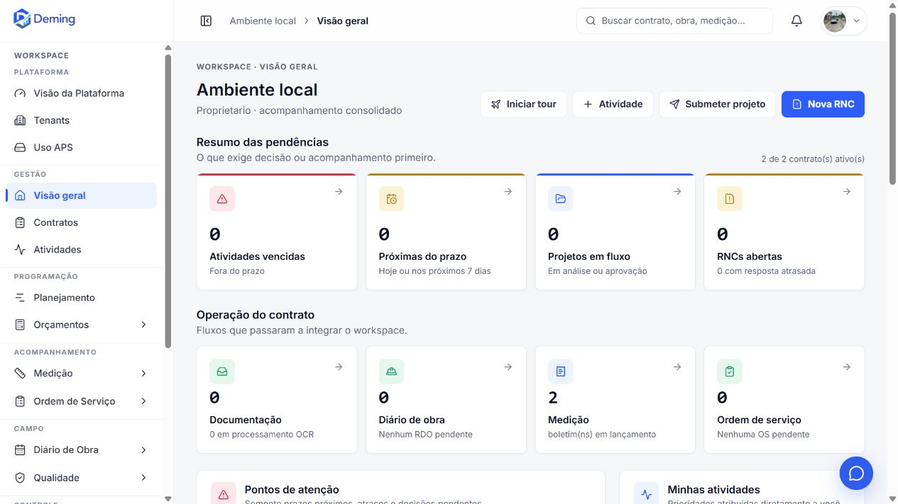
Tela inicial. A captura é de uma versão anterior; hoje o menu também tem OS DNIT.

 | Para… | Use o módulo |
 | --- | --- |
 | Ver os dados do contrato e a equipe | Contratos |
 | Distribuir e acompanhar tarefas | Atividades |
 | Montar custos e quantitativos | Orçamentos e Medição |
 | Liberar itens para execução e medição | Liberação de Serviço |
 | Pedir serviços e produtos no fluxo do DNIT | OS DNIT |
 | Registrar o dia de obra | Diário de Obra (RDA e RDO) |
 | Tratar uma não conformidade | Qualidade (RNC) |
 | Guardar arquivos e controlar revisões | Documentação e Projetos |

### 1.2 Como usar este manual

- O sumário fica à esquerda. No celular, toque em **Sumário** no topo da tela.
- A busca procura em todo o texto, inclusive nas partes técnicas. Atalho: Ctrl+K.
- Clique numa imagem para ampliar. Algumas capturas são de versões anteriores e mostram nomes antigos de menu.
- **Imprimir** gera o manual completo (dá para salvar em PDF). O arquivo `manual.md` tem o mesmo conteúdo em texto.

Esta revisão é de 21/10/2026. Se algo na tela estiver diferente do que está escrito aqui, vale o sistema, e o manual precisa ser atualizado (ver [Atualizar este manual](#operacao/manter-manual)).

### 1.3 Por onde começar

| Perfil | Leia primeiro | Depois |
 | --- | --- | --- |
 | Usuário | Empresas e contratos, depois o capítulo do seu módulo | Notificações; Assistente |
 | Administrador da empresa | Usuários e permissões; Cadastros básicos | Credenciais; Backup e suporte |
 | Desenvolvimento e manutenção | Arquitetura; Instalação local | GitHub e CI/CD; Ambientes; APIs externas |

Um exemplo para fixar a ideia: a empresa tem os contratos CT-001 e CT-002. Quem está vinculado só ao CT-001 não vê nada do CT-002, nem trocando um filtro nem digitando o endereço na mão.

<a id="tecnologias"></a>

## 2. Tecnologias

O que roda por trás do sistema e onde fica cada parte do código.

### 2.1 Ferramentas e bibliotecas


**Laravel 13**Backend


**PHP 8.4+**Linguagem do servidor


**React 19**Telas


**Tailwind CSS**Estilos


**Vite**Build do frontend


**PostgreSQL**Banco de dados


**Docker**Imagem dos deploys


**GitHub**Repositório e CI

O Laravel cuida de rotas, validação, permissões e gravação dos dados. As telas são em React, e o Inertia 2 faz a ponte entre os dois sem precisar de uma API à parte. Além disso, o projeto usa estas bibliotecas:

 | Biblioteca | Para que serve |
 | --- | --- |
 | Dompdf, FPDF, FPDI | Geração e montagem de PDFs. |
 | PhpSpreadsheet | Importação e exportação de planilhas. |
 | ECharts, FullCalendar, Mapbox GL | Gráficos, calendário e mapas. |
 | OCRmyPDF, Tesseract, Poppler | OCR e tratamento de PDF no servidor. |

#### Detalhes técnicos

As versões da tabela são as mínimas declaradas em `composer.json` e `package.json`. As versões instaladas de fato estão em `composer.lock` e `package-lock.json`.

### 2.2 Estrutura do repositório

| Pasta / arquivo | O que tem lá |
 | --- | --- |
 | app/Http/Controllers | Ações das telas, validações e respostas. |
 | app/Models | Models e relacionamentos. |
 | app/Support | Regras compartilhadas, como as de permissão. |
 | app/Services | Integrações, assistente, PDF e processamento. |
 | app/Jobs, app/Notifications | Jobs em fila e notificações. |
 | resources/js | Telas e componentes React. |
 | resources/views | Templates de PDF e e-mail. |
 | routes | Rotas web, API e agendamentos. |
 | config | Configurações e nomes das variáveis de ambiente. |
 | database/migrations | Migrations. |
 | tests | Testes automatizados. |
 | .github, railway, azure, infra | CI/CD, scripts de inicialização e infraestrutura. |
 | docs/portal | Fonte deste manual. |

<a id="contratos"></a>

## 3. Empresas e contratos

Como o sistema separa os dados de cada empresa e de cada contrato.

### 3.1 O que é um tenant

Tenant é o ambiente de uma empresa dentro do SigWorks. A conta do usuário é uma só, mas ela só enxerga as empresas e os contratos aos quais está vinculada.

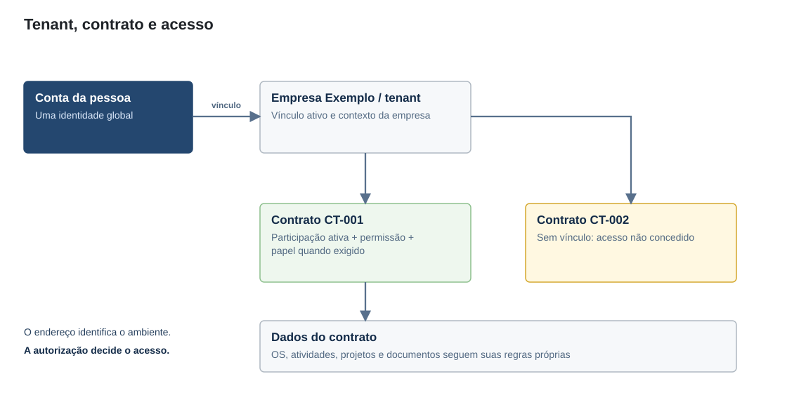
Conta, empresa e contratos.

Os endereços das telas seguem o formato `/t/{tenant}/...`. O trecho depois de `/t/` é o identificador da empresa. Em cada requisição o sistema identifica o tenant, confere se o usuário tem acesso a ele e aplica as regras da tela. Se o tenant estiver suspenso, ninguém da empresa consegue entrar.

#### Detalhes técnicos

Todas as empresas usam o mesmo banco. A separação é feita pelas colunas `tenant_id` e `contract_id` nas consultas e nas checagens de permissão. O middleware ResolveTenant define `app.current_tenant` na sessão do PostgreSQL, mas as migrations não criam políticas RLS, então essa variável sozinha não isola nada. Quem garante a separação é o código da aplicação.

### 3.2 Cadastrar um contrato

1. Em Contratos, clique em **Novo contrato** e preencha identificação, valor, vigência e documento base.
2. Vincule empresas, obras, trechos e disciplinas ao contrato e salve.
3. Escolha a modalidade de medição (Simples ou Controlada) antes de começar a operar.
4. Adicione os usuários e configure as permissões de cada módulo.
5. Mudanças de valor ou prazo entram como aditivo, para manter o histórico.

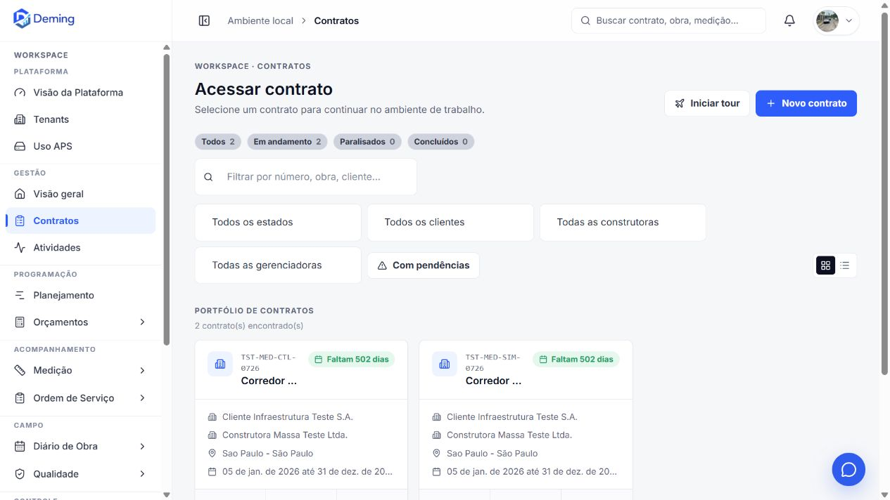
Lista de contratos (dados de teste).

Obra, contrato e tenant são coisas diferentes: a obra é a estrutura física, o contrato é o vínculo comercial e o tenant é a empresa no sistema.

### 3.3 Vínculo e permissão

Estar vinculado a um contrato não basta para fazer tudo nele. Cada ação passa por várias checagens:

 | Checagem | Exemplo |
 | --- | --- |
 | Empresa | A conta tem vínculo ativo com o tenant. |
 | Contrato | O usuário participa do CT-001. |
 | Permissão do módulo | Pode ver as OS DNIT, mas não pode excluir. |
 | Papel no fluxo | É Fiscal Concremat nesse contrato. |
 | Situação do registro | A OS está na etapa em que a análise é permitida. |
 | Regra específica | Só o autor edita a solicitação DNIT, e só enquanto ela é um rascunho nunca enviado. |

As exceções para administradores mudam de módulo para módulo. No OS DNIT, por exemplo, até o administrador precisa estar vinculado ao contrato. Na dúvida, veja a regra no capítulo do módulo.

<a id="acessos"></a>

## 4. Usuários e permissões

Cadastro de usuários e configuração do que cada um pode fazer.

### 4.1 Cadastrar usuários

1. Um administrador da empresa cadastra a conta ou associa uma conta já existente ao tenant.
2. Preencha os dados do vínculo, a situação e o perfil.
3. Vincule o usuário aos contratos em que ele vai trabalhar.
4. Em **Permissões**, escolha o usuário e o contrato e marque os módulos.
5. Se ele for responsável em algum fluxo (fiscal, aprovador etc.), cadastre isso também.

Os perfis disponíveis são proprietário, administrador, gestão, coordenação, engenharia e apoio. O perfil é só um ponto de partida; o que vale é a permissão configurada. No primeiro acesso o usuário precisa trocar a senha pelo navegador antes de usar o app.

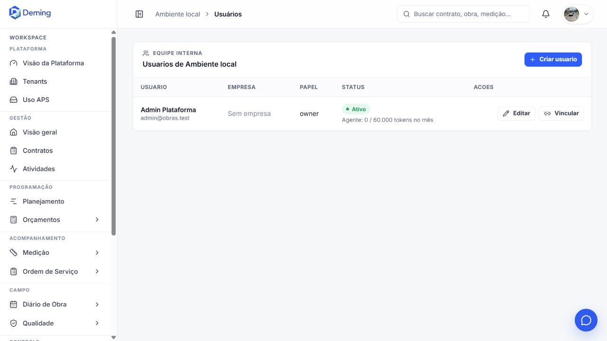
Cadastro de usuários.

### 4.2 Configurar permissões

1. Em Permissões, escolha o usuário.
2. Escolha o contrato, quando o grupo de permissões for por contrato.
3. Abra o módulo e marque as ações.
4. Salve e confira com o próprio usuário se ficou como esperado.

Há permissões da empresa, do contrato e, em alguns casos, de um registro específico. Orçamentos têm controle de acesso próprio, atividades podem ser públicas ou restritas e documentos podem ter acesso individual. A tela esconde os botões que o usuário não pode usar, e o servidor repete a checagem caso a ação chegue por outro caminho.

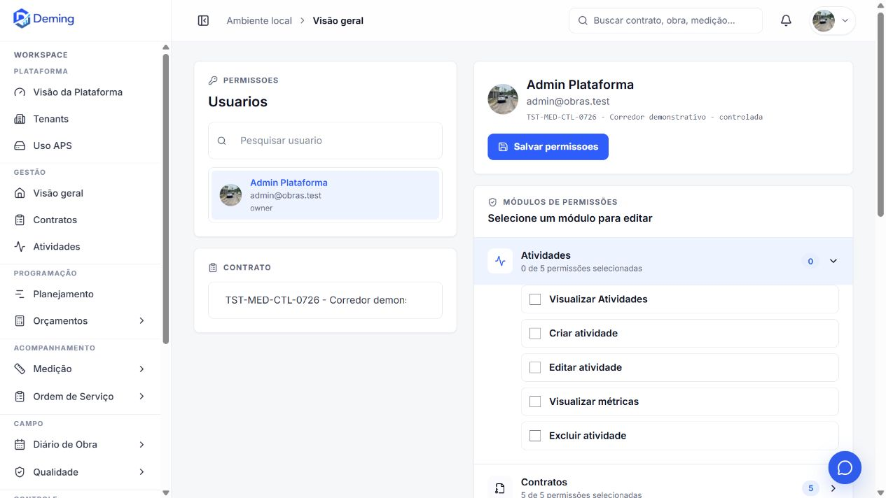
Tela de permissões. Na versão atual há também o grupo OS DNIT, com 13 opções.

### 4.3 Permissões do OS DNIT

| Grupo | Permissões |
 | --- | --- |
 | Ordens | Visualizar, criar, editar e excluir OS. |
 | Catálogo | Visualizar, criar, editar e excluir produtos. |
 | Indicadores | Visualizar dashboard. |
 | Parametrização | Criar, editar e excluir. |
 | Responsáveis | Gerenciar responsáveis. |

As permissões ficam gravadas no vínculo do usuário com o contrato. Marcar qualquer ação do catálogo já inclui a visualização do catálogo, e as demais incluem Visualizar OS. Ao desmarcar Visualizar OS, o grupo inteiro é limpo. O menu OS DNIT só aparece para quem tem Visualizar OS. O proprietário tem acesso total, mas só nos contratos de que participa.

**Atenção:** se o usuário nunca teve as permissões do OS DNIT configuradas (valor `null`), vale o padrão do perfil, para não quebrar quem já usava o sistema. Para tirar o acesso, salve o grupo vazio na tela de permissões (valor `[]`).

<a id="parametrizacao"></a>

## 5. Cadastros básicos e plataforma

O que precisa estar cadastrado antes de começar a operar.

### 5.1 Empresas, obras, trechos e disciplinas

1. Cadastre as empresas com o tipo: Gerenciadora, Construtora ou Cliente.
2. Cadastre as obras. Se houver obra principal e subobras, faça a ligação entre elas.
3. Cadastre trechos e disciplinas no formato pedido pela tela.
4. Vincule esses cadastros ao contrato e salve.
5. Complete os cadastros de cada módulo, como rodovias no OS DNIT e equipamentos no RDO.

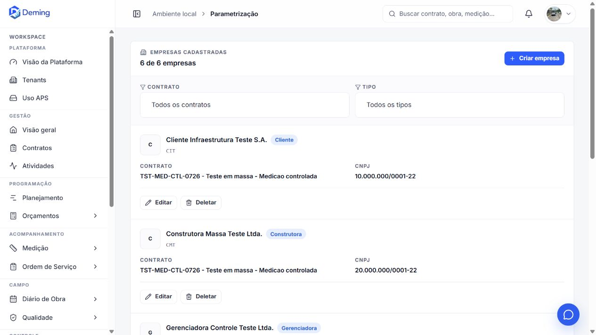
Parametrização. Os cadastros só aparecem nos módulos depois de vinculados ao contrato.

Obras usam código de três dígitos e disciplinas usam sigla de três letras. Em projetos sem divisão por trecho, use o trecho GER (Geral).

### 5.2 Administração da plataforma

O administrador da plataforma enxerga todas as empresas. Nessa área ele cadastra e suspende tenants, acompanha indicadores gerais e o consumo do Autodesk APS e define os limites de uso do assistente. Isso não dá acesso livre aos contratos: as regras de cada módulo continuam valendo.

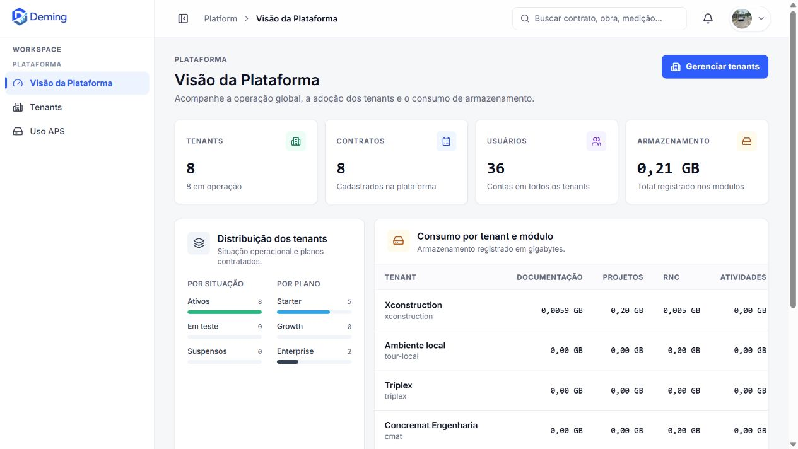
Administração da plataforma.

Suspender um tenant bloqueia o acesso da empresa inteira. Antes de mudar plano, proprietário ou limites, confira se está no tenant certo.

<a id="atividades"></a>

## 6. Atividades e checklists

Distribuição e acompanhamento das tarefas da equipe.

### 6.1 Criar uma atividade

O quadro tem quatro colunas: A fazer, Em andamento, Em revisão e Concluídas.

1. Clique em **Nova atividade** e escolha Atividade ou Checklist.
2. Preencha título, contrato, categoria, prioridade, prazo e descrição.
3. Escolha os responsáveis e a visibilidade.
4. No checklist, adicione as etapas.
5. Salve. Pelo card dá para comentar, anexar arquivos, marcar etapas e mudar a coluna.

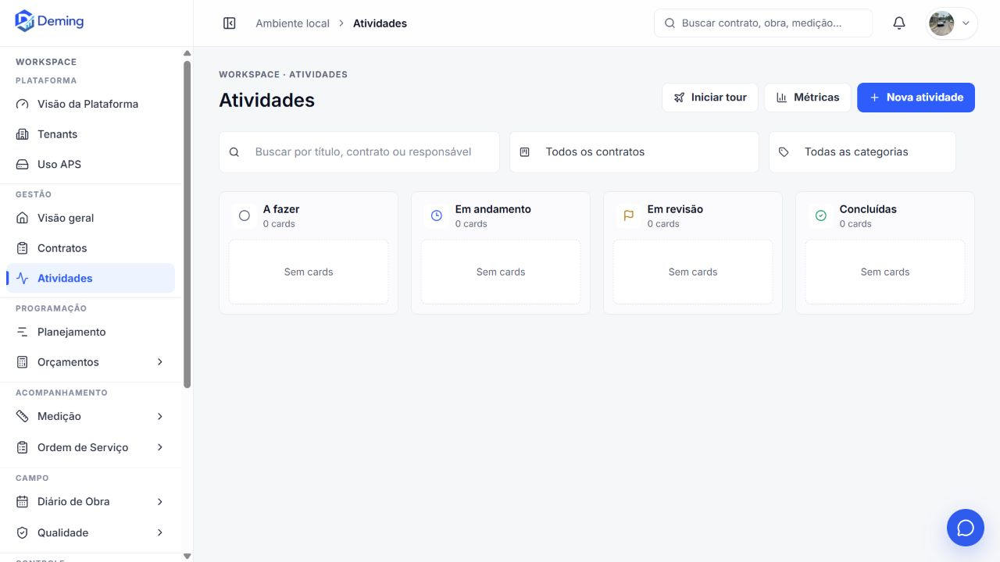
Quadro de atividades.

Atividade pública aparece para todos que têm acesso ao contrato; restrita, só para quem criou e para os responsáveis. A aba Métricas tem permissão própria. Quem criou a atividade pode editá-la, mas isso não dá permissão para mexer nas atividades dos outros.

### 6.2 Vincular uma atividade a uma OS DNIT

1. Escolha a categoria **Ordem de Serviço DNIT**.
2. No campo que aparece, busque a OS pelo número ou pelo assunto.
3. Selecione uma OS do mesmo contrato.
4. Salve. O detalhe da atividade passa a ter um link para a OS.

Nessa categoria o vínculo é obrigatório. Se você trocar o contrato, a OS selecionada é limpa; se trocar a categoria, o vínculo é removido ao salvar. A busca mostra até 20 resultados, então refine o termo se a OS não aparecer. A categoria Liberação de Serviço é outra e não usa esse campo.

A atividade só aponta para a OS. Ela não cria, não encaminha e não aprova nada no OS DNIT.

<a id="orcamentos"></a>

## 7. Orçamentos

Montagem de orçamentos a partir de insumos e composições.

### 7.1 Montar um orçamento

1. Consulte ou importe os insumos e composições (SINAPI, SICRO ou base própria).
2. Confira UF, competência, coeficientes, produção e regras de custo.
3. Crie o orçamento e defina bases, encargos, arredondamento e BDI.
4. Monte as etapas e adicione composições ou insumos com os quantitativos.
5. Revise os totais, corrija os preços zerados e gere os relatórios.
6. Finalize. Só orçamento finalizado pode ser usado em Itens de Contrato.

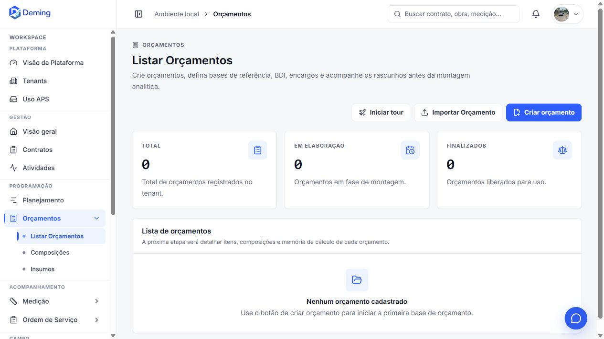
Tela de orçamento.

As bases SINAPI e SICRO são importadas para o sistema; não há consulta em tempo real às bases oficiais. Confira a competência e a UF da base antes de usar.

### 7.2 Acesso e alterações

Cada orçamento tem controle de acesso próprio. Quem criou e os administradores podem abrir **Acessos** e liberar visualização ou edição para outras pessoas, independentemente da permissão geral do módulo. Se for alterar um orçamento já usado como referência, faça uma cópia antes.

A planilha importada precisa seguir o modelo do importador. Mesmo quando a importação funciona, revise valores, casas decimais, unidades, base e competência. Finalizar é o que libera o orçamento para Itens de Contrato, então só finalize depois da revisão.

<a id="liberacao"></a>

## 8. Liberação de Serviço

O antigo módulo de Ordem de Serviço, ligado aos itens do contrato e à medição.

### 8.1 Criar e liberar uma OS

1. Prepare os itens de contrato, os responsáveis e os prazos.
2. Em Liberação de Serviço, crie a OS com escopo, obra, prazos e itens autorizados.
3. Revise o rascunho e envie para análise.
4. Os fiscais analisam e os aprovadores concluem, conforme a parametrização do contrato.
5. Registre a execução e acompanhe documentos, histórico e métricas.

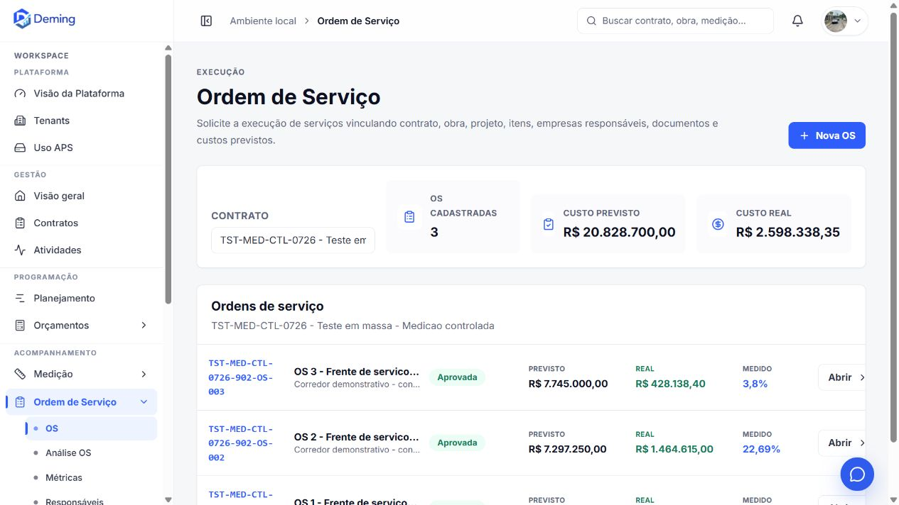
Liberação de Serviço (captura de quando o módulo ainda se chamava Ordem de Serviço).

Na medição controlada, os itens liberados por OS aprovada entram no pleito. O módulo também mostra custo previsto, custo medido e percentual executado.

### 8.2 Liberação de Serviço e OS DNIT

São módulos separados, cada um com seus cadastros, fluxo e permissões.

 |  | Liberação de Serviço | OS DNIT |
 | --- | --- | --- |
 | Para quê | Itens do contrato, execução e medição controlada | Pedido e análise de serviços e produtos do DNIT |
 | Endereço | /ordem-servico/... | /os-dnit/... |
 | Papéis | Fiscais e aprovadores do contrato | Analista DNIT, Fiscal Concremat e Fiscal do contrato |
 | Devolução | Volta para rascunho | O pedido original continua travado |
 | Código | OrdemServico, OrdemServicoPermissions | OsDnitOrder, OsDnitPermissions |

As regras de edição e de permissão de um módulo não valem para o outro.

<a id="os-dnit"></a>

## 9. OS DNIT

Pedido de serviços e produtos ao DNIT, com análise da Concremat e decisão do fiscal do contrato.

### 9.1 Criar uma OS

Para conhecer o fluxo na prática, clique em **Iniciar tour** nas telas Ordem de Serviço, Responsáveis, Produtos ou Dashboard. São 12 passos, na ordem: responsáveis, produtos, criação e envio, análise da Concremat, decisão do fiscal e dashboard. O tour usa dados fictícios, então nada é cadastrado e nenhum e-mail é enviado.

1. No contrato, cadastre os produtos e as rodovias e defina os responsáveis.
2. Em Ordem de Serviço, clique em **Criar OS**.
3. Preencha lote, rodovia, km inicial e final, assunto, prazo pretendido, necessidade técnica, justificativa e número SEI/processo. Anexe os documentos.
4. Busque os produtos do contrato e informe as quantidades.
5. Salve o rascunho. O número (sequencial/ano, por contrato) é gerado automaticamente.
6. Revise e clique em **Enviar para análise**. A OS vai para o Fiscal Concremat.

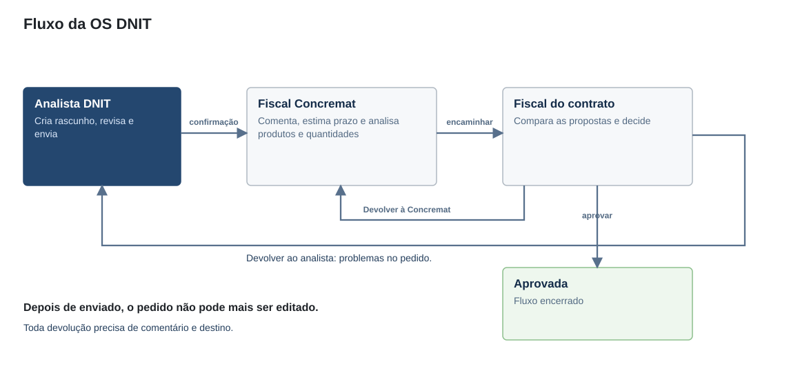
Fluxo da OS DNIT.

O autor só pode editar a OS enquanto ela for um rascunho que nunca foi enviado. Depois do primeiro envio, mesmo que volte devolvida, a solicitação original fica travada. Excluir segue a mesma regra, e a exclusão é lógica: o registro, os anexos e o número continuam guardados.

### 9.2 Analisar, aprovar ou devolver

1. Na lista, o responsável clica em **Analisar OS**. A análise abre numa janela sobre a própria lista.
2. O Fiscal Concremat preenche o comentário (obrigatório), o prazo estimado e os produtos e quantidades. Ele pode só salvar ou já encaminhar ao Fiscal do contrato.
3. O Fiscal do contrato vê o pedido do analista ao lado da análise da Concremat, com as diferenças de produtos e quantidades destacadas.
4. Para aprovar ou devolver, escreva o comentário e confirme. Na devolução, informe também o motivo e para quem volta.
5. Devolva à Concremat quando o problema for produto, quantidade ou prazo da análise, e ao Analista DNIT quando for no pedido.

Toda mudança de etapa fica no histórico e gera aviso para os responsáveis. O e-mail entrar na fila não quer dizer que foi entregue ou lido. A aprovação encerra o fluxo da OS; ela não confirma que o serviço foi executado.

### 9.3 Produtos, rodovias e responsáveis

| Cadastro | Como funciona |
 | --- | --- |
 | Produtos | Código, nome, categoria, unidade e frequência (Mensal ou Por demanda). Lista com filtros, 15 por página. |
 | Categorias | Gestão e controle; Supervisão de obras; Controle tecnológico; Controle executivo; Levantamentos e estudos; Sondagens; Projetos e inspeções; Ambiental. |
 | Rodovias | Texto livre, por exemplo BR-364/AC. Podem ser editadas e desativadas. |
 | Responsáveis | Analista DNIT, Fiscal Concremat e Fiscal do contrato, por contrato. |

Produtos e rodovias que já foram usados em alguma OS não podem ser excluídos. Alterar o catálogo não muda as OS já gravadas. As permissões de catálogo e de parametrização não têm relação com os papéis da análise.

### 9.4 Lista, PDF e dashboard

A lista tem filtros e mostra 10 OS por página, separadas em Todas, Rascunho/Analista DNIT, Análise Concremat, Fiscal do contrato e Finalizadas. **Acessar** abre o detalhe com o quadro do fluxo.

 | PDF | Conteúdo |
 | --- | --- |
 | Solicitação do analista | Cabeçalho, identificação, descrição, justificativa e produtos pedidos. |
 | Solicitação + Concremat | O anterior mais a análise da Concremat, em nova seção com cabeçalho. |
 | Solicitação + análises | O anterior mais a decisão do fiscal. |
 | Completo | Tudo isso e o histórico do fluxo no final. |

O PDF sai em A4. O dashboard fica no menu logo depois de Produtos e mostra total, rascunhos, em análise, com o fiscal, aprovadas e devolvidas. Os cartões contam a situação atual de cada OS; o gráfico mensal conta envios e aprovações. Salvar a análise sem encaminhar não zera o tempo de espera da etapa.

<a id="medicao"></a>

## 10. Medição e Folhas de Rosto

Do item de contrato até o boletim de medição.

### 10.1 Medição simples e controlada

| Modalidade | Como funciona |
 | --- | --- |
 | Simples | O pleito é montado direto dos itens do contrato, sem OS de liberação. |
 | Controlada | O pleito usa só itens liberados por OS aprovada no módulo Liberação de Serviço. |

1. Importe os Itens de Contrato de um orçamento finalizado e confira quantitativos, valores e unidades.
2. Cadastre os índices de reajuste por competência, se houver.
3. Abra o boletim do contrato e crie as Folhas de Rosto.
4. Envie as FRs e acompanhe as etapas de fiscal, qualidade, medição e finalização.
5. Use o fluxo do BM e os relatórios para conferir autores, decisões, datas e acumulados.

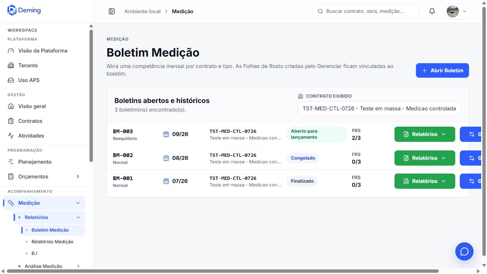
Medição. A modalidade e os responsáveis do contrato definem o fluxo.

### 10.2 Conferência e relatórios

Em algumas operações o sistema bloqueia a redução de quantidade abaixo do que já foi medido. Mesmo assim, confira período, preço, arredondamento e acumulado. Custo medido e quantidade autorizada são números diferentes e não devem ser comparados entre si.

Boletins, Relatórios de Medição e B.I. servem para conferência. Opções marcadas como "em breve" na tela ainda não funcionam. A aprovação da medição é independente das aprovações do OS DNIT e do RDO.

<a id="diario"></a>

## 11. Diário de obra (RDA e RDO)

O apontamento de campo e o relatório diário oficial.

### 11.1 Preencher o diário

| Documento | O que é |
 | --- | --- |
 | RDA | Apontamento de campo. Pode ser feito offline no app e sincronizado depois. |
 | RDO | Relatório diário oficial, por data e por frente de obra. |

1. Configure contrato, obras/frentes, responsáveis, datas e regras de geração.
2. Cadastre mão de obra, equipamentos e subcontratadas.
3. Preencha os apontamentos e publique os RDAs.
4. No calendário do RDO, gere ou copie o registro do dia.
5. Importe os RDAs publicados e confira clima, serviços, recursos, ocorrências e fotos.
6. Envie as frentes e acompanhe as etapas seguintes.

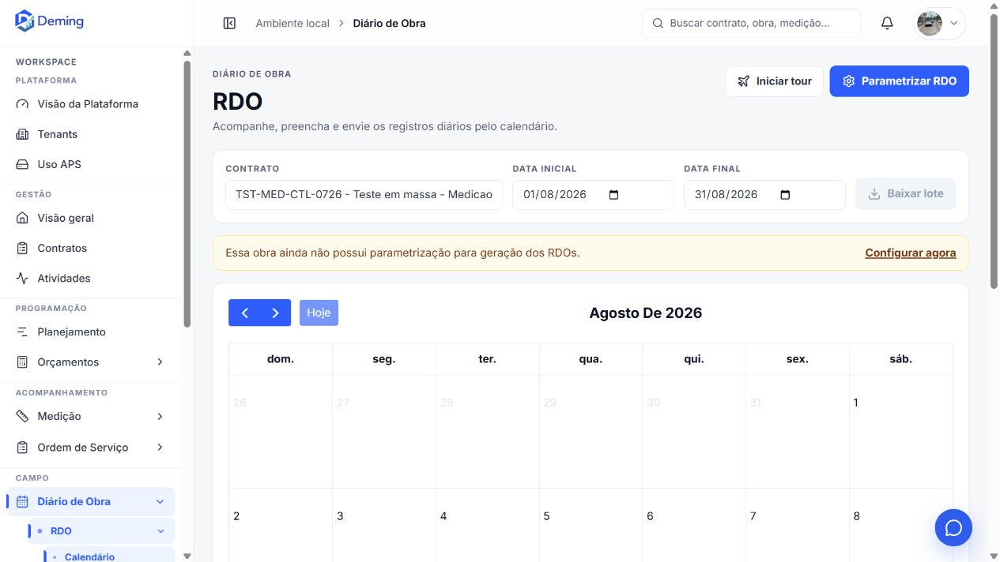
Calendário do diário de obra.

### 11.2 Análise, ressalvas e comprovação

A construtora envia as frentes, a gerenciadora analisa e o cliente dá a decisão final. O sistema mostra quais frentes ainda estão pendentes em cada etapa. A gerenciadora também pode registrar fiscalização e divergências.

1. A construtora envia as frentes para a gerenciadora.
2. A gerenciadora registra as decisões e, com todas as frentes analisadas, encaminha ao cliente.
3. Se houver devolução, o RDO volta para a construtora ajustar.
4. Se o cliente aceitar com ressalvas, pode ficar uma pendência de comprovação. A construtora resolve e envia a comprovação.
5. Sem ressalvas pendentes, o cliente conclui e o RDO é arquivado, com versões e histórico.

A geração do PDF e a assinatura dependem da situação e da configuração do RDO. Para reabertura, versões e prazos, siga o que a tela mostra.

<a id="qualidade"></a>

## 12. Qualidade (RNC)

Registro e tratamento de não conformidades.

### 12.1 Abrir e encerrar uma RNC

1. Defina o Responsável Operacional, o Responsável da Construtora e o Responsável de Acompanhamento.
2. Crie a RNC com contrato, obra, disciplina, gravidade, localização e descrição.
3. Vincule os projetos relacionados.
4. Clique em **Notificar** para formalizar a comunicação.
5. A construtora propõe a ação corretiva e o prazo; os responsáveis analisam e podem pedir ajustes.
6. Registre as evidências da execução, encerre a RNC e, se precisar, gere o PDF.

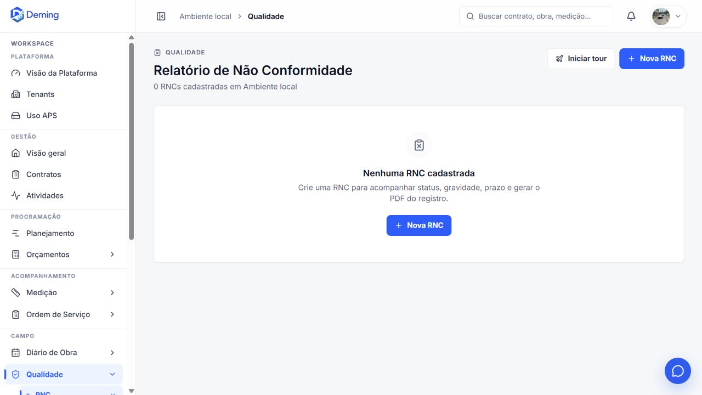
Tela de RNC.

O mapa serve para marcar a localização (latitude e longitude). O PDF da RNC traz texto, fotos e histórico. A área IC ainda não está em uso.

<a id="documentacao"></a>

## 13. Documentação (GED)

Envio, busca e controle de acesso de documentos.

### 13.1 Enviar e encontrar documentos

1. Em Documentação, clique em **Enviar documento** e preencha os dados, incluindo o contrato.
2. Classifique com tipo, etiquetas e correspondentes.
3. Anexe o arquivo e aguarde o processamento.
4. Use a busca e os filtros para encontrar o documento. Dali dá para ver a prévia, baixar, anotar e consultar histórico e acessos.
5. Documento excluído vai para a Lixeira e pode ser recuperado por quem tem permissão.

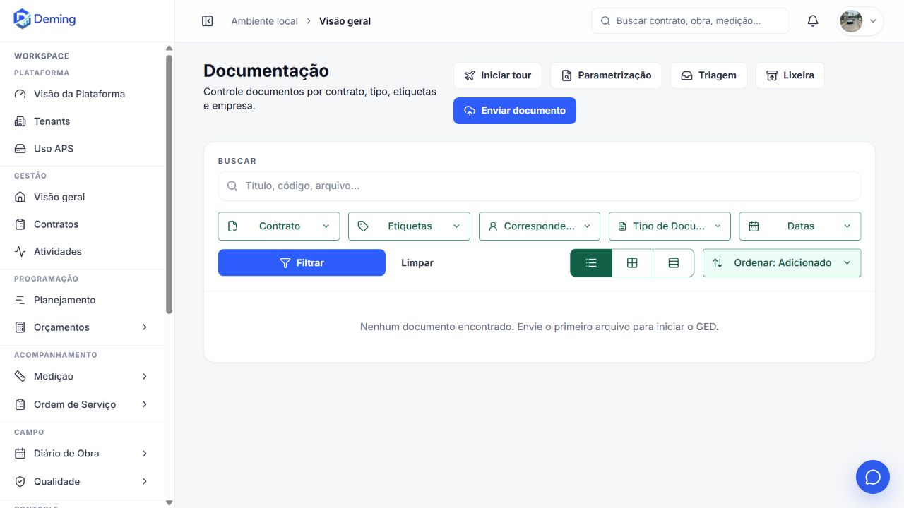
GED: busca, filtros, triagem, parametrização e lixeira.

Ter acesso à empresa não dá acesso a todos os documentos: contam a permissão do módulo, o contrato e a visibilidade de cada documento. O OCR serve para pesquisar o conteúdo do arquivo e não valida o documento.

### 13.2 Importação por e-mail e OCR

O GED pode ler caixas de e-mail por IMAP e importar os anexos. O envio de e-mails do sistema é outra coisa e passa pelo Brevo. Quando não dá para saber qual é o PDF principal da mensagem, ela vai para a triagem.

1. Cadastre a conta IMAP e teste a conexão.
2. Defina as regras e o contrato de destino.
3. Resolva a triagem quando o sistema não souber qual é o documento principal.
4. Acompanhe a fila de OCR.
5. Antes de usar o texto extraído, confira com o arquivo original.

Não existe integração com SharePoint.

#### Detalhes técnicos

A senha IMAP é gravada criptografada (cast `encrypted`) e não aparece na serialização do model; para ser lida, depende da APP_KEY. O OCR roda em fila, usando OCRmyPDF, Tesseract e Poppler, com limite de páginas e de tempo por arquivo.

<a id="projetos"></a>

## 14. Projetos e Autodesk APS

Acervo de projetos e visualização de modelos 3D.

### 14.1 Cadastrar e revisar projetos

1. Confira se o contrato tem obras, trechos, disciplinas e responsáveis vinculados.
2. Envie o arquivo com os dados e a identificação no padrão da EAP.
3. Acompanhe versões, revisões e, quando for o caso, pacotes de submissão.
4. Os responsáveis analisam e aprovam ou reprovam.
5. Consulte Projetos Revisados, CAP, comparação e Lista Mestra.
6. Abra o visualizador quando a conversão do arquivo terminar.

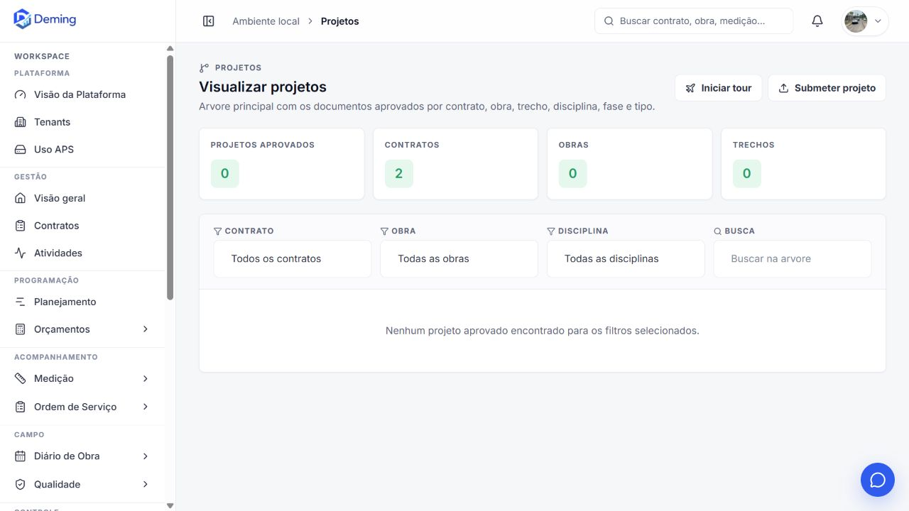
Acervo de projetos.

O SigWorks guarda e organiza os arquivos de projeto, mas não edita modelos. A integração com o Autodesk APS envia o arquivo, pede a conversão e mostra o resultado no visualizador. Não há edição de geometria nem integração com ACC ou Forma.

### 14.2 Por que o modelo demora a abrir

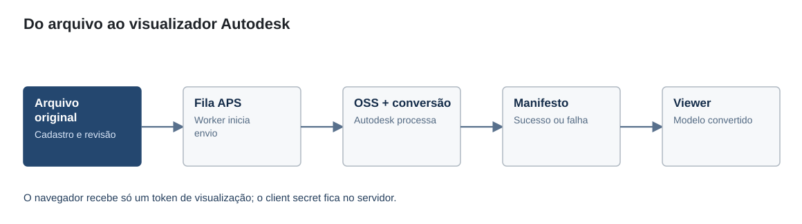
Do arquivo enviado até o visualizador.

O arquivo aparecer no cadastro não quer dizer que a conversão terminou. A fila APS envia o arquivo, a Autodesk converte e devolve um manifesto, e só então o visualizador consegue abrir. O status mostra em que ponto está: na fila, processando, concluído ou com falha.

Antes de reenviar, veja se o worker APS está rodando, se há jobs com falha e se a Autodesk ainda está processando. Reenviar sem necessidade duplica o trabalho e consome cota.

<a id="assistente"></a>

## 15. Assistente SigWorks

Como o assistente de IA busca as informações antes de responder.

### 15.1 Como o assistente responde

O assistente usa RAG (geração com recuperação): antes de responder, ele busca no sistema as informações que o usuário tem permissão para ver e manda só esse trecho para o modelo de IA, junto com a pergunta.

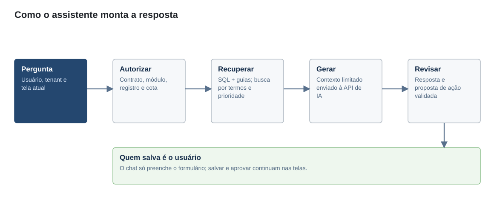
Etapas de uma resposta do assistente.

1. O usuário pergunta no chat. O sistema identifica o tenant, o perfil e a tela em que ele está.
2. O sistema confere a cota e define quais contratos e módulos ele pode consultar.
3. A busca procura registros e guias de uso dentro desse escopo e ordena os resultados.
4. O backend monta o contexto, com as últimas mensagens da conversa, e chama a Responses API.
5. A resposta é gravada. Sugestões de navegação ou de formulário passam por uma nova validação.
6. Se a resposta trouxer um formulário preenchido, o usuário abre, revisa e salva na tela normal.

Código: `app/Http/Controllers/Tenant/AssistantController.php`, `app/Services/Assistant/AssistantRetriever.php`, `app/Services/Assistant/AssistantContextBuilder.php`, `app/Services/Assistant/OpenAiAssistant.php`

### 15.2 Implementação atual

A busca combina consultas SQL, guias de uso e uma pontuação por palavras-chave, prioridade e tela atual. Não há embeddings nem índice vetorial. O modelo recebe só um recorte dos dados, nunca o banco inteiro ou todos os anexos.

 | Limite | Padrão |
 | --- | --- |
 | Fontes por pergunta | 8 |
 | Texto por fonte | 1.600 caracteres |
 | Total de contexto | 12.000 caracteres |
 | Histórico | 4 mensagens, com limite de tamanho por mensagem |
 | Cota por usuário | 60.000 tokens/mês |
 | Cota por tenant | 1.000.000 tokens/mês |

Todos esses limites podem ser alterados por variável de ambiente. O modelo usado vem de `OPENAI_CHAT_MODEL`.

Os dados encontrados na busca são enviados ao provedor de IA. Por isso a busca precisa sempre filtrar pelo acesso do usuário. A resposta pode vir errada ou incompleta; decisões formais continuam sendo tomadas nas telas do sistema.

Código: `app/Services/Assistant/AssistantAccessScope.php`, `app/Services/Assistant/AssistantRetriever.php`, `app/Services/Assistant/AssistantQuotaService.php`, `config/services.php`

### 15.3 Assistente e OS DNIT

- Explica rascunho, análise da Concremat, decisão, devolução, PDF, produtos, rodovias, responsáveis e dashboard.
- Sabe a diferença entre OS DNIT e Liberação de Serviço.
- Conta as OS que o usuário pode ver e traz exemplos. No detalhe, mostra até três OS recentes ou a OS com o número informado.
- Só consulta catálogo e responsáveis se o usuário tiver as permissões correspondentes.
- Preenche parte do formulário de nova OS para quem é Analista DNIT e pode criar OS. Produtos e rodovias são buscados no contrato.
- Preenche uma atividade na categoria OS DNIT, já com a OS vinculada.
- Não salva, não envia, não aprova, não devolve, não exclui e não dispara e-mail.

Exemplos: "Como analisar uma OS DNIT?", "Como baixar só a solicitação do analista?", "Mostre a OS DNIT 001/2026 do contrato CT-001". Para preencher um formulário, informe o contrato e os dados, porque o mesmo número de OS pode existir em contratos diferentes.

Código: `app/Services/Assistant/OsDnitAssistantContext.php`, `app/Services/Assistant/AssistantActionResolver.php`, `resources/js/Utils/assistantDraft.js`, `docs/os-dnit.md`

<a id="integracoes"></a>

## 16. APIs externas

Quais APIs de outras empresas o SigWorks usa, o que cada uma faz e onde ela é configurada.

### 16.1 Visão geral

O SigWorks depende de algumas APIs de terceiros. A maioria é chamada pelo servidor; o Mapbox e o visualizador da Autodesk rodam também no navegador. Cada uma só funciona no ambiente em que as variáveis estiverem preenchidas.

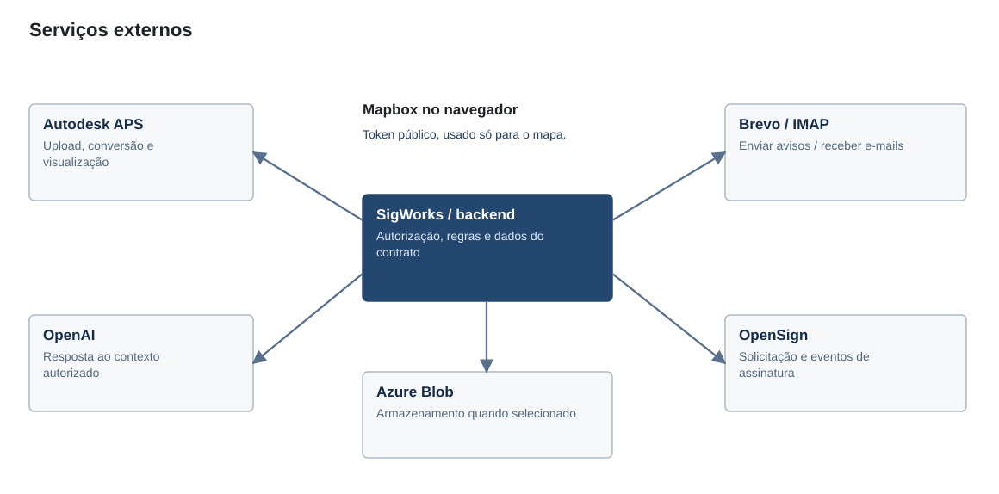
APIs externas ligadas ao SigWorks.

 | Empresa | API usada | Para que serve no SigWorks |
 | --- | --- | --- |
 | Autodesk | Autodesk Platform Services (APS): Authentication, OSS, Model Derivative e Viewer | Guardar os arquivos de projeto, converter os modelos e abrir o visualizador 3D/2D. |
 | OpenAI | OpenAI API: Responses API | Gerar as respostas do Assistente SigWorks. |
 | Brevo | Brevo API v3 (e-mail transacional) | Enviar os e-mails do sistema, como os avisos do OS DNIT e a redefinição de senha. |
 | Mapbox | Mapbox GL JS e Mapbox Styles | Mostrar o mapa e marcar a localização na RNC. |
 | OpenSign | OpenSign API e webhook | Colher as assinaturas digitais do RDO. |
 | Microsoft | Azure Blob Storage | Guardar arquivos privados e temporários, quando esse disco está ligado. |

O GED também lê caixas de e-mail por IMAP. IMAP é um protocolo padrão, não uma API de uma empresa específica: funciona com o servidor de e-mail que for cadastrado na tela.

Postmark, Resend, Amazon SES e Slack aparecem nos arquivos de configuração padrão do Laravel, mas o SigWorks não usa nenhum deles.

Código: `config/services.php`, `config/mail.php`, `config/filesystems.php`, `config/signatures.php`, `app/Services/AutodeskApsService.php`

### 16.2 Autodesk Platform Services (APS)

O APS (antigo Autodesk Forge) é usado no módulo Projetos. Quando alguém envia um modelo, o servidor manda o arquivo para a Autodesk, pede a conversão e depois abre o resultado no visualizador. Todas as chamadas vão para `https://developer.api.autodesk.com`.

 | API | Chamada | Para quê |
 | --- | --- | --- |
 | Authentication API v2 | `POST /authentication/v2/token` | Pega um token de acesso usando client ID e client secret (fluxo client credentials). |
 | OSS (Object Storage Service) v2 | `GET/POST /oss/v2/buckets` | Confere se o bucket existe e cria, se precisar, na região configurada (política `persistent`). |
 | OSS v2 | `…/objects/{arquivo}/signeds3upload` | Envia o arquivo do projeto para o bucket por URL assinada. |
 | Model Derivative API v2 | `POST /modelderivative/v2/designdata/job` | Pede a conversão para o formato SVF2, com vistas 2D e 3D. |
 | Model Derivative API v2 | `GET /modelderivative/v2/designdata/{urn}/manifest` | Consulta se a conversão está na fila, processando, pronta ou com falha. |
 | OSS e Model Derivative | `DELETE` do manifesto e do objeto | Apaga o arquivo e a conversão quando uma versão do projeto é removida. |
 | Viewer SDK v7 | Script carregado no navegador | Mostra o modelo convertido nas telas de visualização e de comparação. |

Na administração da plataforma, o SigWorks também lê o tamanho do bucket e a lista de objetos para mostrar o consumo do APS.

**Variáveis:** `AUTODESK_APS_CLIENT_ID`, `AUTODESK_APS_CLIENT_SECRET`, `AUTODESK_APS_BUCKET_KEY`, `AUTODESK_APS_REGION` e `AUTODESK_APS_SCOPES`. O navegador recebe só um token de leitura; o client secret fica no servidor. Use bucket e região diferentes em cada ambiente.

Documentação: [Authentication](https://aps.autodesk.com/en/docs/oauth/v2), [OSS](https://aps.autodesk.com/en/docs/data/v2), [Model Derivative](https://aps.autodesk.com/en/docs/model-derivative/v2), [Viewer](https://aps.autodesk.com/en/docs/viewer/v7).

Código: `app/Services/AutodeskApsService.php`, `app/Http/Controllers/Tenant/ProjectViewerController.php`, `app/Http/Controllers/Platform/ApsUsageController.php`, `config/services.php`

### 16.3 OpenAI API

A OpenAI gera as respostas do Assistente SigWorks. O servidor chama a **Responses API** (`POST /v1/responses`, em `https://api.openai.com`) com a chave no cabeçalho Authorization.

 | O que vai na chamada | Detalhe |
 | --- | --- |
 | model | O modelo definido em `OPENAI_CHAT_MODEL`. |
 | input | As instruções do assistente, as últimas mensagens da conversa e a pergunta, junto com o contexto que o usuário tem permissão de ver. |
 | max_output_tokens | Tamanho máximo da resposta; padrão 700. |

Da resposta, o SigWorks usa o texto gerado, o nome do modelo e o consumo de tokens, que entra no controle de cotas por usuário e por empresa.

**Variáveis:** `OPENAI_API_KEY`, `OPENAI_CHAT_MODEL` e `OPENAI_BASE_URL` (padrão `https://api.openai.com/v1`). A chave fica só no servidor. Preço, limites e retenção de dados são da OpenAI; as cotas do SigWorks são internas.

Documentação: [OpenAI API](https://developers.openai.com/api/reference/overview).

Código: `app/Services/Assistant/OpenAiAssistant.php`, `app/Services/Assistant/AssistantQuotaService.php`, `config/services.php`

### 16.4 Brevo

O Brevo (antigo Sendinblue) envia os e-mails do sistema quando `MAIL_MAILER=brevo`. O envio usa a **API v3 do Brevo** por HTTPS, através do pacote `symfony/brevo-mailer`, e não SMTP. Passam por ele, por exemplo, os avisos de mudança de etapa do OS DNIT e os e-mails de redefinição de senha.

**Variáveis:** `MAIL_MAILER`, `BREVO_API_KEY` (chave de API v3, não é senha SMTP) e `MAIL_FROM_ADDRESS`. Se a conta do Brevo exigir lista de IPs autorizados, cadastre o IP de saída do servidor, não o do seu computador.

O e-mail passa por etapas diferentes: entra na fila do SigWorks, é aceito pelo Brevo, é entregue e, por fim, lido. O sistema só sabe das duas primeiras.

Documentação: [Brevo API](https://developers.brevo.com/docs/api-key-authentication).

Código: `config/mail.php`, `app/Providers/AppServiceProvider.php`, `app/Services/OsDnitFlowNotifier.php`, `composer.json`

### 16.5 Mapbox

O Mapbox mostra o mapa na criação de RNC, onde o usuário marca a localização do problema. Ele roda no navegador, com a biblioteca **Mapbox GL JS** (versão 3) e o estilo `streets-v12`. A tela adiciona o marcador, os controles de zoom e a atribuição do mapa.

**Variável:** `VITE_MAPBOX_ACCESS_TOKEN`. Esse token vai junto com o JavaScript da tela, então é público: use no Mapbox um token só com escopos de leitura de mapa. Se mudar o token, refaça o build do frontend.

Documentação: [Mapbox GL JS](https://docs.mapbox.com/mapbox-gl-js/), [tokens](https://docs.mapbox.com/help/getting-started/access-tokens/).

Código: `package.json`, `resources/js/Pages/Tenant/Qualidade/RelatorioNaoConformidade/Create.jsx`, `config/services.php`

### 16.6 OpenSign

O OpenSign colhe as assinaturas do RDO. Com `SIGNATURE_DRIVER=opensign`, o SigWorks usa estas chamadas:

 | Chamada | Para quê |
 | --- | --- |
 | `POST {OPENSIGN_BASE_URL}/createdocument` | Envia o PDF do RDO (em base64), a lista de signatários e o prazo para assinar (padrão 15 dias). O próprio OpenSign manda o e-mail com o link de assinatura. |
 | `POST /api/app/functions/getDocument` | Consulta a situação do documento e das assinaturas. |
 | Webhook `POST /api/webhooks/opensign` | Recebe do OpenSign os avisos de assinatura e atualiza o RDO. |

**Atenção:** o webhook só confere o segredo se `OPENSIGN_WEBHOOK_SECRET` estiver preenchida. Com a variável vazia, qualquer chamada é aceita. Em produção, configure o segredo antes de ligar o fluxo.

**Variáveis:** `SIGNATURE_DRIVER`, `OPENSIGN_BASE_URL`, `OPENSIGN_API_KEY` e `OPENSIGN_WEBHOOK_SECRET`. Com `SIGNATURE_DRIVER=local` o fluxo é só simulado, para desenvolvimento, e nenhuma assinatura de verdade é gerada.

Documentação: [OpenSign](https://docs.opensignlabs.com/).

Código: `app/Services/Signatures/OpenSignSignatureProvider.php`, `app/Services/Signatures/LocalSignatureProvider.php`, `app/Http/Controllers/Api/OpenSignWebhookController.php`, `config/signatures.php`

### 16.7 Azure Blob Storage

O Azure Blob Storage pode guardar os arquivos do sistema no lugar do disco do servidor. Existem dois discos prontos: `azure-private`, para documentos, e `azure-temporary`, para arquivos temporários. Eles só são usados quando escolhidos nas variáveis de disco de cada módulo (ver capítulo Arquivos, filas e agendamentos). A ligação é feita pelo pacote `azure-oss/storage-blob-laravel`.

**Variáveis:** `AZURE_STORAGE_CONNECTION_STRING` (secreta), `AZURE_STORAGE_CONTAINER` e `AZURE_STORAGE_TEMPORARY_CONTAINER`.

Documentação: [Azure Blob Storage](https://learn.microsoft.com/en-us/azure/storage/blobs/storage-blobs-introduction).

Código: `config/filesystems.php`, `composer.json`

<a id="arquitetura"></a>

## 17. Arquitetura

Como uma ação percorre o sistema, do clique ao banco.

### 17.1 O que acontece ao clicar em Salvar

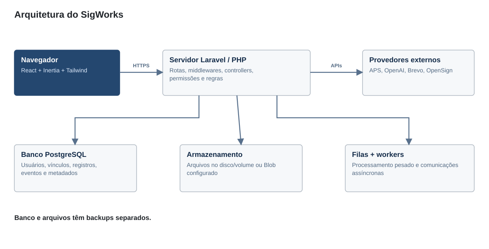
Arquitetura: navegador, servidor, banco, arquivos, filas e serviços externos.

1. A tela React envia os campos preenchidos, com a sessão do usuário.
2. A rota e os middlewares tratam autenticação, tenant e regras gerais.
3. O controller valida os dados, o contrato, a permissão e a situação do registro.
4. Models e services leem e gravam no banco. Operações críticas usam transação e lock.
5. Arquivos vão para o disco configurado, e o trabalho pesado vai para a fila.
6. A resposta atualiza a tela ou mostra os erros de validação.

Quem decide se a ação é permitida é o servidor. Esconder um botão na tela é só conveniência; saber a URL ou o ID de um registro não dá acesso a ele.

Código: `bootstrap/app.php`, `routes/web.php`, `app/Http/Middleware/EnsureOsDnitPermission.php`, `app/Http/Controllers/Tenant/OsDnitWorkflowController.php`

### 17.2 Principais entidades

| Model | O que guarda |
 | --- | --- |
 | User | A conta da pessoa (global). |
 | TenantUser | Vínculo da conta com a empresa: situação e permissões. |
 | ContractParticipant | Participação no contrato: situação e grupos de permissão. |
 | Contract | Dados do contrato e vínculos operacionais. |
 | OsDnitOrder | A OS DNIT: tenant, contrato, autor, situação e versão do fluxo. |
 | OsDnitOrderItem, OsDnitOrderEvent | Produtos da solicitação e eventos do histórico, com snapshot. |
 | Activity | Atividade ou checklist, com a OS DNIT quando houver. |
 | GedDocument, ProjectDocument | Metadados do documento ou projeto. O arquivo fica no disco. |

O banco guarda os metadados e o arquivo fica no disco. Por isso o backup tem que cobrir os dois: só o banco não traz os arquivos de volta, e só os arquivos não trazem vínculos, versões e decisões.

Código: `app/Models/User.php`, `app/Models/ContractParticipant.php`, `app/Models/OsDnitOrder.php`, `app/Models/Activity.php`, `config/filesystems.php`

### 17.3 Limitações conhecidas

- As empresas compartilham o mesmo banco; não há um banco por tenant.
- O assistente não usa busca vetorial.
- Ter o driver S3/Azure configurado não significa que todos os módulos gravam lá.
- O `/up` responder 200 só mostra que o servidor web está de pé. Filas, OCR, e-mail, assinatura e visualizador precisam ser verificados à parte.
- Planejamento e outras áreas marcadas como futuras ainda não estão prontas.

Código: `app/Services/Assistant/AssistantRetriever.php`, `config/filesystems.php`, `railway.toml`, `.github/workflows/post-deploy-smoke.yml`, `resources/js/Layouts/AuthenticatedLayout.jsx`

<a id="mobile-api"></a>

## 18. API e app mobile

Rotas usadas pelo aplicativo, com autenticação própria.

### 18.1 Login e sincronização

| Rota | Função |
 | --- | --- |
 | POST /api/mobile/login | Confere usuário e senha e devolve o token do app. |
 | GET /api/mobile/bootstrap | Dados de apoio que o app precisa (contratos, cadastros etc.). |
 | POST /api/mobile/rnc/offline | Recebe uma RNC feita offline. |
 | POST /api/mobile/rda/offline | Recebe um RDA feito offline. |

O app manda o token como Bearer em cada chamada. O servidor guarda só o hash SHA-256 do token e confere validade, expiração e acesso ao tenant. Se o usuário ainda precisa trocar a senha, ele tem que fazer isso no navegador. A escolha do tenant no login é feita pelo servidor.

Este repositório tem só o backend. O aplicativo em si fica em outro projeto.

Código: `routes/api.php`, `app/Http/Controllers/Api/Mobile/MobileAuthController.php`, `app/Http/Middleware/EnsureMobileApiToken.php`, `app/Models/MobileApiToken.php`

### 18.2 Lista de rotas

Gerada com `php artisan route:list --json`. Inclui as rotas das telas, então nem tudo aqui é API para integração externa.

376 rotas. O prefixo /t/{tenant} indica a empresa; nomes entre chaves são parâmetros.

Autenticação e rotas gerais (30)

 | Método | Caminho | Nome | Middlewares |
 | --- | --- | --- | --- |
 | GET|HEAD | `//` | — | web |
 | GET|HEAD | `/alterar-senha-provisoria` | password.force.edit | web
Authenticate |
 | PUT | `/alterar-senha-provisoria` | password.force.update | web
Authenticate |
 | GET|HEAD | `/confirm-password` | password.confirm | web
Authenticate |
 | POST | `/confirm-password` | — | web
Authenticate |
 | GET|HEAD | `/dashboard` | dashboard | web
Authenticate
EnsureEmailIsVerified
EnsurePasswordWasChanged |
 | GET|HEAD | `/dev-login/{email}` | dev.login | web |
 | GET|HEAD | `/dev-php-limits` | — | web |
 | POST | `/email/verification-notification` | verification.send | web
Authenticate
Illuminate\Routing\Middleware\ThrottleRequests:6,1 |
 | GET|HEAD | `/forgot-password` | password.request | web
RedirectIfAuthenticated |
 | POST | `/forgot-password` | password.email | web
RedirectIfAuthenticated |
 | GET|HEAD | `/login` | login | web
RedirectIfAuthenticated |
 | POST | `/login` | — | web
RedirectIfAuthenticated |
 | POST | `/logout` | logout | web
Authenticate |
 | PATCH | `/notificacoes-ocultas/lidas` | notifications.hidden.read | web
Authenticate
EnsurePasswordWasChanged |
 | PATCH | `/notificacoes/{notification}/lida` | notifications.read | web
Authenticate
EnsurePasswordWasChanged |
 | PUT | `/password` | password.update | web
Authenticate |
 | GET|HEAD | `/profile` | profile.edit | web
Authenticate
EnsurePasswordWasChanged |
 | PATCH | `/profile` | profile.update | web
Authenticate
EnsurePasswordWasChanged |
 | DELETE | `/profile` | profile.destroy | web
Authenticate
EnsurePasswordWasChanged |
 | GET|HEAD | `/register` | register | web
RedirectIfAuthenticated |
 | POST | `/register` | — | web
RedirectIfAuthenticated |
 | POST | `/reset-password` | password.store | web
RedirectIfAuthenticated |
 | GET|HEAD | `/reset-password/{token}` | password.reset | web
RedirectIfAuthenticated |
 | GET|HEAD | `/sanctum/csrf-cookie` | sanctum.csrf-cookie | web |
 | GET|HEAD | `/storage/{path}` | storage.local |  |
 | PUT | `/storage/{path}` | storage.local.upload |  |
 | GET|HEAD | `/up` | — |  |
 | GET|HEAD | `/verify-email` | verification.notice | web
Authenticate |
 | GET|HEAD | `/verify-email/{id}/{hash}` | verification.verify | web
Authenticate
Illuminate\Routing\Middleware\ValidateSignature
Illuminate\Routing\Middleware\ThrottleRequests:6,1 |

Administração da plataforma (7)

 | Método | Caminho | Nome | Middlewares |
 | --- | --- | --- | --- |
 | GET|HEAD | `/admin` | platform.dashboard | web
Authenticate
EnsureEmailIsVerified
EnsurePasswordWasChanged
EnsurePlatformAdmin |
 | GET|HEAD | `/admin/aps` | platform.aps.index | web
Authenticate
EnsureEmailIsVerified
EnsurePasswordWasChanged
EnsurePlatformAdmin |
 | DELETE | `/admin/aps/versions/{version}` | platform.aps.versions.destroy | web
Authenticate
EnsureEmailIsVerified
EnsurePasswordWasChanged
EnsurePlatformAdmin |
 | GET|HEAD | `/admin/tenants` | platform.tenants.index | web
Authenticate
EnsureEmailIsVerified
EnsurePasswordWasChanged
EnsurePlatformAdmin |
 | POST | `/admin/tenants` | platform.tenants.store | web
Authenticate
EnsureEmailIsVerified
EnsurePasswordWasChanged
EnsurePlatformAdmin |
 | PATCH | `/admin/tenants/{tenant}` | platform.tenants.update | web
Authenticate
EnsureEmailIsVerified
EnsurePasswordWasChanged
EnsurePlatformAdmin |
 | PATCH | `/admin/tenants/{tenant}/assistant-quota` | platform.tenants.assistant-quota.update | web
Authenticate
EnsureEmailIsVerified
EnsurePasswordWasChanged
EnsurePlatformAdmin |

API / webhooks (5)

 | Método | Caminho | Nome | Middlewares |
 | --- | --- | --- | --- |
 | GET|HEAD | `/api/mobile/bootstrap` | api.mobile.bootstrap | api
EnsureMobileApiToken |
 | POST | `/api/mobile/login` | api.mobile.login | api |
 | POST | `/api/mobile/rda/offline` | api.mobile.rda.offline.store | api
EnsureMobileApiToken |
 | POST | `/api/mobile/rnc/offline` | api.mobile.rnc.offline.store | api
EnsureMobileApiToken |
 | POST | `/api/webhooks/opensign` | api.webhooks.opensign | api |

Aplicação por tenant (334)

 | Método | Caminho | Nome | Middlewares |
 | --- | --- | --- | --- |
 | GET|HEAD | `/t/{tenant:slug}` | tenant.dashboard | web
Authenticate
EnsureEmailIsVerified
EnsurePasswordWasChanged
ResolveTenant
EnsureTenantAccess |
 | GET|HEAD | `/t/{tenant:slug}/assistente` | tenant.assistant.show | web
Authenticate
EnsureEmailIsVerified
EnsurePasswordWasChanged
ResolveTenant
EnsureTenantAccess |
 | DELETE | `/t/{tenant:slug}/assistente/conversas/{conversation}` | tenant.assistant.conversations.destroy | web
Authenticate
EnsureEmailIsVerified
EnsurePasswordWasChanged
ResolveTenant
EnsureTenantAccess |
 | POST | `/t/{tenant:slug}/assistente/mensagens` | tenant.assistant.messages.store | web
Authenticate
EnsureEmailIsVerified
EnsurePasswordWasChanged
ResolveTenant
EnsureTenantAccess
Illuminate\Routing\Middleware\ThrottleRequests:20,1 |
 | GET|HEAD | `/t/{tenant:slug}/atividades` | tenant.activities.index | web
Authenticate
EnsureEmailIsVerified
EnsurePasswordWasChanged
ResolveTenant
EnsureTenantAccess |
 | POST | `/t/{tenant:slug}/atividades` | tenant.activities.store | web
Authenticate
EnsureEmailIsVerified
EnsurePasswordWasChanged
ResolveTenant
EnsureTenantAccess |
 | GET|HEAD | `/t/{tenant:slug}/atividades/metricas` | tenant.activities.metrics | web
Authenticate
EnsureEmailIsVerified
EnsurePasswordWasChanged
ResolveTenant
EnsureTenantAccess |
 | GET|HEAD | `/t/{tenant:slug}/atividades/os-dnit` | tenant.activities.os-dnit-options | web
Authenticate
EnsureEmailIsVerified
EnsurePasswordWasChanged
ResolveTenant
EnsureTenantAccess |
 | GET|HEAD | `/t/{tenant:slug}/atividades/tour-preview` | tenant.activities.tour-preview | web
Authenticate
EnsureEmailIsVerified
EnsurePasswordWasChanged
ResolveTenant
EnsureTenantAccess |
 | PATCH | `/t/{tenant:slug}/atividades/{activity}` | tenant.activities.update | web
Authenticate
EnsureEmailIsVerified
EnsurePasswordWasChanged
ResolveTenant
EnsureTenantAccess |
 | DELETE | `/t/{tenant:slug}/atividades/{activity}` | tenant.activities.destroy | web
Authenticate
EnsureEmailIsVerified
EnsurePasswordWasChanged
ResolveTenant
EnsureTenantAccess |
 | POST | `/t/{tenant:slug}/atividades/{activity}/arquivos` | tenant.activities.files.store | web
Authenticate
EnsureEmailIsVerified
EnsurePasswordWasChanged
ResolveTenant
EnsureTenantAccess |
 | PATCH | `/t/{tenant:slug}/atividades/{activity}/checklist/{checklistItem}` | tenant.activities.checklist.update | web
Authenticate
EnsureEmailIsVerified
EnsurePasswordWasChanged
ResolveTenant
EnsureTenantAccess |
 | POST | `/t/{tenant:slug}/atividades/{activity}/comentarios` | tenant.activities.comments.store | web
Authenticate
EnsureEmailIsVerified
EnsurePasswordWasChanged
ResolveTenant
EnsureTenantAccess |
 | GET|HEAD | `/t/{tenant:slug}/contracts` | tenant.contracts.index | web
Authenticate
EnsureEmailIsVerified
EnsurePasswordWasChanged
ResolveTenant
EnsureTenantAccess
EnsureContractPermission:view_contracts |
 | POST | `/t/{tenant:slug}/contracts` | tenant.contracts.store | web
Authenticate
EnsureEmailIsVerified
EnsurePasswordWasChanged
ResolveTenant
EnsureTenantAccess
EnsureContractPermission:create_contracts |
 | GET|HEAD | `/t/{tenant:slug}/contracts/tour-preview` | tenant.contracts.tour-preview | web
Authenticate
EnsureEmailIsVerified
EnsurePasswordWasChanged
ResolveTenant
EnsureTenantAccess
EnsureContractPermission:view_contracts |
 | GET|HEAD | `/t/{tenant:slug}/contracts/{contract}` | tenant.contracts.show | web
Authenticate
EnsureEmailIsVerified
EnsurePasswordWasChanged
ResolveTenant
EnsureTenantAccess
EnsureContractPermission:view_contracts |
 | POST | `/t/{tenant:slug}/contracts/{contract}/aditivos` | tenant.contracts.additives.store | web
Authenticate
EnsureEmailIsVerified
EnsurePasswordWasChanged
ResolveTenant
EnsureTenantAccess
EnsureContractPermission:manage_contract_additives |
 | GET|HEAD | `/t/{tenant:slug}/contracts/{contract}/aditivos/{additive}/download` | tenant.contracts.additives.download | web
Authenticate
EnsureEmailIsVerified
EnsurePasswordWasChanged
ResolveTenant
EnsureTenantAccess
EnsureContractPermission:view_contracts |
 | GET|HEAD | `/t/{tenant:slug}/contracts/{contract}/documento-base/download` | tenant.contracts.base-document.download | web
Authenticate
EnsureEmailIsVerified
EnsurePasswordWasChanged
ResolveTenant
EnsureTenantAccess
EnsureContractPermission:view_contracts |
 | PATCH | `/t/{tenant:slug}/contracts/{contract}/parametrizacao` | tenant.contracts.parametrizacao.update | web
Authenticate
EnsureEmailIsVerified
EnsurePasswordWasChanged
ResolveTenant
EnsureTenantAccess
EnsureContractPermission:parametrize_contracts |
 | POST | `/t/{tenant:slug}/contracts/{contract}/participants` | tenant.contracts.participants.store | web
Authenticate
EnsureEmailIsVerified
EnsurePasswordWasChanged
ResolveTenant
EnsureTenantAccess
EnsureContractPermission:manage_contract_participants |
 | GET|HEAD | `/t/{tenant:slug}/diario-obra/rda` | tenant.diario-obra.rda.index | web
Authenticate
EnsureEmailIsVerified
EnsurePasswordWasChanged
ResolveTenant
EnsureTenantAccess
EnsureDiarioObraPermission:view_diario_obra |
 | POST | `/t/{tenant:slug}/diario-obra/rda` | tenant.diario-obra.rda.store | web
Authenticate
EnsureEmailIsVerified
EnsurePasswordWasChanged
ResolveTenant
EnsureTenantAccess
EnsureDiarioObraPermission:fill_rda |
 | GET|HEAD | `/t/{tenant:slug}/diario-obra/rda/responsaveis` | tenant.diario-obra.rda.responsaveis.index | web
Authenticate
EnsureEmailIsVerified
EnsurePasswordWasChanged
ResolveTenant
EnsureTenantAccess
EnsureDiarioObraPermission:manage_diario_responsibles |
 | POST | `/t/{tenant:slug}/diario-obra/rda/responsaveis` | tenant.diario-obra.rda.responsaveis.store | web
Authenticate
EnsureEmailIsVerified
EnsurePasswordWasChanged
ResolveTenant
EnsureTenantAccess
EnsureDiarioObraPermission:manage_diario_responsibles |
 | DELETE | `/t/{tenant:slug}/diario-obra/rda/responsaveis/{responsavel}` | tenant.diario-obra.rda.responsaveis.destroy | web
Authenticate
EnsureEmailIsVerified
EnsurePasswordWasChanged
ResolveTenant
EnsureTenantAccess
EnsureDiarioObraPermission:manage_diario_responsibles |
 | GET|HEAD | `/t/{tenant:slug}/diario-obra/rda/{rda}` | tenant.diario-obra.rda.show | web
Authenticate
EnsureEmailIsVerified
EnsurePasswordWasChanged
ResolveTenant
EnsureTenantAccess
EnsureDiarioObraPermission:view_diario_obra |
 | PATCH | `/t/{tenant:slug}/diario-obra/rda/{rda}` | tenant.diario-obra.rda.update | web
Authenticate
EnsureEmailIsVerified
EnsurePasswordWasChanged
ResolveTenant
EnsureTenantAccess
EnsureDiarioObraPermission:fill_rda |
 | POST | `/t/{tenant:slug}/diario-obra/rda/{rda}/publicar` | tenant.diario-obra.rda.publish | web
Authenticate
EnsureEmailIsVerified
EnsurePasswordWasChanged
ResolveTenant
EnsureTenantAccess
EnsureDiarioObraPermission:fill_rda |
 | GET|HEAD | `/t/{tenant:slug}/diario-obra/rdo` | tenant.diario-obra.rdo.calendar | web
Authenticate
EnsureEmailIsVerified
EnsurePasswordWasChanged
ResolveTenant
EnsureTenantAccess
EnsureDiarioObraPermission:view_diario_obra |
 | GET|HEAD | `/t/{tenant:slug}/diario-obra/rdo/cadastros` | tenant.diario-obra.rdo.cadastros.index | web
Authenticate
EnsureEmailIsVerified
EnsurePasswordWasChanged
ResolveTenant
EnsureTenantAccess
EnsureDiarioObraPermission:manage_rdo_catalogs |
 | POST | `/t/{tenant:slug}/diario-obra/rdo/cadastros/equipamentos` | tenant.diario-obra.rdo.cadastros.equipamentos.store | web
Authenticate
EnsureEmailIsVerified
EnsurePasswordWasChanged
ResolveTenant
EnsureTenantAccess
EnsureDiarioObraPermission:manage_rdo_catalogs |
 | PATCH | `/t/{tenant:slug}/diario-obra/rdo/cadastros/equipamentos/{equipamento}` | tenant.diario-obra.rdo.cadastros.equipamentos.update | web
Authenticate
EnsureEmailIsVerified
EnsurePasswordWasChanged
ResolveTenant
EnsureTenantAccess
EnsureDiarioObraPermission:manage_rdo_catalogs |
 | DELETE | `/t/{tenant:slug}/diario-obra/rdo/cadastros/equipamentos/{equipamento}` | tenant.diario-obra.rdo.cadastros.equipamentos.destroy | web
Authenticate
EnsureEmailIsVerified
EnsurePasswordWasChanged
ResolveTenant
EnsureTenantAccess
EnsureDiarioObraPermission:manage_rdo_catalogs |
 | POST | `/t/{tenant:slug}/diario-obra/rdo/cadastros/mao-obra` | tenant.diario-obra.rdo.cadastros.mao-obra.store | web
Authenticate
EnsureEmailIsVerified
EnsurePasswordWasChanged
ResolveTenant
EnsureTenantAccess
EnsureDiarioObraPermission:manage_rdo_catalogs |
 | PATCH | `/t/{tenant:slug}/diario-obra/rdo/cadastros/mao-obra/{maoObra}` | tenant.diario-obra.rdo.cadastros.mao-obra.update | web
Authenticate
EnsureEmailIsVerified
EnsurePasswordWasChanged
ResolveTenant
EnsureTenantAccess
EnsureDiarioObraPermission:manage_rdo_catalogs |
 | DELETE | `/t/{tenant:slug}/diario-obra/rdo/cadastros/mao-obra/{maoObra}` | tenant.diario-obra.rdo.cadastros.mao-obra.destroy | web
Authenticate
EnsureEmailIsVerified
EnsurePasswordWasChanged
ResolveTenant
EnsureTenantAccess
EnsureDiarioObraPermission:manage_rdo_catalogs |
 | POST | `/t/{tenant:slug}/diario-obra/rdo/cadastros/subcontratadas` | tenant.diario-obra.rdo.cadastros.subcontratadas.store | web
Authenticate
EnsureEmailIsVerified
EnsurePasswordWasChanged
ResolveTenant
EnsureTenantAccess
EnsureDiarioObraPermission:manage_rdo_catalogs |
 | PATCH | `/t/{tenant:slug}/diario-obra/rdo/cadastros/subcontratadas/{subcontratada}` | tenant.diario-obra.rdo.cadastros.subcontratadas.update | web
Authenticate
EnsureEmailIsVerified
EnsurePasswordWasChanged
ResolveTenant
EnsureTenantAccess
EnsureDiarioObraPermission:manage_rdo_catalogs |
 | DELETE | `/t/{tenant:slug}/diario-obra/rdo/cadastros/subcontratadas/{subcontratada}` | tenant.diario-obra.rdo.cadastros.subcontratadas.destroy | web
Authenticate
EnsureEmailIsVerified
EnsurePasswordWasChanged
ResolveTenant
EnsureTenantAccess
EnsureDiarioObraPermission:manage_rdo_catalogs |
 | GET|HEAD | `/t/{tenant:slug}/diario-obra/rdo/dashboard` | tenant.diario-obra.rdo.dashboard | web
Authenticate
EnsureEmailIsVerified
EnsurePasswordWasChanged
ResolveTenant
EnsureTenantAccess
EnsureDiarioObraPermission:view_rdo_dashboard |
 | POST | `/t/{tenant:slug}/diario-obra/rdo/gerar` | tenant.diario-obra.rdo.generate | web
Authenticate
EnsureEmailIsVerified
EnsurePasswordWasChanged
ResolveTenant
EnsureTenantAccess
EnsureDiarioObraPermission:manage_rdo_settings |
 | GET|HEAD | `/t/{tenant:slug}/diario-obra/rdo/lote/pdf` | tenant.diario-obra.rdo.batch-pdf | web
Authenticate
EnsureEmailIsVerified
EnsurePasswordWasChanged
ResolveTenant
EnsureTenantAccess
EnsureDiarioObraPermission:view_diario_obra |
 | GET|HEAD | `/t/{tenant:slug}/diario-obra/rdo/parametrizacao` | tenant.diario-obra.rdo.settings | web
Authenticate
EnsureEmailIsVerified
EnsurePasswordWasChanged
ResolveTenant
EnsureTenantAccess
EnsureDiarioObraPermission:manage_rdo_settings |
 | POST | `/t/{tenant:slug}/diario-obra/rdo/parametrizacao` | tenant.diario-obra.rdo.settings.store | web
Authenticate
EnsureEmailIsVerified
EnsurePasswordWasChanged
ResolveTenant
EnsureTenantAccess
EnsureDiarioObraPermission:manage_rdo_settings |
 | GET|HEAD | `/t/{tenant:slug}/diario-obra/rdo/responsaveis` | tenant.diario-obra.rdo.responsaveis.index | web
Authenticate
EnsureEmailIsVerified
EnsurePasswordWasChanged
ResolveTenant
EnsureTenantAccess
EnsureDiarioObraPermission:manage_diario_responsibles |
 | POST | `/t/{tenant:slug}/diario-obra/rdo/responsaveis` | tenant.diario-obra.rdo.responsaveis.store | web
Authenticate
EnsureEmailIsVerified
EnsurePasswordWasChanged
ResolveTenant
EnsureTenantAccess
EnsureDiarioObraPermission:manage_diario_responsibles |
 | DELETE | `/t/{tenant:slug}/diario-obra/rdo/responsaveis/{responsavel}` | tenant.diario-obra.rdo.responsaveis.destroy | web
Authenticate
EnsureEmailIsVerified
EnsurePasswordWasChanged
ResolveTenant
EnsureTenantAccess
EnsureDiarioObraPermission:manage_diario_responsibles |
 | GET|HEAD | `/t/{tenant:slug}/diario-obra/rdo/{rdo}` | tenant.diario-obra.rdo.show | web
Authenticate
EnsureEmailIsVerified
EnsurePasswordWasChanged
ResolveTenant
EnsureTenantAccess
EnsureDiarioObraPermission:view_diario_obra |
 | POST | `/t/{tenant:slug}/diario-obra/rdo/{rdo}/assinaturas` | tenant.diario-obra.rdo.signatures.store | web
Authenticate
EnsureEmailIsVerified
EnsurePasswordWasChanged
ResolveTenant
EnsureTenantAccess
EnsureDiarioObraPermission:manage_rdo_signatures |
 | POST | `/t/{tenant:slug}/diario-obra/rdo/{rdo}/assinaturas/manual` | tenant.diario-obra.rdo.signatures.manual | web
Authenticate
EnsureEmailIsVerified
EnsurePasswordWasChanged
ResolveTenant
EnsureTenantAccess
EnsureDiarioObraPermission:manage_rdo_signatures |
 | POST | `/t/{tenant:slug}/diario-obra/rdo/{rdo}/assinaturas/{signature}/atualizar` | tenant.diario-obra.rdo.signatures.refresh | web
Authenticate
EnsureEmailIsVerified
EnsurePasswordWasChanged
ResolveTenant
EnsureTenantAccess
EnsureDiarioObraPermission:manage_rdo_signatures |
 | GET|HEAD | `/t/{tenant:slug}/diario-obra/rdo/{rdo}/assinaturas/{signature}/pdf-assinado` | tenant.diario-obra.rdo.signatures.signed | web
Authenticate
EnsureEmailIsVerified
EnsurePasswordWasChanged
ResolveTenant
EnsureTenantAccess
EnsureDiarioObraPermission:view_diario_obra |
 | GET|HEAD | `/t/{tenant:slug}/diario-obra/rdo/{rdo}/assinaturas/{signature}/pdf-original` | tenant.diario-obra.rdo.signatures.unsigned | web
Authenticate
EnsureEmailIsVerified
EnsurePasswordWasChanged
ResolveTenant
EnsureTenantAccess
EnsureDiarioObraPermission:view_diario_obra |
 | POST | `/t/{tenant:slug}/diario-obra/rdo/{rdo}/divergencias` | tenant.diario-obra.rdo.divergences.store | web
Authenticate
EnsureEmailIsVerified
EnsurePasswordWasChanged
ResolveTenant
EnsureTenantAccess
EnsureDiarioObraPermission:review_rdo |
 | PATCH | `/t/{tenant:slug}/diario-obra/rdo/{rdo}/divergencias/{divergencia}` | tenant.diario-obra.rdo.divergences.update | web
Authenticate
EnsureEmailIsVerified
EnsurePasswordWasChanged
ResolveTenant
EnsureTenantAccess
EnsureDiarioObraPermission:view_diario_obra |
 | POST | `/t/{tenant:slug}/diario-obra/rdo/{rdo}/fiscalizacao` | tenant.diario-obra.rdo.inspection.store | web
Authenticate
EnsureEmailIsVerified
EnsurePasswordWasChanged
ResolveTenant
EnsureTenantAccess
EnsureDiarioObraPermission:review_rdo |
 | POST | `/t/{tenant:slug}/diario-obra/rdo/{rdo}/fluxo` | tenant.diario-obra.rdo.flow | web
Authenticate
EnsureEmailIsVerified
EnsurePasswordWasChanged
ResolveTenant
EnsureTenantAccess
EnsureDiarioObraPermission:view_diario_obra |
 | GET|HEAD | `/t/{tenant:slug}/diario-obra/rdo/{rdo}/historico` | tenant.diario-obra.rdo.history | web
Authenticate
EnsureEmailIsVerified
EnsurePasswordWasChanged
ResolveTenant
EnsureTenantAccess
EnsureDiarioObraPermission:view_diario_obra |
 | POST | `/t/{tenant:slug}/diario-obra/rdo/{rdo}/importar-rda/{rda}` | tenant.diario-obra.rdo.import-rda | web
Authenticate
EnsureEmailIsVerified
EnsurePasswordWasChanged
ResolveTenant
EnsureTenantAccess
EnsureDiarioObraPermission:fill_rdo |
 | GET|HEAD | `/t/{tenant:slug}/diario-obra/rdo/{rdo}/pdf` | tenant.diario-obra.rdo.pdf | web
Authenticate
EnsureEmailIsVerified
EnsurePasswordWasChanged
ResolveTenant
EnsureTenantAccess
EnsureDiarioObraPermission:view_diario_obra |
 | POST | `/t/{tenant:slug}/diario-obra/rdo/{rdo}/reabrir` | tenant.diario-obra.rdo.reopen | web
Authenticate
EnsureEmailIsVerified
EnsurePasswordWasChanged
ResolveTenant
EnsureTenantAccess
EnsureDiarioObraPermission:manage_rdo_settings |
 | POST | `/t/{tenant:slug}/diario-obra/rdo/{rdo}/secoes` | tenant.diario-obra.rdo.sections.store-all | web
Authenticate
EnsureEmailIsVerified
EnsurePasswordWasChanged
ResolveTenant
EnsureTenantAccess
EnsureDiarioObraPermission:fill_rdo |
 | POST | `/t/{tenant:slug}/diario-obra/rdo/{rdo}/secoes/{secao}` | tenant.diario-obra.rdo.sections.store | web
Authenticate
EnsureEmailIsVerified
EnsurePasswordWasChanged
ResolveTenant
EnsureTenantAccess
EnsureDiarioObraPermission:fill_rdo |
 | GET|HEAD | `/t/{tenant:slug}/diario-obra/tour-preview` | tenant.diario-obra.tour-preview | web
Authenticate
EnsureEmailIsVerified
EnsurePasswordWasChanged
ResolveTenant
EnsureTenantAccess
EnsureDiarioObraPermission:view_diario_obra |
 | GET|HEAD | `/t/{tenant:slug}/documentacao` | tenant.ged.index | web
Authenticate
EnsureEmailIsVerified
EnsurePasswordWasChanged
ResolveTenant
EnsureTenantAccess
EnsureDocumentationPermission:view_documents |
 | POST | `/t/{tenant:slug}/documentacao` | tenant.ged.store | web
Authenticate
EnsureEmailIsVerified
EnsurePasswordWasChanged
ResolveTenant
EnsureTenantAccess
EnsureDocumentationPermission:upload_documents |
 | POST | `/t/{tenant:slug}/documentacao/correspondentes` | tenant.ged.correspondents.store | web
Authenticate
EnsureEmailIsVerified
EnsurePasswordWasChanged
ResolveTenant
EnsureTenantAccess
EnsureDocumentationPermission:manage_document_settings |
 | GET|HEAD | `/t/{tenant:slug}/documentacao/email` | tenant.ged.email | web
Authenticate
EnsureEmailIsVerified
EnsurePasswordWasChanged
ResolveTenant
EnsureTenantAccess
EnsureDocumentationPermission:manage_document_email |
 | POST | `/t/{tenant:slug}/documentacao/email/contas` | tenant.ged.email.accounts.store | web
Authenticate
EnsureEmailIsVerified
EnsurePasswordWasChanged
ResolveTenant
EnsureTenantAccess
EnsureDocumentationPermission:manage_document_email |
 | POST | `/t/{tenant:slug}/documentacao/email/contas/testar` | tenant.ged.email.accounts.test | web
Authenticate
EnsureEmailIsVerified
EnsurePasswordWasChanged
ResolveTenant
EnsureTenantAccess
EnsureDocumentationPermission:manage_document_email |
 | PATCH | `/t/{tenant:slug}/documentacao/email/contas/{account}` | tenant.ged.email.accounts.update | web
Authenticate
EnsureEmailIsVerified
EnsurePasswordWasChanged
ResolveTenant
EnsureTenantAccess
EnsureDocumentationPermission:manage_document_email |
 | DELETE | `/t/{tenant:slug}/documentacao/email/contas/{account}` | tenant.ged.email.accounts.destroy | web
Authenticate
EnsureEmailIsVerified
EnsurePasswordWasChanged
ResolveTenant
EnsureTenantAccess
EnsureDocumentationPermission:manage_document_email |
 | POST | `/t/{tenant:slug}/documentacao/email/contas/{account}/processar` | tenant.ged.email.accounts.process | web
Authenticate
EnsureEmailIsVerified
EnsurePasswordWasChanged
ResolveTenant
EnsureTenantAccess
EnsureDocumentationPermission:manage_document_email |
 | POST | `/t/{tenant:slug}/documentacao/email/regras` | tenant.ged.email.rules.store | web
Authenticate
EnsureEmailIsVerified
EnsurePasswordWasChanged
ResolveTenant
EnsureTenantAccess
EnsureDocumentationPermission:manage_document_email |
 | PATCH | `/t/{tenant:slug}/documentacao/email/regras/{rule}` | tenant.ged.email.rules.update | web
Authenticate
EnsureEmailIsVerified
EnsurePasswordWasChanged
ResolveTenant
EnsureTenantAccess
EnsureDocumentationPermission:manage_document_email |
 | DELETE | `/t/{tenant:slug}/documentacao/email/regras/{rule}` | tenant.ged.email.rules.destroy | web
Authenticate
EnsureEmailIsVerified
EnsurePasswordWasChanged
ResolveTenant
EnsureTenantAccess
EnsureDocumentationPermission:manage_document_email |
 | GET|HEAD | `/t/{tenant:slug}/documentacao/lixeira` | tenant.ged.trash | web
Authenticate
EnsureEmailIsVerified
EnsurePasswordWasChanged
ResolveTenant
EnsureTenantAccess
EnsureDocumentationPermission:manage_document_trash |
 | POST | `/t/{tenant:slug}/documentacao/lixeira` | tenant.ged.trash.action | web
Authenticate
EnsureEmailIsVerified
EnsurePasswordWasChanged
ResolveTenant
EnsureTenantAccess
EnsureDocumentationPermission:manage_document_trash |
 | GET|HEAD | `/t/{tenant:slug}/documentacao/parametrizacao` | tenant.ged.settings | web
Authenticate
EnsureEmailIsVerified
EnsurePasswordWasChanged
ResolveTenant
EnsureTenantAccess
EnsureDocumentationPermission:manage_document_settings |
 | POST | `/t/{tenant:slug}/documentacao/selecionados/acoes` | tenant.ged.bulk-action | web
Authenticate
EnsureEmailIsVerified
EnsurePasswordWasChanged
ResolveTenant
EnsureTenantAccess
EnsureDocumentationPermission:view_documents |
 | GET|HEAD | `/t/{tenant:slug}/documentacao/selecionados/download` | tenant.ged.bulk-download | web
Authenticate
EnsureEmailIsVerified
EnsurePasswordWasChanged
ResolveTenant
EnsureTenantAccess
EnsureDocumentationPermission:view_documents |
 | POST | `/t/{tenant:slug}/documentacao/tags` | tenant.ged.tags.store | web
Authenticate
EnsureEmailIsVerified
EnsurePasswordWasChanged
ResolveTenant
EnsureTenantAccess
EnsureDocumentationPermission:manage_document_settings |
 | PATCH | `/t/{tenant:slug}/documentacao/tags/{tag}` | tenant.ged.tags.update | web
Authenticate
EnsureEmailIsVerified
EnsurePasswordWasChanged
ResolveTenant
EnsureTenantAccess
EnsureDocumentationPermission:manage_document_settings |
 | DELETE | `/t/{tenant:slug}/documentacao/tags/{tag}` | tenant.ged.tags.destroy | web
Authenticate
EnsureEmailIsVerified
EnsurePasswordWasChanged
ResolveTenant
EnsureTenantAccess
EnsureDocumentationPermission:manage_document_settings |
 | POST | `/t/{tenant:slug}/documentacao/tipos` | tenant.ged.types.store | web
Authenticate
EnsureEmailIsVerified
EnsurePasswordWasChanged
ResolveTenant
EnsureTenantAccess
EnsureDocumentationPermission:manage_document_settings |
 | PATCH | `/t/{tenant:slug}/documentacao/tipos/{type}` | tenant.ged.types.update | web
Authenticate
EnsureEmailIsVerified
EnsurePasswordWasChanged
ResolveTenant
EnsureTenantAccess
EnsureDocumentationPermission:manage_document_settings |
 | DELETE | `/t/{tenant:slug}/documentacao/tipos/{type}` | tenant.ged.types.destroy | web
Authenticate
EnsureEmailIsVerified
EnsurePasswordWasChanged
ResolveTenant
EnsureTenantAccess
EnsureDocumentationPermission:manage_document_settings |
 | GET|HEAD | `/t/{tenant:slug}/documentacao/tour-preview` | tenant.ged.tour-preview | web
Authenticate
EnsureEmailIsVerified
EnsurePasswordWasChanged
ResolveTenant
EnsureTenantAccess
EnsureDocumentationPermission:view_documents |
 | GET|HEAD | `/t/{tenant:slug}/documentacao/triagem` | tenant.ged.triage | web
Authenticate
EnsureEmailIsVerified
EnsurePasswordWasChanged
ResolveTenant
EnsureTenantAccess
EnsureDocumentationPermission:manage_document_email |
 | POST | `/t/{tenant:slug}/documentacao/triagem/{message}/resolver` | tenant.ged.triage.resolve | web
Authenticate
EnsureEmailIsVerified
EnsurePasswordWasChanged
ResolveTenant
EnsureTenantAccess
EnsureDocumentationPermission:manage_document_email |
 | PUT | `/t/{tenant:slug}/documentacao/{document}` | tenant.ged.update | web
Authenticate
EnsureEmailIsVerified
EnsurePasswordWasChanged
ResolveTenant
EnsureTenantAccess
EnsureDocumentationPermission:edit_documents |
 | DELETE | `/t/{tenant:slug}/documentacao/{document}` | tenant.ged.destroy | web
Authenticate
EnsureEmailIsVerified
EnsurePasswordWasChanged
ResolveTenant
EnsureTenantAccess
EnsureDocumentationPermission:delete_documents |
 | GET|HEAD | `/t/{tenant:slug}/documentacao/{document}/attachments` | tenant.ged.attachments | web
Authenticate
EnsureEmailIsVerified
EnsurePasswordWasChanged
ResolveTenant
EnsureTenantAccess
EnsureDocumentationPermission:view_documents |
 | POST | `/t/{tenant:slug}/documentacao/{document}/attachments` | tenant.ged.attachments.store | web
Authenticate
EnsureEmailIsVerified
EnsurePasswordWasChanged
ResolveTenant
EnsureTenantAccess
EnsureDocumentationPermission:edit_documents |
 | PATCH | `/t/{tenant:slug}/documentacao/{document}/attachments/{attachment}` | tenant.ged.attachments.update | web
Authenticate
EnsureEmailIsVerified
EnsurePasswordWasChanged
ResolveTenant
EnsureTenantAccess
EnsureDocumentationPermission:edit_documents |
 | DELETE | `/t/{tenant:slug}/documentacao/{document}/attachments/{attachment}` | tenant.ged.attachments.destroy | web
Authenticate
EnsureEmailIsVerified
EnsurePasswordWasChanged
ResolveTenant
EnsureTenantAccess
EnsureDocumentationPermission:edit_documents |
 | GET|HEAD | `/t/{tenant:slug}/documentacao/{document}/attachments/{attachment}/download` | tenant.ged.attachments.download | web
Authenticate
EnsureEmailIsVerified
EnsurePasswordWasChanged
ResolveTenant
EnsureTenantAccess
EnsureDocumentationPermission:view_documents |
 | POST | `/t/{tenant:slug}/documentacao/{document}/attachments/{attachment}/ocr` | tenant.ged.attachments.ocr | web
Authenticate
EnsureEmailIsVerified
EnsurePasswordWasChanged
ResolveTenant
EnsureTenantAccess
EnsureDocumentationPermission:manage_document_ocr |
 | GET|HEAD | `/t/{tenant:slug}/documentacao/{document}/attachments/{attachment}/preview` | tenant.ged.attachments.preview | web
Authenticate
EnsureEmailIsVerified
EnsurePasswordWasChanged
ResolveTenant
EnsureTenantAccess
EnsureDocumentationPermission:view_documents |
 | GET|HEAD | `/t/{tenant:slug}/documentacao/{document}/content` | tenant.ged.content | web
Authenticate
EnsureEmailIsVerified
EnsurePasswordWasChanged
ResolveTenant
EnsureTenantAccess
EnsureDocumentationPermission:view_documents |
 | GET|HEAD | `/t/{tenant:slug}/documentacao/{document}/details` | tenant.ged.details | web
Authenticate
EnsureEmailIsVerified
EnsurePasswordWasChanged
ResolveTenant
EnsureTenantAccess
EnsureDocumentationPermission:view_documents |
 | GET|HEAD | `/t/{tenant:slug}/documentacao/{document}/download` | tenant.ged.download | web
Authenticate
EnsureEmailIsVerified
EnsurePasswordWasChanged
ResolveTenant
EnsureTenantAccess
EnsureDocumentationPermission:view_documents |
 | GET|HEAD | `/t/{tenant:slug}/documentacao/{document}/history` | tenant.ged.history | web
Authenticate
EnsureEmailIsVerified
EnsurePasswordWasChanged
ResolveTenant
EnsureTenantAccess
EnsureDocumentationPermission:view_documents |
 | GET|HEAD | `/t/{tenant:slug}/documentacao/{document}/metadata` | tenant.ged.metadata | web
Authenticate
EnsureEmailIsVerified
EnsurePasswordWasChanged
ResolveTenant
EnsureTenantAccess
EnsureDocumentationPermission:view_documents |
 | GET|HEAD | `/t/{tenant:slug}/documentacao/{document}/notes` | tenant.ged.notes | web
Authenticate
EnsureEmailIsVerified
EnsurePasswordWasChanged
ResolveTenant
EnsureTenantAccess
EnsureDocumentationPermission:view_documents |
 | POST | `/t/{tenant:slug}/documentacao/{document}/notes` | tenant.ged.notes.store | web
Authenticate
EnsureEmailIsVerified
EnsurePasswordWasChanged
ResolveTenant
EnsureTenantAccess
EnsureDocumentationPermission:edit_documents |
 | POST | `/t/{tenant:slug}/documentacao/{document}/ocr` | tenant.ged.ocr | web
Authenticate
EnsureEmailIsVerified
EnsurePasswordWasChanged
ResolveTenant
EnsureTenantAccess
EnsureDocumentationPermission:manage_document_ocr |
 | GET|HEAD | `/t/{tenant:slug}/documentacao/{document}/permissions` | tenant.ged.permissions | web
Authenticate
EnsureEmailIsVerified
EnsurePasswordWasChanged
ResolveTenant
EnsureTenantAccess
EnsureDocumentationPermission:manage_document_permissions |
 | PATCH | `/t/{tenant:slug}/documentacao/{document}/permissions` | tenant.ged.permissions.update | web
Authenticate
EnsureEmailIsVerified
EnsurePasswordWasChanged
ResolveTenant
EnsureTenantAccess
EnsureDocumentationPermission:manage_document_permissions |
 | GET|HEAD | `/t/{tenant:slug}/documentacao/{document}/preview` | tenant.ged.preview | web
Authenticate
EnsureEmailIsVerified
EnsurePasswordWasChanged
ResolveTenant
EnsureTenantAccess
EnsureDocumentationPermission:view_documents |
 | GET|HEAD | `/t/{tenant:slug}/medicao/analisar-pleito` | tenant.medicao.analisar-pleito.index | web
Authenticate
EnsureEmailIsVerified
EnsurePasswordWasChanged
ResolveTenant
EnsureTenantAccess
EnsureMedicaoPermission:analyze_measurement_claims |
 | GET|HEAD | `/t/{tenant:slug}/medicao/analisar-pleito/grupo` | tenant.medicao.analisar-pleito.grupo | web
Authenticate
EnsureEmailIsVerified
EnsurePasswordWasChanged
ResolveTenant
EnsureTenantAccess
EnsureMedicaoPermission:analyze_measurement_claims |
 | GET|HEAD | `/t/{tenant:slug}/medicao/analisar-pleito/responsaveis` | tenant.medicao.analisar-pleito.responsaveis.index | web
Authenticate
EnsureEmailIsVerified
EnsurePasswordWasChanged
ResolveTenant
EnsureTenantAccess
EnsureMedicaoPermission:manage_measurement_responsibles |
 | POST | `/t/{tenant:slug}/medicao/analisar-pleito/responsaveis` | tenant.medicao.analisar-pleito.responsaveis.store | web
Authenticate
EnsureEmailIsVerified
EnsurePasswordWasChanged
ResolveTenant
EnsureTenantAccess
EnsureMedicaoPermission:manage_measurement_responsibles |
 | DELETE | `/t/{tenant:slug}/medicao/analisar-pleito/responsaveis/{responsavel}` | tenant.medicao.analisar-pleito.responsaveis.destroy | web
Authenticate
EnsureEmailIsVerified
EnsurePasswordWasChanged
ResolveTenant
EnsureTenantAccess
EnsureMedicaoPermission:manage_measurement_responsibles |
 | POST | `/t/{tenant:slug}/medicao/analisar-pleito/{folha}/analise` | tenant.medicao.analisar-pleito.analise.store | web
Authenticate
EnsureEmailIsVerified
EnsurePasswordWasChanged
ResolveTenant
EnsureTenantAccess
EnsureMedicaoPermission:analyze_measurement_claims |
 | GET|HEAD | `/t/{tenant:slug}/medicao/analisar-pleito/{folha}/detalhes` | tenant.medicao.analisar-pleito.folha | web
Authenticate
EnsureEmailIsVerified
EnsurePasswordWasChanged
ResolveTenant
EnsureTenantAccess
EnsureMedicaoPermission:analyze_measurement_claims |
 | PATCH | `/t/{tenant:slug}/medicao/analisar-pleito/{folha}/fluxo` | tenant.medicao.analisar-pleito.fluxo | web
Authenticate
EnsureEmailIsVerified
EnsurePasswordWasChanged
ResolveTenant
EnsureTenantAccess
EnsureMedicaoPermission:analyze_measurement_claims |
 | GET|HEAD | `/t/{tenant:slug}/medicao/bi` | tenant.medicao.bi.index | web
Authenticate
EnsureEmailIsVerified
EnsurePasswordWasChanged
ResolveTenant
EnsureTenantAccess
EnsureMedicaoPermission:view_measurement_bi |
 | GET|HEAD | `/t/{tenant:slug}/medicao/boletim-medicao` | tenant.medicao.boletim-medicao.index | web
Authenticate
EnsureEmailIsVerified
EnsurePasswordWasChanged
ResolveTenant
EnsureTenantAccess
EnsureMedicaoPermission:view_measurements |
 | POST | `/t/{tenant:slug}/medicao/boletim-medicao` | tenant.medicao.boletim-medicao.store | web
Authenticate
EnsureEmailIsVerified
EnsurePasswordWasChanged
ResolveTenant
EnsureTenantAccess
EnsureMedicaoPermission:manage_measurement_bulletins |
 | PATCH | `/t/{tenant:slug}/medicao/boletim-medicao/{boletim}/congelar` | tenant.medicao.boletim-medicao.freeze | web
Authenticate
EnsureEmailIsVerified
EnsurePasswordWasChanged
ResolveTenant
EnsureTenantAccess
EnsureMedicaoPermission:manage_measurement_bulletins |
 | PATCH | `/t/{tenant:slug}/medicao/boletim-medicao/{boletim}/finalizar` | tenant.medicao.boletim-medicao.finish | web
Authenticate
EnsureEmailIsVerified
EnsurePasswordWasChanged
ResolveTenant
EnsureTenantAccess
EnsureMedicaoPermission:manage_measurement_bulletins |
 | PATCH | `/t/{tenant:slug}/medicao/boletim-medicao/{boletim}/reabrir` | tenant.medicao.boletim-medicao.reopen | web
Authenticate
EnsureEmailIsVerified
EnsurePasswordWasChanged
ResolveTenant
EnsureTenantAccess
EnsureMedicaoPermission:manage_measurement_bulletins |
 | GET|HEAD | `/t/{tenant:slug}/medicao/folha-rosto` | tenant.medicao.folha-rosto.index | web
Authenticate
EnsureEmailIsVerified
EnsurePasswordWasChanged
ResolveTenant
EnsureTenantAccess
EnsureMedicaoPermission:view_measurements |
 | GET|HEAD | `/t/{tenant:slug}/medicao/folha-rosto/contrato/{contract}` | tenant.medicao.folha-rosto.simple.show | web
Authenticate
EnsureEmailIsVerified
EnsurePasswordWasChanged
ResolveTenant
EnsureTenantAccess
EnsureMedicaoPermission:view_measurements |
 | POST | `/t/{tenant:slug}/medicao/folha-rosto/contrato/{contract}` | tenant.medicao.folha-rosto.simple.store | web
Authenticate
EnsureEmailIsVerified
EnsurePasswordWasChanged
ResolveTenant
EnsureTenantAccess
EnsureMedicaoPermission:manage_measurement_claims |
 | GET|HEAD | `/t/{tenant:slug}/medicao/folha-rosto/os/{ordem}` | tenant.medicao.folha-rosto.show | web
Authenticate
EnsureEmailIsVerified
EnsurePasswordWasChanged
ResolveTenant
EnsureTenantAccess
EnsureMedicaoPermission:view_measurements |
 | POST | `/t/{tenant:slug}/medicao/folha-rosto/os/{ordem}` | tenant.medicao.folha-rosto.store | web
Authenticate
EnsureEmailIsVerified
EnsurePasswordWasChanged
ResolveTenant
EnsureTenantAccess
EnsureMedicaoPermission:manage_measurement_claims |
 | PATCH | `/t/{tenant:slug}/medicao/folha-rosto/{folha}` | tenant.medicao.folha-rosto.update | web
Authenticate
EnsureEmailIsVerified
EnsurePasswordWasChanged
ResolveTenant
EnsureTenantAccess
EnsureMedicaoPermission:manage_measurement_claims |
 | PATCH | `/t/{tenant:slug}/medicao/folha-rosto/{folha}/enviar-analise` | tenant.medicao.folha-rosto.submit-analysis | web
Authenticate
EnsureEmailIsVerified
EnsurePasswordWasChanged
ResolveTenant
EnsureTenantAccess
EnsureMedicaoPermission:manage_measurement_claims |
 | GET|HEAD | `/t/{tenant:slug}/medicao/folha-rosto/{folha}/memoria-calculo` | tenant.medicao.folha-rosto.memoria.download | web
Authenticate
EnsureEmailIsVerified
EnsurePasswordWasChanged
ResolveTenant
EnsureTenantAccess
EnsureMedicaoPermission:view_measurements |
 | GET|HEAD | `/t/{tenant:slug}/medicao/indice-reajuste` | tenant.medicao.indice-reajuste.index | web
Authenticate
EnsureEmailIsVerified
EnsurePasswordWasChanged
ResolveTenant
EnsureTenantAccess
EnsureMedicaoPermission:view_measurements |
 | POST | `/t/{tenant:slug}/medicao/indice-reajuste` | tenant.medicao.indice-reajuste.store | web
Authenticate
EnsureEmailIsVerified
EnsurePasswordWasChanged
ResolveTenant
EnsureTenantAccess
EnsureMedicaoPermission:manage_measurement_adjustment_indices |
 | POST | `/t/{tenant:slug}/medicao/indice-reajuste/vinculos` | tenant.medicao.indice-reajuste.vinculos.store | web
Authenticate
EnsureEmailIsVerified
EnsurePasswordWasChanged
ResolveTenant
EnsureTenantAccess
EnsureMedicaoPermission:manage_measurement_adjustment_indices |
 | POST | `/t/{tenant:slug}/medicao/indice-reajuste/vinculos/importar` | tenant.medicao.indice-reajuste.vinculos.import | web
Authenticate
EnsureEmailIsVerified
EnsurePasswordWasChanged
ResolveTenant
EnsureTenantAccess
EnsureMedicaoPermission:manage_measurement_adjustment_indices |
 | DELETE | `/t/{tenant:slug}/medicao/indice-reajuste/{indice}` | tenant.medicao.indice-reajuste.destroy | web
Authenticate
EnsureEmailIsVerified
EnsurePasswordWasChanged
ResolveTenant
EnsureTenantAccess
EnsureMedicaoPermission:manage_measurement_adjustment_indices |
 | POST | `/t/{tenant:slug}/medicao/indice-reajuste/{indice}/competencias` | tenant.medicao.indice-reajuste.competencias.store | web
Authenticate
EnsureEmailIsVerified
EnsurePasswordWasChanged
ResolveTenant
EnsureTenantAccess
EnsureMedicaoPermission:manage_measurement_adjustment_indices |
 | DELETE | `/t/{tenant:slug}/medicao/indice-reajuste/{indice}/competencias/{competencia}` | tenant.medicao.indice-reajuste.competencias.destroy | web
Authenticate
EnsureEmailIsVerified
EnsurePasswordWasChanged
ResolveTenant
EnsureTenantAccess
EnsureMedicaoPermission:manage_measurement_adjustment_indices |
 | GET|HEAD | `/t/{tenant:slug}/medicao/item` | tenant.medicao.item.index | web
Authenticate
EnsureEmailIsVerified
EnsurePasswordWasChanged
ResolveTenant
EnsureTenantAccess
EnsureMedicaoPermission:view_measurements |
 | POST | `/t/{tenant:slug}/medicao/item` | tenant.medicao.item.store | web
Authenticate
EnsureEmailIsVerified
EnsurePasswordWasChanged
ResolveTenant
EnsureTenantAccess
EnsureMedicaoPermission:manage_measurement_items |
 | POST | `/t/{tenant:slug}/medicao/item/aditivo/importar` | tenant.medicao.item.additive.import | web
Authenticate
EnsureEmailIsVerified
EnsurePasswordWasChanged
ResolveTenant
EnsureTenantAccess
EnsureMedicaoPermission:manage_measurement_item_additives |
 | POST | `/t/{tenant:slug}/medicao/item/aditivo/manual` | tenant.medicao.item.additive.manual | web
Authenticate
EnsureEmailIsVerified
EnsurePasswordWasChanged
ResolveTenant
EnsureTenantAccess
EnsureMedicaoPermission:manage_measurement_item_additives |
 | POST | `/t/{tenant:slug}/medicao/item/aditivo/orcamento` | tenant.medicao.item.additive.orcamento.store | web
Authenticate
EnsureEmailIsVerified
EnsurePasswordWasChanged
ResolveTenant
EnsureTenantAccess
EnsureMedicaoPermission:manage_measurement_item_additives |
 | POST | `/t/{tenant:slug}/medicao/item/importar` | tenant.medicao.item.import | web
Authenticate
EnsureEmailIsVerified
EnsurePasswordWasChanged
ResolveTenant
EnsureTenantAccess
EnsureMedicaoPermission:import_measurement_items |
 | POST | `/t/{tenant:slug}/medicao/item/orcamento` | tenant.medicao.item.orcamento.store | web
Authenticate
EnsureEmailIsVerified
EnsurePasswordWasChanged
ResolveTenant
EnsureTenantAccess
EnsureMedicaoPermission:import_measurement_items |
 | GET|HEAD | `/t/{tenant:slug}/medicao/relatorios` | tenant.medicao.relatorios.index | web
Authenticate
EnsureEmailIsVerified
EnsurePasswordWasChanged
ResolveTenant
EnsureTenantAccess
EnsureMedicaoPermission:view_measurement_reports |
 | GET|HEAD | `/t/{tenant:slug}/medicao/relatorios/analise-pleito/excel` | tenant.medicao.relatorios.analise-pleito.excel | web
Authenticate
EnsureEmailIsVerified
EnsurePasswordWasChanged
ResolveTenant
EnsureTenantAccess
EnsureMedicaoPermission:view_measurement_reports |
 | GET|HEAD | `/t/{tenant:slug}/medicao/relatorios/analise-pleito/pdf` | tenant.medicao.relatorios.analise-pleito.pdf | web
Authenticate
EnsureEmailIsVerified
EnsurePasswordWasChanged
ResolveTenant
EnsureTenantAccess
EnsureMedicaoPermission:view_measurement_reports |
 | GET|HEAD | `/t/{tenant:slug}/medicao/relatorios/fluxo-fr/excel` | tenant.medicao.relatorios.fluxo-fr.excel | web
Authenticate
EnsureEmailIsVerified
EnsurePasswordWasChanged
ResolveTenant
EnsureTenantAccess
EnsureMedicaoPermission:view_measurement_reports |
 | GET|HEAD | `/t/{tenant:slug}/medicao/relatorios/fluxo-fr/pdf` | tenant.medicao.relatorios.fluxo-fr.pdf | web
Authenticate
EnsureEmailIsVerified
EnsurePasswordWasChanged
ResolveTenant
EnsureTenantAccess
EnsureMedicaoPermission:view_measurement_reports |
 | GET|HEAD | `/t/{tenant:slug}/medicao/relatorios/pleito-preliminar/excel` | tenant.medicao.relatorios.pleito-preliminar.excel | web
Authenticate
EnsureEmailIsVerified
EnsurePasswordWasChanged
ResolveTenant
EnsureTenantAccess
EnsureMedicaoPermission:view_measurement_reports |
 | GET|HEAD | `/t/{tenant:slug}/medicao/relatorios/pleito-preliminar/pdf` | tenant.medicao.relatorios.pleito-preliminar.pdf | web
Authenticate
EnsureEmailIsVerified
EnsurePasswordWasChanged
ResolveTenant
EnsureTenantAccess
EnsureMedicaoPermission:view_measurement_reports |
 | GET|HEAD | `/t/{tenant:slug}/medicao/relatorios/por-fr/excel` | tenant.medicao.relatorios.por-fr.excel | web
Authenticate
EnsureEmailIsVerified
EnsurePasswordWasChanged
ResolveTenant
EnsureTenantAccess
EnsureMedicaoPermission:view_measurement_reports |
 | GET|HEAD | `/t/{tenant:slug}/medicao/relatorios/por-fr/pdf` | tenant.medicao.relatorios.por-fr.pdf | web
Authenticate
EnsureEmailIsVerified
EnsurePasswordWasChanged
ResolveTenant
EnsureTenantAccess
EnsureMedicaoPermission:view_measurement_reports |
 | GET|HEAD | `/t/{tenant:slug}/medicao/relatorios/resumo/excel` | tenant.medicao.relatorios.resumo.excel | web
Authenticate
EnsureEmailIsVerified
EnsurePasswordWasChanged
ResolveTenant
EnsureTenantAccess
EnsureMedicaoPermission:view_measurement_reports |
 | GET|HEAD | `/t/{tenant:slug}/medicao/relatorios/resumo/pdf` | tenant.medicao.relatorios.resumo.pdf | web
Authenticate
EnsureEmailIsVerified
EnsurePasswordWasChanged
ResolveTenant
EnsureTenantAccess
EnsureMedicaoPermission:view_measurement_reports |
 | GET|HEAD | `/t/{tenant:slug}/medicao/relatorios/sintetico/excel` | tenant.medicao.relatorios.sintetico.excel | web
Authenticate
EnsureEmailIsVerified
EnsurePasswordWasChanged
ResolveTenant
EnsureTenantAccess
EnsureMedicaoPermission:view_measurement_reports |
 | GET|HEAD | `/t/{tenant:slug}/medicao/relatorios/sintetico/pdf` | tenant.medicao.relatorios.sintetico.pdf | web
Authenticate
EnsureEmailIsVerified
EnsurePasswordWasChanged
ResolveTenant
EnsureTenantAccess
EnsureMedicaoPermission:view_measurement_reports |
 | GET|HEAD | `/t/{tenant:slug}/orcamentos` | tenant.orcamentos.index | web
Authenticate
EnsureEmailIsVerified
EnsurePasswordWasChanged
ResolveTenant
EnsureTenantAccess |
 | POST | `/t/{tenant:slug}/orcamentos` | tenant.orcamentos.store | web
Authenticate
EnsureEmailIsVerified
EnsurePasswordWasChanged
ResolveTenant
EnsureTenantAccess |
 | GET|HEAD | `/t/{tenant:slug}/orcamentos/composicoes` | tenant.orcamentos.composicoes.index | web
Authenticate
EnsureEmailIsVerified
EnsurePasswordWasChanged
ResolveTenant
EnsureTenantAccess |
 | POST | `/t/{tenant:slug}/orcamentos/composicoes` | tenant.orcamentos.composicoes.store | web
Authenticate
EnsureEmailIsVerified
EnsurePasswordWasChanged
ResolveTenant
EnsureTenantAccess |
 | POST | `/t/{tenant:slug}/orcamentos/composicoes/importar` | tenant.orcamentos.composicoes.import | web
Authenticate
EnsureEmailIsVerified
EnsurePasswordWasChanged
ResolveTenant
EnsureTenantAccess |
 | POST | `/t/{tenant:slug}/orcamentos/composicoes/importar-analitico` | tenant.orcamentos.composicoes.import-analitico | web
Authenticate
EnsureEmailIsVerified
EnsurePasswordWasChanged
ResolveTenant
EnsureTenantAccess |
 | GET|HEAD | `/t/{tenant:slug}/orcamentos/composicoes/nova` | tenant.orcamentos.composicoes.create | web
Authenticate
EnsureEmailIsVerified
EnsurePasswordWasChanged
ResolveTenant
EnsureTenantAccess |
 | GET|HEAD | `/t/{tenant:slug}/orcamentos/composicoes/{composicao}` | tenant.orcamentos.composicoes.show | web
Authenticate
EnsureEmailIsVerified
EnsurePasswordWasChanged
ResolveTenant
EnsureTenantAccess |
 | POST | `/t/{tenant:slug}/orcamentos/composicoes/{composicao}/insumos` | tenant.orcamentos.composicoes.insumos.store | web
Authenticate
EnsureEmailIsVerified
EnsurePasswordWasChanged
ResolveTenant
EnsureTenantAccess |
 | POST | `/t/{tenant:slug}/orcamentos/composicoes/{composicao}/itens` | tenant.orcamentos.composicoes.items.store | web
Authenticate
EnsureEmailIsVerified
EnsurePasswordWasChanged
ResolveTenant
EnsureTenantAccess |
 | PATCH | `/t/{tenant:slug}/orcamentos/composicoes/{composicao}/itens/{item}` | tenant.orcamentos.composicoes.items.update | web
Authenticate
EnsureEmailIsVerified
EnsurePasswordWasChanged
ResolveTenant
EnsureTenantAccess |
 | DELETE | `/t/{tenant:slug}/orcamentos/composicoes/{composicao}/itens/{item}` | tenant.orcamentos.composicoes.items.destroy | web
Authenticate
EnsureEmailIsVerified
EnsurePasswordWasChanged
ResolveTenant
EnsureTenantAccess |
 | GET|HEAD | `/t/{tenant:slug}/orcamentos/composicoes/{composicao}/opcoes-itens` | tenant.orcamentos.composicoes.items.options | web
Authenticate
EnsureEmailIsVerified
EnsurePasswordWasChanged
ResolveTenant
EnsureTenantAccess |
 | GET|HEAD | `/t/{tenant:slug}/orcamentos/importar` | tenant.orcamentos.import.create | web
Authenticate
EnsureEmailIsVerified
EnsurePasswordWasChanged
ResolveTenant
EnsureTenantAccess |
 | POST | `/t/{tenant:slug}/orcamentos/importar` | tenant.orcamentos.import.store | web
Authenticate
EnsureEmailIsVerified
EnsurePasswordWasChanged
ResolveTenant
EnsureTenantAccess |
 | GET|HEAD | `/t/{tenant:slug}/orcamentos/insumos` | tenant.orcamentos.insumos.index | web
Authenticate
EnsureEmailIsVerified
EnsurePasswordWasChanged
ResolveTenant
EnsureTenantAccess |
 | POST | `/t/{tenant:slug}/orcamentos/insumos` | tenant.orcamentos.insumos.store | web
Authenticate
EnsureEmailIsVerified
EnsurePasswordWasChanged
ResolveTenant
EnsureTenantAccess |
 | POST | `/t/{tenant:slug}/orcamentos/insumos/grupos` | tenant.orcamentos.insumos.grupos.store | web
Authenticate
EnsureEmailIsVerified
EnsurePasswordWasChanged
ResolveTenant
EnsureTenantAccess |
 | PATCH | `/t/{tenant:slug}/orcamentos/insumos/grupos/{grupo}` | tenant.orcamentos.insumos.grupos.update | web
Authenticate
EnsureEmailIsVerified
EnsurePasswordWasChanged
ResolveTenant
EnsureTenantAccess |
 | DELETE | `/t/{tenant:slug}/orcamentos/insumos/grupos/{grupo}` | tenant.orcamentos.insumos.grupos.destroy | web
Authenticate
EnsureEmailIsVerified
EnsurePasswordWasChanged
ResolveTenant
EnsureTenantAccess |
 | POST | `/t/{tenant:slug}/orcamentos/insumos/importar` | tenant.orcamentos.insumos.import | web
Authenticate
EnsureEmailIsVerified
EnsurePasswordWasChanged
ResolveTenant
EnsureTenantAccess |
 | GET|HEAD | `/t/{tenant:slug}/orcamentos/novo` | tenant.orcamentos.create | web
Authenticate
EnsureEmailIsVerified
EnsurePasswordWasChanged
ResolveTenant
EnsureTenantAccess |
 | GET|HEAD | `/t/{tenant:slug}/orcamentos/tour-preview` | tenant.orcamentos.tour-preview | web
Authenticate
EnsureEmailIsVerified
EnsurePasswordWasChanged
ResolveTenant
EnsureTenantAccess |
 | GET|HEAD | `/t/{tenant:slug}/orcamentos/{orcamento}` | tenant.orcamentos.show | web
Authenticate
EnsureEmailIsVerified
EnsurePasswordWasChanged
ResolveTenant
EnsureTenantAccess |
 | GET|HEAD | `/t/{tenant:slug}/orcamentos/{orcamento}/acessos` | tenant.orcamentos.accesses.index | web
Authenticate
EnsureEmailIsVerified
EnsurePasswordWasChanged
ResolveTenant
EnsureTenantAccess |
 | PUT | `/t/{tenant:slug}/orcamentos/{orcamento}/acessos` | tenant.orcamentos.accesses.update | web
Authenticate
EnsureEmailIsVerified
EnsurePasswordWasChanged
ResolveTenant
EnsureTenantAccess |
 | GET|HEAD | `/t/{tenant:slug}/orcamentos/{orcamento}/composicoes-opcoes` | tenant.orcamentos.composicoes.options | web
Authenticate
EnsureEmailIsVerified
EnsurePasswordWasChanged
ResolveTenant
EnsureTenantAccess |
 | POST | `/t/{tenant:slug}/orcamentos/{orcamento}/copiar` | tenant.orcamentos.copy.store | web
Authenticate
EnsureEmailIsVerified
EnsurePasswordWasChanged
ResolveTenant
EnsureTenantAccess |
 | GET|HEAD | `/t/{tenant:slug}/orcamentos/{orcamento}/copiar/{sourceOrcamento}` | tenant.orcamentos.copy.preview | web
Authenticate
EnsureEmailIsVerified
EnsurePasswordWasChanged
ResolveTenant
EnsureTenantAccess |
 | POST | `/t/{tenant:slug}/orcamentos/{orcamento}/etapas` | tenant.orcamentos.etapas.store | web
Authenticate
EnsureEmailIsVerified
EnsurePasswordWasChanged
ResolveTenant
EnsureTenantAccess |
 | PATCH | `/t/{tenant:slug}/orcamentos/{orcamento}/etapas/{etapa}` | tenant.orcamentos.etapas.update | web
Authenticate
EnsureEmailIsVerified
EnsurePasswordWasChanged
ResolveTenant
EnsureTenantAccess |
 | DELETE | `/t/{tenant:slug}/orcamentos/{orcamento}/etapas/{etapa}` | tenant.orcamentos.etapas.destroy | web
Authenticate
EnsureEmailIsVerified
EnsurePasswordWasChanged
ResolveTenant
EnsureTenantAccess |
 | POST | `/t/{tenant:slug}/orcamentos/{orcamento}/etapas/{etapa}/composicoes` | tenant.orcamentos.etapas.composicoes.store | web
Authenticate
EnsureEmailIsVerified
EnsurePasswordWasChanged
ResolveTenant
EnsureTenantAccess |
 | POST | `/t/{tenant:slug}/orcamentos/{orcamento}/etapas/{etapa}/insumos` | tenant.orcamentos.etapas.insumos.store | web
Authenticate
EnsureEmailIsVerified
EnsurePasswordWasChanged
ResolveTenant
EnsureTenantAccess |
 | PATCH | `/t/{tenant:slug}/orcamentos/{orcamento}/etapas/{etapa}/ocultar` | tenant.orcamentos.etapas.toggle-hidden | web
Authenticate
EnsureEmailIsVerified
EnsurePasswordWasChanged
ResolveTenant
EnsureTenantAccess |
 | PATCH | `/t/{tenant:slug}/orcamentos/{orcamento}/finalizar` | tenant.orcamentos.close | web
Authenticate
EnsureEmailIsVerified
EnsurePasswordWasChanged
ResolveTenant
EnsureTenantAccess |
 | GET|HEAD | `/t/{tenant:slug}/orcamentos/{orcamento}/insumos-opcoes` | tenant.orcamentos.insumos.options | web
Authenticate
EnsureEmailIsVerified
EnsurePasswordWasChanged
ResolveTenant
EnsureTenantAccess |
 | PATCH | `/t/{tenant:slug}/orcamentos/{orcamento}/itens/{item}` | tenant.orcamentos.itens.update | web
Authenticate
EnsureEmailIsVerified
EnsurePasswordWasChanged
ResolveTenant
EnsureTenantAccess |
 | DELETE | `/t/{tenant:slug}/orcamentos/{orcamento}/itens/{item}` | tenant.orcamentos.itens.destroy | web
Authenticate
EnsureEmailIsVerified
EnsurePasswordWasChanged
ResolveTenant
EnsureTenantAccess |
 | PATCH | `/t/{tenant:slug}/orcamentos/{orcamento}/itens/{item}/bdi` | tenant.orcamentos.itens.toggle-bdi | web
Authenticate
EnsureEmailIsVerified
EnsurePasswordWasChanged
ResolveTenant
EnsureTenantAccess |
 | GET|HEAD | `/t/{tenant:slug}/orcamentos/{orcamento}/relatorios/resumo` | tenant.orcamentos.relatorios.resumo | web
Authenticate
EnsureEmailIsVerified
EnsurePasswordWasChanged
ResolveTenant
EnsureTenantAccess |
 | GET|HEAD | `/t/{tenant:slug}/orcamentos/{orcamento}/relatorios/sintetico` | tenant.orcamentos.relatorios.sintetico | web
Authenticate
EnsureEmailIsVerified
EnsurePasswordWasChanged
ResolveTenant
EnsureTenantAccess |
 | GET|HEAD | `/t/{tenant:slug}/orcamentos/{orcamento}/relatorios/zip` | tenant.orcamentos.relatorios.zip | web
Authenticate
EnsureEmailIsVerified
EnsurePasswordWasChanged
ResolveTenant
EnsureTenantAccess |
 | GET|HEAD | `/t/{tenant:slug}/ordem-servico/analise` | tenant.ordem-servico.analise.index | web
Authenticate
EnsureEmailIsVerified
EnsurePasswordWasChanged
ResolveTenant
EnsureTenantAccess
EnsureOrdemServicoPermission:analyze_service_orders,approve_service_orders |
 | GET|HEAD | `/t/{tenant:slug}/ordem-servico/analise/{ordem}/detalhes` | tenant.ordem-servico.analise.detalhes | web
Authenticate
EnsureEmailIsVerified
EnsurePasswordWasChanged
ResolveTenant
EnsureTenantAccess
EnsureOrdemServicoPermission:analyze_service_orders,approve_service_orders |
 | GET|HEAD | `/t/{tenant:slug}/ordem-servico/metricas` | tenant.ordem-servico.metrics.index | web
Authenticate
EnsureEmailIsVerified
EnsurePasswordWasChanged
ResolveTenant
EnsureTenantAccess
EnsureOrdemServicoPermission:view_service_order_metrics |
 | GET|HEAD | `/t/{tenant:slug}/ordem-servico/os` | tenant.ordem-servico.os.index | web
Authenticate
EnsureEmailIsVerified
EnsurePasswordWasChanged
ResolveTenant
EnsureTenantAccess
EnsureOrdemServicoPermission:view_service_orders |
 | POST | `/t/{tenant:slug}/ordem-servico/os` | tenant.ordem-servico.os.store | web
Authenticate
EnsureEmailIsVerified
EnsurePasswordWasChanged
ResolveTenant
EnsureTenantAccess
EnsureOrdemServicoPermission:manage_service_order_drafts |
 | GET|HEAD | `/t/{tenant:slug}/ordem-servico/os/itens` | tenant.ordem-servico.os.items | web
Authenticate
EnsureEmailIsVerified
EnsurePasswordWasChanged
ResolveTenant
EnsureTenantAccess
EnsureOrdemServicoPermission:manage_service_order_drafts |
 | GET|HEAD | `/t/{tenant:slug}/ordem-servico/os/{ordem}` | tenant.ordem-servico.os.show | web
Authenticate
EnsureEmailIsVerified
EnsurePasswordWasChanged
ResolveTenant
EnsureTenantAccess
EnsureOrdemServicoPermission:view_service_orders |
 | PATCH | `/t/{tenant:slug}/ordem-servico/os/{ordem}` | tenant.ordem-servico.os.update | web
Authenticate
EnsureEmailIsVerified
EnsurePasswordWasChanged
ResolveTenant
EnsureTenantAccess
EnsureOrdemServicoPermission:manage_service_order_drafts |
 | PATCH | `/t/{tenant:slug}/ordem-servico/os/{ordem}/analise` | tenant.ordem-servico.os.analyze | web
Authenticate
EnsureEmailIsVerified
EnsurePasswordWasChanged
ResolveTenant
EnsureTenantAccess
EnsureOrdemServicoPermission:analyze_service_orders |
 | PATCH | `/t/{tenant:slug}/ordem-servico/os/{ordem}/aprovacao` | tenant.ordem-servico.os.approve | web
Authenticate
EnsureEmailIsVerified
EnsurePasswordWasChanged
ResolveTenant
EnsureTenantAccess
EnsureOrdemServicoPermission:approve_service_orders |
 | PATCH | `/t/{tenant:slug}/ordem-servico/os/{ordem}/cancelar` | tenant.ordem-servico.os.cancel | web
Authenticate
EnsureEmailIsVerified
EnsurePasswordWasChanged
ResolveTenant
EnsureTenantAccess
EnsureOrdemServicoPermission:complete_service_orders |
 | POST | `/t/{tenant:slug}/ordem-servico/os/{ordem}/comentarios` | tenant.ordem-servico.os.comments.store | web
Authenticate
EnsureEmailIsVerified
EnsurePasswordWasChanged
ResolveTenant
EnsureTenantAccess
EnsureOrdemServicoPermission:view_service_orders |
 | PATCH | `/t/{tenant:slug}/ordem-servico/os/{ordem}/comentarios/{comentario}/resolver` | tenant.ordem-servico.os.comments.resolve | web
Authenticate
EnsureEmailIsVerified
EnsurePasswordWasChanged
ResolveTenant
EnsureTenantAccess
EnsureOrdemServicoPermission:view_service_orders |
 | POST | `/t/{tenant:slug}/ordem-servico/os/{ordem}/concluir` | tenant.ordem-servico.os.complete | web
Authenticate
EnsureEmailIsVerified
EnsurePasswordWasChanged
ResolveTenant
EnsureTenantAccess
EnsureOrdemServicoPermission:complete_service_orders |
 | GET|HEAD | `/t/{tenant:slug}/ordem-servico/os/{ordem}/documentos/{documento}` | tenant.ordem-servico.os.documents.download | web
Authenticate
EnsureEmailIsVerified
EnsurePasswordWasChanged
ResolveTenant
EnsureTenantAccess
EnsureOrdemServicoPermission:view_service_orders |
 | PATCH | `/t/{tenant:slug}/ordem-servico/os/{ordem}/enviar-analise` | tenant.ordem-servico.os.submit-analysis | web
Authenticate
EnsureEmailIsVerified
EnsurePasswordWasChanged
ResolveTenant
EnsureTenantAccess
EnsureOrdemServicoPermission:manage_service_order_drafts |
 | PATCH | `/t/{tenant:slug}/ordem-servico/os/{ordem}/iniciar-execucao` | tenant.ordem-servico.os.start-execution | web
Authenticate
EnsureEmailIsVerified
EnsurePasswordWasChanged
ResolveTenant
EnsureTenantAccess
EnsureOrdemServicoPermission:manage_service_order_execution |
 | GET|HEAD | `/t/{tenant:slug}/ordem-servico/os/{ordem}/pdf` | tenant.ordem-servico.os.pdf | web
Authenticate
EnsureEmailIsVerified
EnsurePasswordWasChanged
ResolveTenant
EnsureTenantAccess
EnsureOrdemServicoPermission:view_service_orders |
 | PATCH | `/t/{tenant:slug}/ordem-servico/os/{ordem}/reprovar` | tenant.ordem-servico.os.reject | web
Authenticate
EnsureEmailIsVerified
EnsurePasswordWasChanged
ResolveTenant
EnsureTenantAccess
EnsureOrdemServicoPermission:analyze_service_orders,approve_service_orders |
 | GET|HEAD | `/t/{tenant:slug}/ordem-servico/parametrizacao` | tenant.ordem-servico.settings.index | web
Authenticate
EnsureEmailIsVerified
EnsurePasswordWasChanged
ResolveTenant
EnsureTenantAccess
EnsureOrdemServicoPermission:manage_service_order_settings |
 | PATCH | `/t/{tenant:slug}/ordem-servico/parametrizacao` | tenant.ordem-servico.settings.update | web
Authenticate
EnsureEmailIsVerified
EnsurePasswordWasChanged
ResolveTenant
EnsureTenantAccess
EnsureOrdemServicoPermission:manage_service_order_settings |
 | GET|HEAD | `/t/{tenant:slug}/ordem-servico/responsaveis` | tenant.ordem-servico.responsaveis.index | web
Authenticate
EnsureEmailIsVerified
EnsurePasswordWasChanged
ResolveTenant
EnsureTenantAccess
EnsureOrdemServicoPermission:manage_service_order_responsibles |
 | POST | `/t/{tenant:slug}/ordem-servico/responsaveis` | tenant.ordem-servico.responsaveis.store | web
Authenticate
EnsureEmailIsVerified
EnsurePasswordWasChanged
ResolveTenant
EnsureTenantAccess
EnsureOrdemServicoPermission:manage_service_order_responsibles |
 | DELETE | `/t/{tenant:slug}/ordem-servico/responsaveis/{responsavel}` | tenant.ordem-servico.responsaveis.destroy | web
Authenticate
EnsureEmailIsVerified
EnsurePasswordWasChanged
ResolveTenant
EnsureTenantAccess
EnsureOrdemServicoPermission:manage_service_order_responsibles |
 | GET|HEAD | `/t/{tenant:slug}/os-dnit` | tenant.os-dnit.orders.index | web
Authenticate
EnsureEmailIsVerified
EnsurePasswordWasChanged
ResolveTenant
EnsureTenantAccess
EnsureOsDnitPermission:view_orders |
 | POST | `/t/{tenant:slug}/os-dnit` | tenant.os-dnit.orders.store | web
Authenticate
EnsureEmailIsVerified
EnsurePasswordWasChanged
ResolveTenant
EnsureTenantAccess
EnsureOsDnitPermission:view_orders
EnsureOsDnitPermission:create_orders |
 | GET|HEAD | `/t/{tenant:slug}/os-dnit/analise` | tenant.os-dnit.analysis.index | web
Authenticate
EnsureEmailIsVerified
EnsurePasswordWasChanged
ResolveTenant
EnsureTenantAccess
EnsureOsDnitPermission:view_orders |
 | GET|HEAD | `/t/{tenant:slug}/os-dnit/analise/{order}` | tenant.os-dnit.analysis.show | web
Authenticate
EnsureEmailIsVerified
EnsurePasswordWasChanged
ResolveTenant
EnsureTenantAccess
EnsureOsDnitPermission:view_orders |
 | GET|HEAD | `/t/{tenant:slug}/os-dnit/criar` | tenant.os-dnit.orders.create | web
Authenticate
EnsureEmailIsVerified
EnsurePasswordWasChanged
ResolveTenant
EnsureTenantAccess
EnsureOsDnitPermission:view_orders
EnsureOsDnitPermission:create_orders |
 | GET|HEAD | `/t/{tenant:slug}/os-dnit/dashboard` | tenant.os-dnit.dashboard | web
Authenticate
EnsureEmailIsVerified
EnsurePasswordWasChanged
ResolveTenant
EnsureTenantAccess
EnsureOsDnitPermission:view_orders
EnsureOsDnitPermission:view_dashboard |
 | GET|HEAD | `/t/{tenant:slug}/os-dnit/ordens/{order}` | tenant.os-dnit.orders.show | web
Authenticate
EnsureEmailIsVerified
EnsurePasswordWasChanged
ResolveTenant
EnsureTenantAccess
EnsureOsDnitPermission:view_orders |
 | DELETE | `/t/{tenant:slug}/os-dnit/ordens/{order}` | tenant.os-dnit.orders.destroy | web
Authenticate
EnsureEmailIsVerified
EnsurePasswordWasChanged
ResolveTenant
EnsureTenantAccess
EnsureOsDnitPermission:view_orders
EnsureOsDnitPermission:delete_orders |
 | PATCH | `/t/{tenant:slug}/os-dnit/ordens/{order}` | tenant.os-dnit.orders.update | web
Authenticate
EnsureEmailIsVerified
EnsurePasswordWasChanged
ResolveTenant
EnsureTenantAccess
EnsureOsDnitPermission:view_orders
EnsureOsDnitPermission:edit_orders |
 | POST | `/t/{tenant:slug}/os-dnit/ordens/{order}/analise` | tenant.os-dnit.orders.review | web
Authenticate
EnsureEmailIsVerified
EnsurePasswordWasChanged
ResolveTenant
EnsureTenantAccess
EnsureOsDnitPermission:view_orders |
 | GET|HEAD | `/t/{tenant:slug}/os-dnit/ordens/{order}/anexos/{attachment}` | tenant.os-dnit.orders.attachments.download | web
Authenticate
EnsureEmailIsVerified
EnsurePasswordWasChanged
ResolveTenant
EnsureTenantAccess
EnsureOsDnitPermission:view_orders |
 | POST | `/t/{tenant:slug}/os-dnit/ordens/{order}/decisao` | tenant.os-dnit.orders.decide | web
Authenticate
EnsureEmailIsVerified
EnsurePasswordWasChanged
ResolveTenant
EnsureTenantAccess
EnsureOsDnitPermission:view_orders |
 | GET|HEAD | `/t/{tenant:slug}/os-dnit/ordens/{order}/editar` | tenant.os-dnit.orders.edit | web
Authenticate
EnsureEmailIsVerified
EnsurePasswordWasChanged
ResolveTenant
EnsureTenantAccess
EnsureOsDnitPermission:view_orders
EnsureOsDnitPermission:edit_orders |
 | POST | `/t/{tenant:slug}/os-dnit/ordens/{order}/enviar` | tenant.os-dnit.orders.submit | web
Authenticate
EnsureEmailIsVerified
EnsurePasswordWasChanged
ResolveTenant
EnsureTenantAccess
EnsureOsDnitPermission:view_orders |
 | GET|HEAD | `/t/{tenant:slug}/os-dnit/ordens/{order}/pdf` | tenant.os-dnit.orders.pdf | web
Authenticate
EnsureEmailIsVerified
EnsurePasswordWasChanged
ResolveTenant
EnsureTenantAccess
EnsureOsDnitPermission:view_orders |
 | GET|HEAD | `/t/{tenant:slug}/os-dnit/parametrizacao` | tenant.os-dnit.settings.index | web
Authenticate
EnsureEmailIsVerified
EnsurePasswordWasChanged
ResolveTenant
EnsureTenantAccess
EnsureOsDnitPermission:view_orders |
 | POST | `/t/{tenant:slug}/os-dnit/parametrizacao/rodovias` | tenant.os-dnit.settings.highways.store | web
Authenticate
EnsureEmailIsVerified
EnsurePasswordWasChanged
ResolveTenant
EnsureTenantAccess
EnsureOsDnitPermission:view_orders
EnsureOsDnitPermission:create_settings |
 | PATCH | `/t/{tenant:slug}/os-dnit/parametrizacao/rodovias/{highway}` | tenant.os-dnit.settings.highways.update | web
Authenticate
EnsureEmailIsVerified
EnsurePasswordWasChanged
ResolveTenant
EnsureTenantAccess
EnsureOsDnitPermission:view_orders
EnsureOsDnitPermission:edit_settings |
 | DELETE | `/t/{tenant:slug}/os-dnit/parametrizacao/rodovias/{highway}` | tenant.os-dnit.settings.highways.destroy | web
Authenticate
EnsureEmailIsVerified
EnsurePasswordWasChanged
ResolveTenant
EnsureTenantAccess
EnsureOsDnitPermission:view_orders
EnsureOsDnitPermission:delete_settings |
 | GET|HEAD | `/t/{tenant:slug}/os-dnit/produtos` | tenant.os-dnit.products.index | web
Authenticate
EnsureEmailIsVerified
EnsurePasswordWasChanged
ResolveTenant
EnsureTenantAccess
EnsureOsDnitPermission:view_orders
EnsureOsDnitPermission:view_products |
 | POST | `/t/{tenant:slug}/os-dnit/produtos` | tenant.os-dnit.products.store | web
Authenticate
EnsureEmailIsVerified
EnsurePasswordWasChanged
ResolveTenant
EnsureTenantAccess
EnsureOsDnitPermission:view_orders
EnsureOsDnitPermission:create_products |
 | PATCH | `/t/{tenant:slug}/os-dnit/produtos/{product}` | tenant.os-dnit.products.update | web
Authenticate
EnsureEmailIsVerified
EnsurePasswordWasChanged
ResolveTenant
EnsureTenantAccess
EnsureOsDnitPermission:view_orders
EnsureOsDnitPermission:edit_products |
 | DELETE | `/t/{tenant:slug}/os-dnit/produtos/{product}` | tenant.os-dnit.products.destroy | web
Authenticate
EnsureEmailIsVerified
EnsurePasswordWasChanged
ResolveTenant
EnsureTenantAccess
EnsureOsDnitPermission:view_orders
EnsureOsDnitPermission:delete_products |
 | GET|HEAD | `/t/{tenant:slug}/os-dnit/responsaveis` | tenant.os-dnit.responsibles.index | web
Authenticate
EnsureEmailIsVerified
EnsurePasswordWasChanged
ResolveTenant
EnsureTenantAccess
EnsureOsDnitPermission:view_orders
EnsureOsDnitPermission:manage_responsibles |
 | POST | `/t/{tenant:slug}/os-dnit/responsaveis` | tenant.os-dnit.responsibles.store | web
Authenticate
EnsureEmailIsVerified
EnsurePasswordWasChanged
ResolveTenant
EnsureTenantAccess
EnsureOsDnitPermission:view_orders
EnsureOsDnitPermission:manage_responsibles |
 | GET|HEAD | `/t/{tenant:slug}/os-dnit/tour-preview` | tenant.os-dnit.tour-preview | web
Authenticate
EnsureEmailIsVerified
EnsurePasswordWasChanged
ResolveTenant
EnsureTenantAccess
EnsureOsDnitPermission:view_orders |
 | GET|HEAD | `/t/{tenant:slug}/parametrizacao/disciplinas` | tenant.parametrizacao.disciplinas.index | web
Authenticate
EnsureEmailIsVerified
EnsurePasswordWasChanged
ResolveTenant
EnsureTenantAccess
EnsureParametrizacaoPermission:view_parametrizacao
EnsureParametrizacaoPermission:view_parametrizacao_disciplinas |
 | POST | `/t/{tenant:slug}/parametrizacao/disciplinas` | tenant.parametrizacao.disciplinas.store | web
Authenticate
EnsureEmailIsVerified
EnsurePasswordWasChanged
ResolveTenant
EnsureTenantAccess
EnsureParametrizacaoPermission:view_parametrizacao
EnsureParametrizacaoPermission:view_parametrizacao_disciplinas
EnsureParametrizacaoPermission:manage_parametrizacao_disciplinas |
 | PATCH | `/t/{tenant:slug}/parametrizacao/disciplinas/{disciplina}` | tenant.parametrizacao.disciplinas.update | web
Authenticate
EnsureEmailIsVerified
EnsurePasswordWasChanged
ResolveTenant
EnsureTenantAccess
EnsureParametrizacaoPermission:view_parametrizacao
EnsureParametrizacaoPermission:view_parametrizacao_disciplinas
EnsureParametrizacaoPermission:manage_parametrizacao_disciplinas |
 | DELETE | `/t/{tenant:slug}/parametrizacao/disciplinas/{disciplina}` | tenant.parametrizacao.disciplinas.destroy | web
Authenticate
EnsureEmailIsVerified
EnsurePasswordWasChanged
ResolveTenant
EnsureTenantAccess
EnsureParametrizacaoPermission:view_parametrizacao
EnsureParametrizacaoPermission:view_parametrizacao_disciplinas
EnsureParametrizacaoPermission:manage_parametrizacao_disciplinas |
 | GET|HEAD | `/t/{tenant:slug}/parametrizacao/empresas` | tenant.parametrizacao.empresas.index | web
Authenticate
EnsureEmailIsVerified
EnsurePasswordWasChanged
ResolveTenant
EnsureTenantAccess
EnsureParametrizacaoPermission:view_parametrizacao
EnsureParametrizacaoPermission:view_parametrizacao_empresas |
 | POST | `/t/{tenant:slug}/parametrizacao/empresas` | tenant.parametrizacao.empresas.store | web
Authenticate
EnsureEmailIsVerified
EnsurePasswordWasChanged
ResolveTenant
EnsureTenantAccess
EnsureParametrizacaoPermission:view_parametrizacao
EnsureParametrizacaoPermission:view_parametrizacao_empresas
EnsureParametrizacaoPermission:manage_parametrizacao_empresas |
 | PATCH | `/t/{tenant:slug}/parametrizacao/empresas/{empresa}` | tenant.parametrizacao.empresas.update | web
Authenticate
EnsureEmailIsVerified
EnsurePasswordWasChanged
ResolveTenant
EnsureTenantAccess
EnsureParametrizacaoPermission:view_parametrizacao
EnsureParametrizacaoPermission:view_parametrizacao_empresas
EnsureParametrizacaoPermission:manage_parametrizacao_empresas |
 | DELETE | `/t/{tenant:slug}/parametrizacao/empresas/{empresa}` | tenant.parametrizacao.empresas.destroy | web
Authenticate
EnsureEmailIsVerified
EnsurePasswordWasChanged
ResolveTenant
EnsureTenantAccess
EnsureParametrizacaoPermission:view_parametrizacao
EnsureParametrizacaoPermission:view_parametrizacao_empresas
EnsureParametrizacaoPermission:manage_parametrizacao_empresas |
 | GET|HEAD | `/t/{tenant:slug}/parametrizacao/obras` | tenant.parametrizacao.obras.index | web
Authenticate
EnsureEmailIsVerified
EnsurePasswordWasChanged
ResolveTenant
EnsureTenantAccess
EnsureParametrizacaoPermission:view_parametrizacao
EnsureParametrizacaoPermission:view_parametrizacao_obras |
 | POST | `/t/{tenant:slug}/parametrizacao/obras` | tenant.parametrizacao.obras.store | web
Authenticate
EnsureEmailIsVerified
EnsurePasswordWasChanged
ResolveTenant
EnsureTenantAccess
EnsureParametrizacaoPermission:view_parametrizacao
EnsureParametrizacaoPermission:view_parametrizacao_obras
EnsureParametrizacaoPermission:manage_parametrizacao_obras |
 | PATCH | `/t/{tenant:slug}/parametrizacao/obras/{obra}` | tenant.parametrizacao.obras.update | web
Authenticate
EnsureEmailIsVerified
EnsurePasswordWasChanged
ResolveTenant
EnsureTenantAccess
EnsureParametrizacaoPermission:view_parametrizacao
EnsureParametrizacaoPermission:view_parametrizacao_obras
EnsureParametrizacaoPermission:manage_parametrizacao_obras |
 | DELETE | `/t/{tenant:slug}/parametrizacao/obras/{obra}` | tenant.parametrizacao.obras.destroy | web
Authenticate
EnsureEmailIsVerified
EnsurePasswordWasChanged
ResolveTenant
EnsureTenantAccess
EnsureParametrizacaoPermission:view_parametrizacao
EnsureParametrizacaoPermission:view_parametrizacao_obras
EnsureParametrizacaoPermission:manage_parametrizacao_obras |
 | GET|HEAD | `/t/{tenant:slug}/parametrizacao/trechos` | tenant.parametrizacao.trechos.index | web
Authenticate
EnsureEmailIsVerified
EnsurePasswordWasChanged
ResolveTenant
EnsureTenantAccess
EnsureParametrizacaoPermission:view_parametrizacao
EnsureParametrizacaoPermission:view_parametrizacao_trechos |
 | POST | `/t/{tenant:slug}/parametrizacao/trechos` | tenant.parametrizacao.trechos.store | web
Authenticate
EnsureEmailIsVerified
EnsurePasswordWasChanged
ResolveTenant
EnsureTenantAccess
EnsureParametrizacaoPermission:view_parametrizacao
EnsureParametrizacaoPermission:view_parametrizacao_trechos
EnsureParametrizacaoPermission:manage_parametrizacao_trechos |
 | PATCH | `/t/{tenant:slug}/parametrizacao/trechos/{trecho}` | tenant.parametrizacao.trechos.update | web
Authenticate
EnsureEmailIsVerified
EnsurePasswordWasChanged
ResolveTenant
EnsureTenantAccess
EnsureParametrizacaoPermission:view_parametrizacao
EnsureParametrizacaoPermission:view_parametrizacao_trechos
EnsureParametrizacaoPermission:manage_parametrizacao_trechos |
 | DELETE | `/t/{tenant:slug}/parametrizacao/trechos/{trecho}` | tenant.parametrizacao.trechos.destroy | web
Authenticate
EnsureEmailIsVerified
EnsurePasswordWasChanged
ResolveTenant
EnsureTenantAccess
EnsureParametrizacaoPermission:view_parametrizacao
EnsureParametrizacaoPermission:view_parametrizacao_trechos
EnsureParametrizacaoPermission:manage_parametrizacao_trechos |
 | GET|HEAD | `/t/{tenant:slug}/permissoes` | tenant.permissions.index | web
Authenticate
EnsureEmailIsVerified
EnsurePasswordWasChanged
ResolveTenant
EnsureTenantAccess |
 | PATCH | `/t/{tenant:slug}/permissoes` | tenant.permissions.update | web
Authenticate
EnsureEmailIsVerified
EnsurePasswordWasChanged
ResolveTenant
EnsureTenantAccess |
 | GET|HEAD | `/t/{tenant:slug}/projetos` | tenant.projects.index | web
Authenticate
EnsureEmailIsVerified
EnsurePasswordWasChanged
ResolveTenant
EnsureTenantAccess |
 | POST | `/t/{tenant:slug}/projetos` | tenant.projects.store | web
Authenticate
EnsureEmailIsVerified
EnsurePasswordWasChanged
ResolveTenant
EnsureTenantAccess |
 | GET|HEAD | `/t/{tenant:slug}/projetos/analisar` | tenant.projects.review.index | web
Authenticate
EnsureEmailIsVerified
EnsurePasswordWasChanged
ResolveTenant
EnsureTenantAccess |
 | GET|HEAD | `/t/{tenant:slug}/projetos/aps/viewer-token` | tenant.projects.viewer-token | web
Authenticate
EnsureEmailIsVerified
EnsurePasswordWasChanged
ResolveTenant
EnsureTenantAccess |
 | PATCH | `/t/{tenant:slug}/projetos/checklist-itens/{item}` | tenant.projects.checklist-items.update | web
Authenticate
EnsureEmailIsVerified
EnsurePasswordWasChanged
ResolveTenant
EnsureTenantAccess |
 | GET|HEAD | `/t/{tenant:slug}/projetos/lista-mestra` | tenant.projects.master-list.index | web
Authenticate
EnsureEmailIsVerified
EnsurePasswordWasChanged
ResolveTenant
EnsureTenantAccess |
 | GET|HEAD | `/t/{tenant:slug}/projetos/lista-mestra/excel` | tenant.projects.master-list.excel | web
Authenticate
EnsureEmailIsVerified
EnsurePasswordWasChanged
ResolveTenant
EnsureTenantAccess |
 | GET|HEAD | `/t/{tenant:slug}/projetos/lista-mestra/pdf` | tenant.projects.master-list.pdf | web
Authenticate
EnsureEmailIsVerified
EnsurePasswordWasChanged
ResolveTenant
EnsureTenantAccess |
 | POST | `/t/{tenant:slug}/projetos/lotes` | tenant.projects.batches.store | web
Authenticate
EnsureEmailIsVerified
EnsurePasswordWasChanged
ResolveTenant
EnsureTenantAccess |
 | PATCH | `/t/{tenant:slug}/projetos/lotes/{batch}/analise` | tenant.projects.batches.review.update | web
Authenticate
EnsureEmailIsVerified
EnsurePasswordWasChanged
ResolveTenant
EnsureTenantAccess |
 | GET|HEAD | `/t/{tenant:slug}/projetos/lotes/{batch}/cap.pdf` | tenant.projects.batches.cap.pdf | web
Authenticate
EnsureEmailIsVerified
EnsurePasswordWasChanged
ResolveTenant
EnsureTenantAccess |
 | PATCH | `/t/{tenant:slug}/projetos/marcacoes/{markup}` | tenant.projects.markups.update | web
Authenticate
EnsureEmailIsVerified
EnsurePasswordWasChanged
ResolveTenant
EnsureTenantAccess |
 | DELETE | `/t/{tenant:slug}/projetos/marcacoes/{markup}` | tenant.projects.markups.destroy | web
Authenticate
EnsureEmailIsVerified
EnsurePasswordWasChanged
ResolveTenant
EnsureTenantAccess |
 | POST | `/t/{tenant:slug}/projetos/marcacoes/{markup}/respostas` | tenant.projects.markups.replies.store | web
Authenticate
EnsureEmailIsVerified
EnsurePasswordWasChanged
ResolveTenant
EnsureTenantAccess |
 | GET|HEAD | `/t/{tenant:slug}/projetos/responsaveis` | tenant.projects.responsaveis.index | web
Authenticate
EnsureEmailIsVerified
EnsurePasswordWasChanged
ResolveTenant
EnsureTenantAccess |
 | POST | `/t/{tenant:slug}/projetos/responsaveis` | tenant.projects.responsaveis.store | web
Authenticate
EnsureEmailIsVerified
EnsurePasswordWasChanged
ResolveTenant
EnsureTenantAccess |
 | DELETE | `/t/{tenant:slug}/projetos/responsaveis/{responsavel}` | tenant.projects.responsaveis.destroy | web
Authenticate
EnsureEmailIsVerified
EnsurePasswordWasChanged
ResolveTenant
EnsureTenantAccess |
 | GET|HEAD | `/t/{tenant:slug}/projetos/revisados` | tenant.projects.revisions.index | web
Authenticate
EnsureEmailIsVerified
EnsurePasswordWasChanged
ResolveTenant
EnsureTenantAccess |
 | GET|HEAD | `/t/{tenant:slug}/projetos/tour-preview` | tenant.projects.tour-preview | web
Authenticate
EnsureEmailIsVerified
EnsurePasswordWasChanged
ResolveTenant
EnsureTenantAccess |
 | GET|HEAD | `/t/{tenant:slug}/projetos/versoes/{version}/cap.pdf` | tenant.projects.cap.pdf | web
Authenticate
EnsureEmailIsVerified
EnsurePasswordWasChanged
ResolveTenant
EnsureTenantAccess |
 | GET|HEAD | `/t/{tenant:slug}/projetos/versoes/{version}/comparar/{baseVersion}` | tenant.projects.compare | web
Authenticate
EnsureEmailIsVerified
EnsurePasswordWasChanged
ResolveTenant
EnsureTenantAccess |
 | GET|HEAD | `/t/{tenant:slug}/projetos/versoes/{version}/download` | tenant.projects.versions.download | web
Authenticate
EnsureEmailIsVerified
EnsurePasswordWasChanged
ResolveTenant
EnsureTenantAccess |
 | POST | `/t/{tenant:slug}/projetos/versoes/{version}/marcacoes` | tenant.projects.markups.store | web
Authenticate
EnsureEmailIsVerified
EnsurePasswordWasChanged
ResolveTenant
EnsureTenantAccess |
 | POST | `/t/{tenant:slug}/projetos/versoes/{version}/processar-aps` | tenant.projects.process-aps | web
Authenticate
EnsureEmailIsVerified
EnsurePasswordWasChanged
ResolveTenant
EnsureTenantAccess |
 | GET|HEAD | `/t/{tenant:slug}/projetos/versoes/{version}/status-aps` | tenant.projects.aps-status | web
Authenticate
EnsureEmailIsVerified
EnsurePasswordWasChanged
ResolveTenant
EnsureTenantAccess |
 | GET|HEAD | `/t/{tenant:slug}/projetos/versoes/{version}/visualizar` | tenant.projects.viewer | web
Authenticate
EnsureEmailIsVerified
EnsurePasswordWasChanged
ResolveTenant
EnsureTenantAccess |
 | GET|HEAD | `/t/{tenant:slug}/projetos/visualizar` | tenant.projects.visualizar.index | web
Authenticate
EnsureEmailIsVerified
EnsurePasswordWasChanged
ResolveTenant
EnsureTenantAccess |
 | DELETE | `/t/{tenant:slug}/projetos/{document}` | tenant.projects.destroy | web
Authenticate
EnsureEmailIsVerified
EnsurePasswordWasChanged
ResolveTenant
EnsureTenantAccess |
 | PATCH | `/t/{tenant:slug}/projetos/{document}/analise` | tenant.projects.review.update | web
Authenticate
EnsureEmailIsVerified
EnsurePasswordWasChanged
ResolveTenant
EnsureTenantAccess |
 | PATCH | `/t/{tenant:slug}/projetos/{document}/inativar` | tenant.projects.inactivate | web
Authenticate
EnsureEmailIsVerified
EnsurePasswordWasChanged
ResolveTenant
EnsureTenantAccess |
 | PATCH | `/t/{tenant:slug}/projetos/{document}/status` | tenant.projects.status.update | web
Authenticate
EnsureEmailIsVerified
EnsurePasswordWasChanged
ResolveTenant
EnsureTenantAccess |
 | GET|HEAD | `/t/{tenant:slug}/qualidade/rnc` | tenant.qualidade.rnc.index | web
Authenticate
EnsureEmailIsVerified
EnsurePasswordWasChanged
ResolveTenant
EnsureTenantAccess |
 | POST | `/t/{tenant:slug}/qualidade/rnc` | tenant.qualidade.rnc.store | web
Authenticate
EnsureEmailIsVerified
EnsurePasswordWasChanged
ResolveTenant
EnsureTenantAccess |
 | GET|HEAD | `/t/{tenant:slug}/qualidade/rnc/alertas` | tenant. | web
Authenticate
EnsureEmailIsVerified
EnsurePasswordWasChanged
ResolveTenant
EnsureTenantAccess |
 | GET|HEAD | `/t/{tenant:slug}/qualidade/rnc/dashboard` | tenant.qualidade.rnc.dashboard | web
Authenticate
EnsureEmailIsVerified
EnsurePasswordWasChanged
ResolveTenant
EnsureTenantAccess |
 | GET|HEAD | `/t/{tenant:slug}/qualidade/rnc/nova` | tenant.qualidade.rnc.create | web
Authenticate
EnsureEmailIsVerified
EnsurePasswordWasChanged
ResolveTenant
EnsureTenantAccess |
 | GET|HEAD | `/t/{tenant:slug}/qualidade/rnc/responsaveis` | tenant.qualidade.rnc.responsaveis.index | web
Authenticate
EnsureEmailIsVerified
EnsurePasswordWasChanged
ResolveTenant
EnsureTenantAccess |
 | POST | `/t/{tenant:slug}/qualidade/rnc/responsaveis` | tenant.qualidade.rnc.responsaveis.store | web
Authenticate
EnsureEmailIsVerified
EnsurePasswordWasChanged
ResolveTenant
EnsureTenantAccess |
 | DELETE | `/t/{tenant:slug}/qualidade/rnc/responsaveis/{responsavel}` | tenant.qualidade.rnc.responsaveis.destroy | web
Authenticate
EnsureEmailIsVerified
EnsurePasswordWasChanged
ResolveTenant
EnsureTenantAccess |
 | GET|HEAD | `/t/{tenant:slug}/qualidade/rnc/tour-preview` | tenant.qualidade.rnc.tour-preview | web
Authenticate
EnsureEmailIsVerified
EnsurePasswordWasChanged
ResolveTenant
EnsureTenantAccess |
 | PATCH | `/t/{tenant:slug}/qualidade/rnc/{rnc}` | tenant.qualidade.rnc.update | web
Authenticate
EnsureEmailIsVerified
EnsurePasswordWasChanged
ResolveTenant
EnsureTenantAccess |
 | GET|HEAD | `/t/{tenant:slug}/qualidade/rnc/{rnc}` | tenant.qualidade.rnc.show | web
Authenticate
EnsureEmailIsVerified
EnsurePasswordWasChanged
ResolveTenant
EnsureTenantAccess |
 | DELETE | `/t/{tenant:slug}/qualidade/rnc/{rnc}` | tenant.qualidade.rnc.destroy | web
Authenticate
EnsureEmailIsVerified
EnsurePasswordWasChanged
ResolveTenant
EnsureTenantAccess |
 | GET|HEAD | `/t/{tenant:slug}/qualidade/rnc/{rnc}/acao-corretiva` | tenant.qualidade.rnc.acao-corretiva.create | web
Authenticate
EnsureEmailIsVerified
EnsurePasswordWasChanged
ResolveTenant
EnsureTenantAccess |
 | POST | `/t/{tenant:slug}/qualidade/rnc/{rnc}/acao-corretiva` | tenant.qualidade.rnc.acao-corretiva.store | web
Authenticate
EnsureEmailIsVerified
EnsurePasswordWasChanged
ResolveTenant
EnsureTenantAccess |
 | GET|HEAD | `/t/{tenant:slug}/qualidade/rnc/{rnc}/acao-corretiva/{acaoCorretiva}/download` | tenant.qualidade.rnc.acao-corretiva.download | web
Authenticate
EnsureEmailIsVerified
EnsurePasswordWasChanged
ResolveTenant
EnsureTenantAccess |
 | GET|HEAD | `/t/{tenant:slug}/qualidade/rnc/{rnc}/analisar-proposta` | tenant.qualidade.rnc.analisar-proposta.create | web
Authenticate
EnsureEmailIsVerified
EnsurePasswordWasChanged
ResolveTenant
EnsureTenantAccess |
 | POST | `/t/{tenant:slug}/qualidade/rnc/{rnc}/analisar-proposta` | tenant.qualidade.rnc.analisar-proposta.store | web
Authenticate
EnsureEmailIsVerified
EnsurePasswordWasChanged
ResolveTenant
EnsureTenantAccess |
 | GET|HEAD | `/t/{tenant:slug}/qualidade/rnc/{rnc}/editar` | tenant.qualidade.rnc.edit | web
Authenticate
EnsureEmailIsVerified
EnsurePasswordWasChanged
ResolveTenant
EnsureTenantAccess |
 | GET|HEAD | `/t/{tenant:slug}/qualidade/rnc/{rnc}/evidenciar` | tenant.qualidade.rnc.evidencias.create | web
Authenticate
EnsureEmailIsVerified
EnsurePasswordWasChanged
ResolveTenant
EnsureTenantAccess |
 | POST | `/t/{tenant:slug}/qualidade/rnc/{rnc}/evidenciar` | tenant.qualidade.rnc.evidencias.store | web
Authenticate
EnsureEmailIsVerified
EnsurePasswordWasChanged
ResolveTenant
EnsureTenantAccess |
 | GET|HEAD | `/t/{tenant:slug}/qualidade/rnc/{rnc}/evidencias/{evidencia}/download` | tenant.qualidade.rnc.evidencias.download | web
Authenticate
EnsureEmailIsVerified
EnsurePasswordWasChanged
ResolveTenant
EnsureTenantAccess |
 | POST | `/t/{tenant:slug}/qualidade/rnc/{rnc}/notificar` | tenant.qualidade.rnc.notify | web
Authenticate
EnsureEmailIsVerified
EnsurePasswordWasChanged
ResolveTenant
EnsureTenantAccess |
 | GET|HEAD | `/t/{tenant:slug}/qualidade/rnc/{rnc}/pdf` | tenant.qualidade.rnc.pdf | web
Authenticate
EnsureEmailIsVerified
EnsurePasswordWasChanged
ResolveTenant
EnsureTenantAccess |
 | GET|HEAD | `/t/{tenant:slug}/tutoriais` | tenant.tutorials.index | web
Authenticate
EnsureEmailIsVerified
EnsurePasswordWasChanged
ResolveTenant
EnsureTenantAccess |
 | GET|HEAD | `/t/{tenant:slug}/usuarios` | tenant.users.index | web
Authenticate
EnsureEmailIsVerified
EnsurePasswordWasChanged
ResolveTenant
EnsureTenantAccess |
 | POST | `/t/{tenant:slug}/usuarios` | tenant.users.store | web
Authenticate
EnsureEmailIsVerified
EnsurePasswordWasChanged
ResolveTenant
EnsureTenantAccess |
 | PATCH | `/t/{tenant:slug}/usuarios/{membership}` | tenant.users.update | web
Authenticate
EnsureEmailIsVerified
EnsurePasswordWasChanged
ResolveTenant
EnsureTenantAccess |
 | PATCH | `/t/{tenant:slug}/usuarios/{membership}/desativar` | tenant.users.deactivate | web
Authenticate
EnsureEmailIsVerified
EnsurePasswordWasChanged
ResolveTenant
EnsureTenantAccess |
 | PATCH | `/t/{tenant:slug}/usuarios/{membership}/reativar` | tenant.users.reactivate | web
Authenticate
EnsureEmailIsVerified
EnsurePasswordWasChanged
ResolveTenant
EnsureTenantAccess |
 | PATCH | `/t/{tenant:slug}/usuarios/{membership}/redefinir-senha` | tenant.users.reset-password | web
Authenticate
EnsureEmailIsVerified
EnsurePasswordWasChanged
ResolveTenant
EnsureTenantAccess |

Código: `routes/web.php`, `routes/api.php`, `bootstrap/app.php`

<a id="github"></a>

## 19. GitHub e CI/CD

Do commit até o deploy.

### 19.1 Branches e pull requests

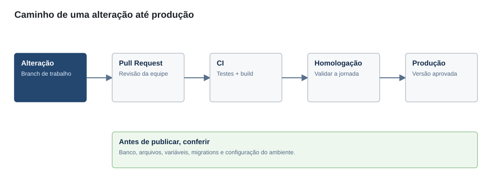
Caminho de uma alteração até produção.

O repositório é o [EderDeev/SaaS-Obra](https://github.com/EderDeev/SaaS-Obra). O desenvolvimento acontece na branch `staging`, e o que vai para produção passa para a `main`.

1. Crie uma branch a partir de `staging`.
2. Faça a alteração e teste localmente.
3. Abra o PR para `staging` e espere a revisão e o CI.
4. Teste na homologação com dados de teste.
5. Abra o PR de `staging` para `main` e publique depois da aprovação.

Proteção de branch, aprovação obrigatória e o "Wait for CI" são configurados no GitHub e no Railway, fora do repositório.

Código: `docs/ci-cd.md`, `.github/workflows/ci.yml`, `.github/workflows/azure-development.yml`

### 19.2 O que o CI verifica

| Job | O que faz |
 | --- | --- |
 | Application tests and build | Instala dependências, valida o Composer, faz o build do frontend e roda os testes em SQLite `:memory:`. |
 | PostgreSQL migration check | Sobe um PostgreSQL descartável e roda as migrations. Não roda testes contra ele. |
 | Public healthcheck | Depois de um deploy (ou manualmente), chama `/up` por HTTPS. |
 | Azure development deploy | Manual, só para staging. Faz o build da imagem, autentica por OIDC, publica, testa o `/up` e desliga as revisões no fim. |

O CI não faz deploy. No Railway, o deploy automático e a espera pelo CI dependem da configuração do serviço. O workflow da Azure também não roda sozinho depois do CI.

Com OIDC o workflow pega credenciais temporárias na Azure, sem guardar senha. Client ID, tenant ID e subscription ID ficam em Variables; as senhas de banco, storage e a APP_KEY continuam em Secrets. Ver [OIDC no GitHub](https://docs.github.com/en/actions/concepts/security/openid-connect).

Código: `.github/workflows/ci.yml`, `.github/workflows/post-deploy-smoke.yml`, `.github/workflows/azure-development.yml`

### 19.3 Deploy, migrations e rollback

1. Anote o commit e o ambiente de destino.
2. Confira variáveis, volumes, backup e migrations pendentes.
3. Rode só as migrations previstas, pelo processo do ambiente.
4. Teste o `/up`, o login e um fluxo real, além de filas e integrações.
5. Se der problema, pare os deploys e volte o código para a versão anterior.
6. Não reverta o banco: corrija com uma nova migration compatível com os dados que já existem.

As migrations do OS DNIT (permissões e vínculo com atividades) precisam ir junto com o código. Sem elas o build passa, mas as telas quebram.

Código: `AGENTS.md`, `railway/init-app.sh`, `azure/start-app.sh`, `database/migrations/2026_10_21_180000_add_os_dnit_permissions_and_soft_deletes.php`, `database/migrations/2026_10_21_190000_link_activities_to_os_dnit_orders.php`

<a id="ambientes"></a>

## 20. Ambientes

Local, Railway (produção) e Azure (homologação).

### 20.1 Onde o sistema roda

| Ambiente | Uso |
 | --- | --- |
 | Local | Desenvolvimento. |
 | Railway | Produção. Configurado em `railway.toml` e nos scripts da pasta `railway/`. |
 | Azure | Homologação, ligada só quando necessário. Ver `docs/azure-operacao.md`. |
 | GitHub Actions | Máquinas e bancos temporários do CI. Nunca acessa o banco de produção. |

Cada ambiente tem seu próprio banco, bucket, credenciais e lista de destinatários. Não reaproveite os de produção na homologação.

Código: `docs/azure-operacao.md`, `docs/railway.md`, `docs/ci-cd.md`, `railway.toml`

### 20.2 Inicialização no Railway

O `railway.toml` define build, pre-deploy, comando de início e o healthcheck em `/up`. O script de início sobe, além do servidor web, o agendador, o worker geral, o worker de e-mail do OS DNIT, os workers do APS e o worker do GED/OCR. A documentação antiga, que fala só em fila `sync`, está desatualizada.

O disco do container é apagado a cada deploy. Arquivos públicos, documentos privados e temporários precisam estar em volume. Um volume montado só em `storage/app/public` não cobre `storage/app/private`.

Confira os volumes no painel antes de publicar. Ver [volumes no Railway](https://docs.railway.com/volumes).

Código: `railway.toml`, `railway/start-app.sh`, `railway/init-app.sh`, `config/filesystems.php`, `docs/railway.md`

### 20.3 Ligar e desligar a homologação Azure

```text
cd /d "C:\caminho\obras-saas"
python scripts\azure-dev-session.py start --minutes 60
```

Rode no CMD, com Python e o Azure CLI já logado, e deixe a janela aberta. Quando a sessão subir, o script mostra a linha `URL: https://…`. Para ver o status ou encerrar:

```text
python scripts\azure-dev-session.py status
python scripts\azure-dev-session.py stop
```

Cada sessão dura de 1 a 60 minutos. O script reserva o tempo pedido mais 15 minutos de margem, dentro de um limite de 2.100 minutos por mês (UTC). Sessões curtas ou que falharam gastam a reserva do mesmo jeito. Esse limite é nosso, não da Azure, e não impede cobrança na assinatura.

Ao terminar, o script desativa as revisões, e uma regra cron garante a escala a zero. Banco e arquivos não são apagados, e alguns custos continuam. Não ative revisões por fora do script. Ver [escala no Container Apps](https://learn.microsoft.com/en-us/azure/container-apps/scale-app).

Código: `scripts/azure-dev-session.py`, `docs/azure-operacao.md`, `infra/azure/modules/core.bicep`

<a id="arquivos-filas"></a>

## 21. Arquivos, filas e agendamentos

Armazenamento de arquivos e processamento em segundo plano.

### 21.1 Discos de armazenamento

| Variável | Padrão | Uso |
 | --- | --- | --- |
 | FILESYSTEM_DISK | local | Disco geral. |
 | GED_DOCUMENT_DISK | public | Arquivos do GED. |
 | PROJECT_DOCUMENT_DISK | local | Arquivos de projetos. |
 | OS_DNIT_ATTACHMENT_DISK | local | Anexos da OS DNIT. |
 | azure-private, azure-temporary | não usados por padrão | Disponíveis; precisam ser escolhidos e configurados. |

O disco `local` aponta para `storage/app/private` e o `public` para `storage/app/public` (exposto em `public/storage`). Esses são os padrões; confira o que está configurado em cada ambiente antes de definir volumes e backup.

Arquivos no disco `public` podem ser abertos direto pela URL, sem passar pelo login. Um link difícil de adivinhar não é controle de acesso.

Código: `config/filesystems.php`, `config/projects.php`, `config/ged.php`, `config/os_dnit.php`, `app/Services/Storage/StoredFileMaterializer.php`

### 21.2 Filas e agendamentos

| Fila | Para quê |
 | --- | --- |
 | imports, default, maintenance | Importações, tarefas gerais e manutenção. |
 | aps (ou AUTODESK_APS_QUEUE) | Envio e conversão de modelos na Autodesk. |
 | ged (ou GED_OCR_QUEUE) | OCR e processamento de documentos. |
 | os-dnit-mail, na conexão os_dnit_mail | E-mails do fluxo DNIT, com retentativas próprias. |
 | schedule:work | Agendador. Entre outras coisas, gera o RDO diário. |

Job é a tarefa, a fila é onde ela espera e o worker é o processo que executa. Se um job não anda, a tela continua funcionando normalmente; veja primeiro se existe worker rodando para aquela conexão e fila. Quando OCR, conversão APS ou e-mails não acontecem, quase sempre é fila parada.

Cuidado ao reprocessar jobs com falha: alguns, como envio de e-mail, podem duplicar o efeito.

Código: `config/queue.php`, `railway/start-app.sh`, `railway/start-worker.sh`, `routes/console.php`, `app/Services/OsDnitFlowNotifier.php`

### 21.3 Notificações e perfil

O sino mostra as notificações da conta e marca o que já foi lido. Os e-mails são enviados conforme o evento e os responsáveis. Para saber quem decidiu o quê e quando, a referência é o histórico do módulo, não o e-mail.

No perfil o usuário altera os dados da própria conta. Isso não muda vínculos nem permissões. Ao abrir um chamado sobre e-mail, informe ambiente, contrato, documento e horário, sem colar chaves ou senhas.

Código: `app/Http/Controllers/NotificationController.php`, `app/Http/Controllers/ProfileController.php`, `app/Notifications/OsDnitFlowChangedNotification.php`

<a id="segredos"></a>

## 22. Credenciais e variáveis de ambiente

Onde ficam as chaves e como trocá-las.

### 22.1 Onde guardar as credenciais

| Onde | O que fica lá |
 | --- | --- |
 | .env local | Configuração da máquina de desenvolvimento. Nunca vai para o Git. |
 | Variables do Railway | Configuração de produção. |
 | Secrets e Variables do GitHub | Valores usados pelos workflows. |
 | Container App na Azure | Configuração da homologação. |
 | Banco de dados | Senhas cadastradas pela tela, como a do IMAP do GED, gravadas criptografadas. |

Variáveis `VITE_*` entram no JavaScript que vai para o navegador, então só podem ter valores públicos, como o token do Mapbox. `OPENAI_API_KEY`, `BREVO_API_KEY`, client secret do APS, senha do banco e connection string do storage ficam só no servidor.

Para cada credencial, registre quem é o responsável, em qual ambiente ela é usada, para que serve, os escopos, a validade e quando foi testada pela última vez. Nunca coloque valores em prints, exemplos, documentação ou chamados.

Código: `.gitignore`, `config/services.php`, `config/mail.php`, `config/filesystems.php`, `.github/workflows/azure-development.yml`

### 22.2 Lista de variáveis

| Variável | Para quê | Onde fica |
 | --- | --- | --- |
 | `APP_KEY / APP_PREVIOUS_KEYS` | Criptografia da aplicação | Servidor. Não trocar em instalação que já tem dados criptografados. |
 | `DB_CONNECTION / DB_HOST / DB_DATABASE / DB_USERNAME / DB_PASSWORD` | Conexão com o banco | Servidor. DB_URL ou DATABASE_URL podem substituir as demais. |
 | `DB_PROTECT_DESTRUCTIVE` | Bloqueia comandos destrutivos no banco | Servidor. Manter ligado em ambientes com dados. |
 | `AUTODESK_APS_CLIENT_ID / AUTODESK_APS_CLIENT_SECRET` | Credenciais do APS | Servidor. O secret nunca vai para o navegador. |
 | `AUTODESK_APS_BUCKET_KEY / AUTODESK_APS_REGION / AUTODESK_APS_SCOPES` | Bucket, região e escopos | Servidor. Usar bucket diferente em cada ambiente. |
 | `AUTODESK_APS_CA_BUNDLE / AUTODESK_APS_VERIFY_SSL` | Certificados HTTPS do APS | Servidor. Corrigir o bundle em vez de desligar a verificação. |
 | `OPENAI_API_KEY / OPENAI_BASE_URL / OPENAI_CHAT_MODEL` | Chave, endereço e modelo do assistente | Servidor. |
 | `AI_ASSISTANT_ENABLED / AI_*_MONTHLY_TOKEN_LIMIT` | Liga o assistente e define as cotas internas | Servidor. |
 | `OPENAI_RAG_* / OPENAI_HISTORY_*` | Limites de contexto e histórico | Servidor. Mudar só depois de avaliar qualidade e consumo. |
 | `MAIL_MAILER / BREVO_API_KEY / MAIL_FROM_ADDRESS` | Envio de e-mail e remetente | Servidor. |
 | `MAIL_HOST / MAIL_USERNAME / MAIL_PASSWORD` | SMTP, se for usado no lugar do Brevo | Servidor. |
 | `VITE_MAPBOX_ACCESS_TOKEN` | Mapas | Público; vai no build do frontend. |
 | `SIGNATURE_DRIVER / OPENSIGN_BASE_URL / OPENSIGN_API_KEY` | Assinatura de documentos | Servidor. |
 | `OPENSIGN_WEBHOOK_SECRET` | Segredo do webhook do OpenSign | Servidor. Obrigatório em produção. |
 | `AZURE_STORAGE_CONNECTION_STRING / AZURE_STORAGE_CONTAINER` | Acesso ao Azure Blob | Servidor. A connection string é secreta. |
 | `FILESYSTEM_DISK / GED_DOCUMENT_DISK / PROJECT_DOCUMENT_DISK / OS_DNIT_ATTACHMENT_DISK` | Disco usado por cada módulo | Servidor. Conferir se cada disco está em volume. |
 | `AZURE_CLIENT_ID / AZURE_TENANT_ID / AZURE_SUBSCRIPTION_ID` | Login OIDC do workflow | GitHub Variables. Não são secretos. |
 | `AZURE_APP_KEY / AZURE_POSTGRES_ADMIN_PASSWORD / AZURE_STORAGE_CONNECTION_STRING` | Segredos da homologação Azure | GitHub Secrets. |
 | `GITHUB_TOKEN` | Token temporário do workflow | Gerado pelo GitHub a cada execução. |
 | `Token do app mobile` | Acesso do app à API | O servidor guarda só o hash e controla a expiração. |
 | `Conta e senha IMAP do GED` | Leitura da caixa de e-mail | Cadastrada na tela; a senha fica criptografada no banco. |

Existem ainda outras variáveis de timeout e limites. A lista completa está abaixo.

Todas as variáveis lidas em config/*.php (192)

 | Variável | Arquivo de configuração |
 | --- | --- |
 | `AI_ASSISTANT_ENABLED` | `config/services.php` |
 | `AI_TENANT_MONTHLY_TOKEN_LIMIT` | `config/services.php` |
 | `AI_USER_MONTHLY_TOKEN_LIMIT` | `config/services.php` |
 | `APP_DEBUG` | `config/app.php` |
 | `APP_ENV` | `config/app.php`
`config/database.php` |
 | `APP_FAKER_LOCALE` | `config/app.php` |
 | `APP_FALLBACK_LOCALE` | `config/app.php` |
 | `APP_KEY` | `config/app.php` |
 | `APP_LOCALE` | `config/app.php` |
 | `APP_MAINTENANCE_DRIVER` | `config/app.php` |
 | `APP_MAINTENANCE_STORE` | `config/app.php` |
 | `APP_NAME` | `config/app.php`
`config/cache.php`
`config/database.php`
`config/logging.php`
`config/mail.php`
`config/session.php` |
 | `APP_PREVIOUS_KEYS` | `config/app.php` |
 | `APP_ROOT_DOMAIN` | `config/app.php` |
 | `APP_TIMEZONE` | `config/app.php` |
 | `APP_URL` | `config/app.php`
`config/filesystems.php`
`config/mail.php` |
 | `AUTH_GUARD` | `config/auth.php` |
 | `AUTH_MODEL` | `config/auth.php` |
 | `AUTH_PASSWORD_BROKER` | `config/auth.php` |
 | `AUTH_PASSWORD_RESET_TOKEN_TABLE` | `config/auth.php` |
 | `AUTH_PASSWORD_TIMEOUT` | `config/auth.php` |
 | `AUTODESK_APS_AUTO_PROCESS` | `config/services.php` |
 | `AUTODESK_APS_BUCKET_KEY` | `config/services.php` |
 | `AUTODESK_APS_CA_BUNDLE` | `config/services.php` |
 | `AUTODESK_APS_CLIENT_ID` | `config/services.php` |
 | `AUTODESK_APS_CLIENT_SECRET` | `config/services.php` |
 | `AUTODESK_APS_QUEUE` | `config/services.php` |
 | `AUTODESK_APS_REGION` | `config/services.php` |
 | `AUTODESK_APS_SCOPES` | `config/services.php` |
 | `AUTODESK_APS_STORAGE_LIMIT_BYTES` | `config/services.php` |
 | `AUTODESK_APS_VERIFY_SSL` | `config/services.php` |
 | `AUTODESK_APS_VIEWER_API` | `config/services.php` |
 | `AUTODESK_APS_WORKER_TIMEOUT` | `config/services.php` |
 | `AWS_ACCESS_KEY_ID` | `config/cache.php`
`config/filesystems.php`
`config/queue.php`
`config/services.php` |
 | `AWS_BUCKET` | `config/filesystems.php` |
 | `AWS_DEFAULT_REGION` | `config/cache.php`
`config/filesystems.php`
`config/queue.php`
`config/services.php` |
 | `AWS_ENDPOINT` | `config/filesystems.php` |
 | `AWS_SECRET_ACCESS_KEY` | `config/cache.php`
`config/filesystems.php`
`config/queue.php`
`config/services.php` |
 | `AWS_URL` | `config/filesystems.php` |
 | `AWS_USE_PATH_STYLE_ENDPOINT` | `config/filesystems.php` |
 | `AZURE_STORAGE_CONNECTION_STRING` | `config/filesystems.php` |
 | `AZURE_STORAGE_CONTAINER` | `config/filesystems.php` |
 | `AZURE_STORAGE_TEMPORARY_CONTAINER` | `config/filesystems.php` |
 | `BEANSTALKD_QUEUE` | `config/queue.php` |
 | `BEANSTALKD_QUEUE_HOST` | `config/queue.php` |
 | `BEANSTALKD_QUEUE_RETRY_AFTER` | `config/queue.php` |
 | `BREVO_API_KEY` | `config/mail.php` |
 | `CACHE_PREFIX` | `config/cache.php` |
 | `CACHE_STORE` | `config/cache.php` |
 | `DATABASE_URL` | `config/database.php` |
 | `DB_CACHE_CONNECTION` | `config/cache.php` |
 | `DB_CACHE_LOCK_CONNECTION` | `config/cache.php` |
 | `DB_CACHE_LOCK_TABLE` | `config/cache.php` |
 | `DB_CACHE_TABLE` | `config/cache.php` |
 | `DB_CHARSET` | `config/database.php` |
 | `DB_COLLATION` | `config/database.php` |
 | `DB_CONNECTION` | `config/database.php`
`config/queue.php` |
 | `DB_DATABASE` | `config/database.php` |
 | `DB_ENCRYPT` | `config/database.php` |
 | `DB_FOREIGN_KEYS` | `config/database.php` |
 | `DB_HOST` | `config/database.php` |
 | `DB_PASSWORD` | `config/database.php` |
 | `DB_PORT` | `config/database.php` |
 | `DB_PROTECT_DESTRUCTIVE` | `config/database.php` |
 | `DB_QUEUE` | `config/queue.php` |
 | `DB_QUEUE_CONNECTION` | `config/queue.php` |
 | `DB_QUEUE_RETRY_AFTER` | `config/queue.php` |
 | `DB_QUEUE_TABLE` | `config/queue.php` |
 | `DB_SOCKET` | `config/database.php` |
 | `DB_SSLMODE` | `config/database.php` |
 | `DB_TRUST_SERVER_CERTIFICATE` | `config/database.php` |
 | `DB_URL` | `config/database.php` |
 | `DB_USERNAME` | `config/database.php` |
 | `DYNAMODB_CACHE_TABLE` | `config/cache.php` |
 | `DYNAMODB_ENDPOINT` | `config/cache.php` |
 | `FILESYSTEM_DISK` | `config/filesystems.php` |
 | `GED_DOCUMENT_DISK` | `config/ged.php` |
 | `GED_OCR_DESKEW` | `config/ged.php` |
 | `GED_OCR_ENABLED` | `config/ged.php` |
 | `GED_OCR_LANGUAGE` | `config/ged.php` |
 | `GED_OCR_MAX_PAGES` | `config/ged.php` |
 | `GED_OCR_MODE` | `config/ged.php` |
 | `GED_OCR_OCRMYPDF_BIN` | `config/ged.php` |
 | `GED_OCR_OUTPUT_TYPE` | `config/ged.php` |
 | `GED_OCR_PDFINFO_BIN` | `config/ged.php` |
 | `GED_OCR_PDFTOPPM_BIN` | `config/ged.php` |
 | `GED_OCR_PDFTOTEXT_BIN` | `config/ged.php` |
 | `GED_OCR_QUEUE` | `config/ged.php` |
 | `GED_OCR_QUEUE_CONNECTION` | `config/ged.php` |
 | `GED_OCR_ROTATE_PAGES` | `config/ged.php` |
 | `GED_OCR_TESSDATA_DIR` | `config/ged.php` |
 | `GED_OCR_TESSERACT_BIN` | `config/ged.php` |
 | `GED_OCR_TIMEOUT` | `config/ged.php` |
 | `LOG_CHANNEL` | `config/logging.php` |
 | `LOG_DAILY_DAYS` | `config/logging.php` |
 | `LOG_DEPRECATIONS_CHANNEL` | `config/logging.php` |
 | `LOG_DEPRECATIONS_TRACE` | `config/logging.php` |
 | `LOG_LEVEL` | `config/logging.php` |
 | `LOG_PAPERTRAIL_HANDLER` | `config/logging.php` |
 | `LOG_SLACK_EMOJI` | `config/logging.php` |
 | `LOG_SLACK_USERNAME` | `config/logging.php` |
 | `LOG_SLACK_WEBHOOK_URL` | `config/logging.php` |
 | `LOG_STACK` | `config/logging.php` |
 | `LOG_STDERR_FORMATTER` | `config/logging.php` |
 | `LOG_SYSLOG_FACILITY` | `config/logging.php` |
 | `MAIL_EHLO_DOMAIN` | `config/mail.php` |
 | `MAIL_FROM_ADDRESS` | `config/mail.php` |
 | `MAIL_FROM_NAME` | `config/mail.php` |
 | `MAIL_HOST` | `config/mail.php` |
 | `MAIL_LOG_CHANNEL` | `config/mail.php` |
 | `MAIL_MAILER` | `config/mail.php` |
 | `MAIL_PASSWORD` | `config/mail.php` |
 | `MAIL_PORT` | `config/mail.php` |
 | `MAIL_SCHEME` | `config/mail.php` |
 | `MAIL_SENDMAIL_PATH` | `config/mail.php` |
 | `MAIL_TIMEOUT` | `config/mail.php` |
 | `MAIL_URL` | `config/mail.php` |
 | `MAIL_USERNAME` | `config/mail.php` |
 | `MEMCACHED_HOST` | `config/cache.php` |
 | `MEMCACHED_PASSWORD` | `config/cache.php` |
 | `MEMCACHED_PERSISTENT_ID` | `config/cache.php` |
 | `MEMCACHED_PORT` | `config/cache.php` |
 | `MEMCACHED_USERNAME` | `config/cache.php` |
 | `MYSQL_ATTR_SSL_CA` | `config/database.php` |
 | `OPENAI_API_KEY` | `config/services.php` |
 | `OPENAI_BASE_URL` | `config/services.php` |
 | `OPENAI_CHAT_MODEL` | `config/services.php` |
 | `OPENAI_HISTORY_CHARACTER_LIMIT` | `config/services.php` |
 | `OPENAI_HISTORY_MESSAGES` | `config/services.php` |
 | `OPENAI_MAX_OUTPUT_TOKENS` | `config/services.php` |
 | `OPENAI_RAG_CONTEXT_CHARACTER_LIMIT` | `config/services.php` |
 | `OPENAI_RAG_MAX_SOURCES` | `config/services.php` |
 | `OPENAI_RAG_SOURCE_CHARACTER_LIMIT` | `config/services.php` |
 | `OPENAI_TIMEOUT` | `config/services.php` |
 | `OPENSIGN_API_KEY` | `config/signatures.php` |
 | `OPENSIGN_BASE_URL` | `config/signatures.php` |
 | `OPENSIGN_CREATE_REQUEST_PATH` | `config/signatures.php` |
 | `OPENSIGN_TIME_TO_COMPLETE_DAYS` | `config/signatures.php` |
 | `OPENSIGN_VERIFY_SSL` | `config/signatures.php` |
 | `OPENSIGN_WEBHOOK_SECRET` | `config/signatures.php` |
 | `OS_DNIT_ATTACHMENT_DISK` | `config/os_dnit.php` |
 | `PAPERTRAIL_PORT` | `config/logging.php` |
 | `PAPERTRAIL_URL` | `config/logging.php` |
 | `POSTMARK_API_KEY` | `config/services.php` |
 | `POSTMARK_MESSAGE_STREAM_ID` | `config/mail.php` |
 | `PROJECT_DOCUMENT_DISK` | `config/projects.php` |
 | `QUEUE_CONNECTION` | `config/queue.php` |
 | `QUEUE_FAILED_DRIVER` | `config/queue.php` |
 | `RAILWAY_ENVIRONMENT_ID` | `config/database.php` |
 | `RAILWAY_PROJECT_ID` | `config/database.php` |
 | `RAILWAY_SERVICE_ID` | `config/database.php` |
 | `REDIS_BACKOFF_ALGORITHM` | `config/database.php` |
 | `REDIS_BACKOFF_BASE` | `config/database.php` |
 | `REDIS_BACKOFF_CAP` | `config/database.php` |
 | `REDIS_CACHE_CONNECTION` | `config/cache.php` |
 | `REDIS_CACHE_DB` | `config/database.php` |
 | `REDIS_CACHE_LOCK_CONNECTION` | `config/cache.php` |
 | `REDIS_CLIENT` | `config/database.php` |
 | `REDIS_CLUSTER` | `config/database.php` |
 | `REDIS_DB` | `config/database.php` |
 | `REDIS_HOST` | `config/database.php` |
 | `REDIS_MAX_RETRIES` | `config/database.php` |
 | `REDIS_PASSWORD` | `config/database.php` |
 | `REDIS_PERSISTENT` | `config/database.php` |
 | `REDIS_PORT` | `config/database.php` |
 | `REDIS_PREFIX` | `config/database.php` |
 | `REDIS_QUEUE` | `config/queue.php` |
 | `REDIS_QUEUE_CONNECTION` | `config/queue.php` |
 | `REDIS_QUEUE_RETRY_AFTER` | `config/queue.php` |
 | `REDIS_URL` | `config/database.php` |
 | `REDIS_USERNAME` | `config/database.php` |
 | `RESEND_API_KEY` | `config/services.php` |
 | `SESSION_CONNECTION` | `config/session.php` |
 | `SESSION_COOKIE` | `config/session.php` |
 | `SESSION_DOMAIN` | `config/session.php` |
 | `SESSION_DRIVER` | `config/session.php` |
 | `SESSION_ENCRYPT` | `config/session.php` |
 | `SESSION_EXPIRE_ON_CLOSE` | `config/session.php` |
 | `SESSION_HTTP_ONLY` | `config/session.php` |
 | `SESSION_LIFETIME` | `config/session.php` |
 | `SESSION_PARTITIONED_COOKIE` | `config/session.php` |
 | `SESSION_PATH` | `config/session.php` |
 | `SESSION_SAME_SITE` | `config/session.php` |
 | `SESSION_SECURE_COOKIE` | `config/session.php` |
 | `SESSION_STORE` | `config/session.php` |
 | `SESSION_TABLE` | `config/session.php` |
 | `SIGNATURE_DRIVER` | `config/signatures.php` |
 | `SLACK_BOT_USER_DEFAULT_CHANNEL` | `config/services.php` |
 | `SLACK_BOT_USER_OAUTH_TOKEN` | `config/services.php` |
 | `SQS_PREFIX` | `config/queue.php` |
 | `SQS_QUEUE` | `config/queue.php` |
 | `SQS_SUFFIX` | `config/queue.php` |

Código: `config/app.php`, `config/database.php`, `config/services.php`, `config/mail.php`, `config/filesystems.php`, `config/signatures.php`, `config/ged.php`

### 22.3 Trocar uma chave

1. Identifique o provedor, o ambiente, o que usa a chave e quem vai fazer a troca.
2. Gere a nova chave no provedor, com os escopos necessários.
3. Atualize a variável no ambiente e reinicie o que for preciso. Se for `VITE_*`, refaça o build.
4. Teste uma operação real e veja os logs e os workers.
5. Revogue a chave antiga e registre a troca.

**APP_KEY:** não gere uma nova a cada deploy. Ela criptografa dados já gravados, como as senhas IMAP. Para trocar, coloque a chave antiga em `APP_PREVIOUS_KEYS` e planeje a recriptografia dos dados.

Se uma chave vazar, avise o responsável e faça a troca no provedor. Apagar o valor num commit novo não resolve: ele continua no histórico do Git.

Código: `config/app.php`, `app/Models/GedEmailAccount.php`, `.gitignore`

<a id="instalacao"></a>

## 23. Instalação local

Como montar o ambiente de desenvolvimento sem apagar o banco.

### 23.1 Preparar o ambiente

1. Instale PHP (com as extensões do projeto), Composer, Node.js e npm. O Dockerfile mostra o ambiente Linux completo, com as ferramentas de OCR.
2. Clone o repositório e rode `composer install` e `npm ci`.
3. Crie o `.env` a partir do `.env.example`, com credenciais de desenvolvimento. Não copie o banco de produção.
4. Gere a `APP_KEY` só em instalação nova, antes de existir qualquer dado criptografado.
5. Antes de rodar migrations, confira driver, host, banco e `APP_ENV`. Em banco com dados, nunca use `migrate:fresh`, `refresh` ou `reset`.
6. Suba o backend, o frontend e os workers que precisar. O sistema abre em 127.0.0.1:8000.

```text
composer install
npm ci
npm run serve:php
```

Em outro terminal, o Vite:

```text
npm run dev -- --host 127.0.0.1 --port 5173 --strictPort
```

Se existir o arquivo `public/hot`, o endereço dentro dele precisa ser o do Vite que está rodando. Para usar o frontend compilado, rode o build e apague o `public/hot`.

Código: `composer.json`, `package.json`, `Dockerfile`, `server.php`, `AGENTS.md`

### 23.2 Workers e HTTPS

```text
php artisan queue:work database --queue=imports,default,maintenance --sleep=3 --tries=1 --timeout=3600
php artisan queue:work database --queue=aps --sleep=1 --tries=1 --timeout=900
php artisan queue:work database --queue=ged --sleep=3 --tries=1 --timeout=3600
php artisan queue:work os_dnit_mail --queue=os-dnit-mail --sleep=2 --tries=5 --timeout=60
php artisan schedule:work
```

Cada linha é um processo, em um terminal separado. Suba só os que o recurso que você vai testar precisa. O `composer run dev` também sobe alguns processos, mas confira se ele cobre as filas de que você precisa.

Se aparecer erro de certificado HTTPS, veja qual `php.ini` está sendo carregado e se o `curl.cainfo` aponta para um bundle de CAs válido. Não desligue a verificação SSL. Ver [curl.cainfo](https://www.php.net/manual/en/curl.configuration.php).

Código: `composer.json`, `railway/start-app.sh`, `config/queue.php`, `config/services.php`

### 23.3 Rodar os testes

Os testes (PHPUnit/Pest) só podem rodar em SQLite em memória. Antes de rodar, confirme que a conexão resolvida é `sqlite`, o banco é `:memory:` e o ambiente é `testing`. O bootstrap dos testes já remove as URLs de banco e bloqueia a execução se detectar sinais de produção.

1. Use o `phpunit.xml` e os arquivos de teste do projeto, sem alterar a conexão.
2. Confirme a conexão resolvida.
3. Rode a suíte ou só o arquivo que interessa.
4. Nos testes, simule as chamadas a serviços externos.
5. Rode também o build do frontend quando mexer em telas.

**Nunca** rode os testes contra PostgreSQL, seja local, homologação ou produção. A etapa de migrations com PostgreSQL do CI usa um banco descartável, criado só para isso.

Código: `AGENTS.md`, `tests/bootstrap.php`, `phpunit.xml`, `.github/workflows/ci.yml`

<a id="operacao"></a>

## 24. Backup e suporte

Backup, problemas comuns e manutenção deste manual.

### 24.1 Backup

- Banco: vínculos, registros, versões, histórico e metadados.
- Arquivos: todas as pastas e containers usados pelos módulos.
- Configuração: lista das variáveis de cada ambiente, guardada em local seguro.
- Código: o commit em produção e as dependências.
- Serviços externos: os modelos na Autodesk e os documentos no OpenSign.

1. Defina frequência, retenção e responsável.
2. Faça um backup antes de qualquer mudança grande.
3. Teste a restauração num ambiente separado.
4. Depois de restaurar, confira registros, arquivos, permissões e dados criptografados.
5. Anote quanto tempo levou e o que não voltou.

Ter backup ligado no provedor não garante que a restauração funciona. Só o teste confirma.

Código: `AGENTS.md`, `config/filesystems.php`, `docs/azure-operacao.md`, `docs/ci-cd.md`

### 24.2 Problemas comuns

| Problema | O que verificar primeiro |
 | --- | --- |
 | Menu ou dados não aparecem | Tenant, vínculo ativo, contrato e permissão. Depois, a visibilidade do registro e o papel no fluxo. |
 | Rascunho DNIT não edita | Se é o autor, se tem permissão de editar, se o status é `draft` e se `submitted_at` está vazio. OS devolvida não volta a ser editável. |
 | Análise não encaminha | Etapa atual, versão do registro, campos obrigatórios e se o responsável de destino está ativo. |
 | E-mail não chegou | Se o evento foi gerado, os destinatários, o worker da fila, os jobs com falha e o retorno do Brevo. |
 | OCR parado | Worker `ged`, ferramentas instaladas, acesso ao arquivo e limites de tempo e páginas. |
 | Modelo não abre | Worker APS, URN, manifesto e resposta da conversão. |
 | Assistente não responde | Se está habilitado, a cota, a chave, o modelo, a base URL, o certificado HTTPS e o log do backend. |
 | Arquivos somem depois do deploy | O disco usado pelo módulo e se ele está num volume. |
 | Tela sem CSS ou JS | Build, `public/hot`, endereço do Vite e arquivos estáticos. |
 | Homologação Azure não abre | Se a sessão está ativa, a URL mostrada pelo script e se a revisão está ativa. |

No chamado, informe horário, ambiente, módulo, contrato, número do documento e em que passo deu erro, com a mensagem e um print sem dados sensíveis. Para erro de validação, comece pelo campo indicado. Nunca limpe o banco para resolver um problema.

Código: `docs/os-dnit.md`, `docs/azure-operacao.md`, `railway/start-app.sh`, `app/Http/Controllers/Tenant/AssistantController.php`

### 24.3 Atualizar este manual

1. Edite o texto em `docs/portal/content.py`.
2. Se a tela ou o fluxo mudou, atualize os diagramas (`diagrams.py`) e as capturas.
3. Confira os nomes das variáveis direto em `config/` e nos workflows. Não copie nada do `.env`.
4. Rode `python docs/portal/build_portal.py`.
5. Abra o `dist/index.html` e confira busca, imagens, navegação, impressão e a versão de celular.

O `auditoria.json`, gerado junto, lista os arquivos usados e o commit de base de cada versão.

Código: `docs/portal/content.py`, `docs/portal/build_portal.py`, `docs/portal/README.md`

<a id="glossario"></a>

## 25. Glossário e referências

Termos usados no sistema e links para documentação externa.

### 25.1 Glossário

| Termo | Significado |
 | --- | --- |
 | SaaS | Software usado como serviço, pela internet. |
 | Tenant | O ambiente de uma empresa no sistema. |
 | Contrato | O contrato de obra, que organiza pessoas, registros e operação. |
 | Frontend / backend | A tela no navegador / o servidor que valida e executa as regras. |
 | API | Interface para um sistema conversar com outro. |
 | Endpoint | O endereço de uma operação da API. |
 | Token / escopo | Credencial de acesso / o que ela permite fazer. |
 | Webhook | Chamada que um serviço externo faz ao SigWorks quando algo acontece. |
 | Job / worker / fila | A tarefa / o processo que executa / onde a tarefa espera. |
 | Migration | Alteração versionada na estrutura do banco. |
 | Commit / branch / PR | Versão registrada / linha de trabalho / pedido para juntar alterações. |
 | CI/CD | Testes automáticos / processo de publicação. |
 | Deploy | Publicar uma versão num ambiente. |
 | RAG | Buscar informações antes de gerar a resposta com IA. |
 | OCR | Leitura automática de texto em imagem ou PDF. |
 | Exclusão lógica | O registro some das listas, mas continua guardado. |
 | BDI | Benefícios e Despesas Indiretas, aplicado sobre o custo. |
 | EAP | Estrutura Analítica do Projeto. |
 | RDA / RDO | Apontamento diário / Relatório Diário de Obra. |
 | RNC | Relatório de Não Conformidade. |
 | BM / FR | Boletim de Medição / Folha de Rosto. |

### 25.2 Referências

- [OpenAI: API e autenticação](https://developers.openai.com/api/reference/overview)
- [Autodesk APS: OAuth](https://aps.autodesk.com/en/docs/oauth/v2)
- [Brevo: chave de API](https://developers.brevo.com/docs/api-key-authentication)
- [Mapbox: tokens](https://docs.mapbox.com/help/getting-started/access-tokens/)
- [OpenSign](https://docs.opensignlabs.com/)
- [GitHub: OpenID Connect](https://docs.github.com/en/actions/concepts/security/openid-connect)
- [Azure: escala no Container Apps](https://learn.microsoft.com/en-us/azure/container-apps/scale-app)
- [Railway: volumes](https://docs.railway.com/volumes)
- [PHP: configuração do cURL](https://www.php.net/manual/en/curl.configuration.php)

As capturas de tela são do próprio sistema. Os diagramas foram feitos para este manual.
