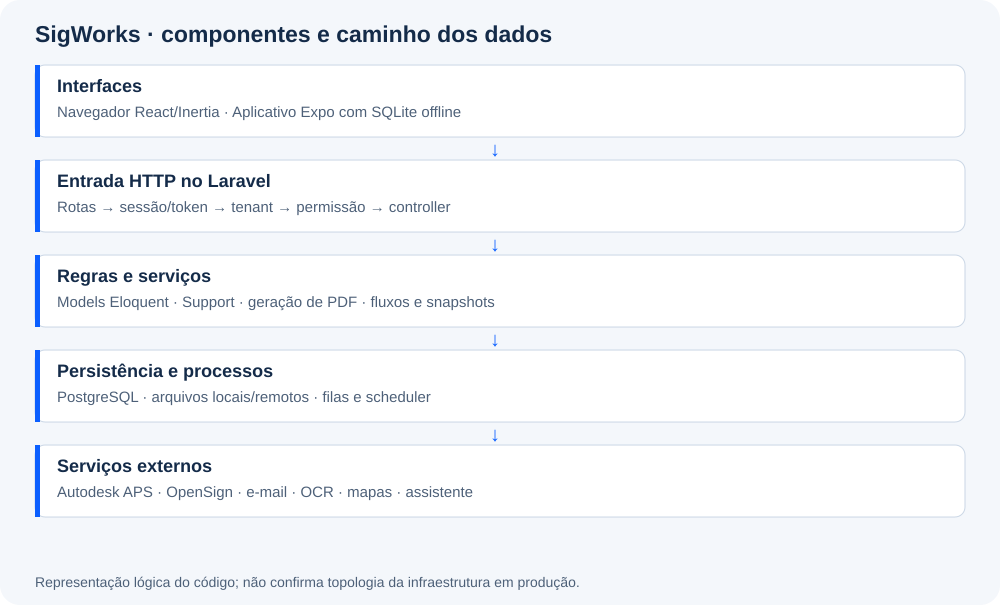

# 01 · Arquitetura

## Visão do conjunto

O SigWorks é um SaaS para gestão de obras, com usuários globais e acesso segmentado por **diretoria (tenant)** e contrato. Cada diretoria tem seu contexto de acesso e seus contratos; as empresas participantes são cadastradas separadamente nos contratos. A aplicação principal é um **monólito Laravel com frontend React integrado por Inertia**. O mobile é um projeto Expo separado, que consome endpoints JSON do mesmo backend.

O Laravel concentra autenticação, autorização, regras de negócio, persistência, geração de PDF e integração com serviços externos. A interface web não é uma SPA independente com uma API REST completa para todos os módulos: muitos endpoints retornam páginas Inertia, redirecionamentos e mensagens de sessão. O app usa a API específica em `/api/mobile`.

## Tecnologias observadas

| Camada | Tecnologia e referência |
| --- | --- |
| Runtime backend | PHP `^8.4`, conforme [composer.json](../../composer.json) |
| Framework | Laravel `^13.8`, Eloquent e validação do framework |
| Interface web | React 19, Inertia 2, Ziggy e Tailwind; [package.json](../../package.json) |
| Build web | Vite 8; [vite.config.js](../../vite.config.js) |
| Banco operacional | Configuração PostgreSQL; SQLite em memória nos testes |
| Jobs | Filas Laravel, com conexões e filas dedicadas em [queue.php](../../config/queue.php) |
| PDFs | Dompdf; FPDI/FPDF também constam como dependências |
| Mobile | Expo SDK 54 declarado, React Native 0.81.5, React 19.1 e TypeScript; [package.json mobile](../../../sigworks-mobile/package.json) |
| Qualidade | PHPUnit 12, testes Feature/Unit e verificações de interface com JSDOM |

As faixas de versão são requisitos declarados. As versões resolvidas ficam em `composer.lock` e `package-lock.json`. Não atualize bibliotecas apenas para tornar a documentação coincidente com a versão mais recente disponível.

## Caminho de uma requisição web

1. O navegador pede uma URL, por exemplo `/t/{tenant}/diario-obra/rdo`.
2. [public/index.php](../../public/index.php) inicia o Laravel; [bootstrap/app.php](../../bootstrap/app.php) registra rotas, middleware e exceções.
3. O grupo de rotas aplica autenticação, senha, resolução do tenant e acesso. O módulo acrescenta verificações próprias.
4. O controller valida a entrada, verifica o contrato/recurso e chama regras ou serviços quando necessário.
5. Eloquent lê ou grava no banco. Transações e bloqueios protegem operações sensíveis, como avanço de fluxo e numeração.
6. O controller retorna `Inertia::render` com o nome da página e seus dados.
7. [resources/js/app.jsx](../../resources/js/app.jsx) resolve esse nome para um arquivo de `Pages`, e o React renderiza a tela.

Um POST de formulário costuma terminar em redirect. Inertia acompanha a navegação e disponibiliza erros de validação e mensagens de sessão. Não trate um redirect web como contrato de resposta da API mobile.

## Requisições mobile

O mobile entra por `/api/mobile/login`, recebe token associado a um usuário e tenant, carrega o bootstrap e armazena rascunhos no SQLite do aparelho. A sincronização envia dados e fotos ao backend. Os controllers mobile reaproveitam regras do servidor; o app não é autoridade para decidir quem pode editar ou avançar um documento.

## Processos que compõem o sistema

- Processo HTTP: atende páginas, API, downloads e webhook.
- Scheduler: avalia os comandos registrados em [routes/console.php](../../routes/console.php).
- Workers: processam jobs de importação, OCR, APS, manutenção e mensagens.
- Banco: guarda documentos, vínculos, filas quando configuradas em database, auditoria e referências de arquivos.
- Armazenamento: guarda conteúdo binário; o banco mantém caminho, disco e metadados conforme o módulo.

Uma tela carregar normalmente não prova que filas, OCR ou assinaturas estejam funcionando. O diagnóstico deve identificar qual processo executa cada etapa.

## Decisões estruturais relevantes

Modelos e configurações por contrato permitem variar documentos e fluxos. RDO e RNC preservam snapshots para que uma mudança posterior de parametrização não reescreva silenciosamente documentos existentes. O sistema conserva nomes internos antigos por compatibilidade; a documentação distingue rótulo de interface, classe PHP, tabela e URL.

As regras de autorização são explícitas, espalhadas entre middleware, helpers de permissões e controllers. Não foi identificada, nas migrations revisadas, uma implantação de políticas PostgreSQL RLS. A configuração `app.current_tenant` feita no middleware não substitui os filtros e verificações da aplicação.
