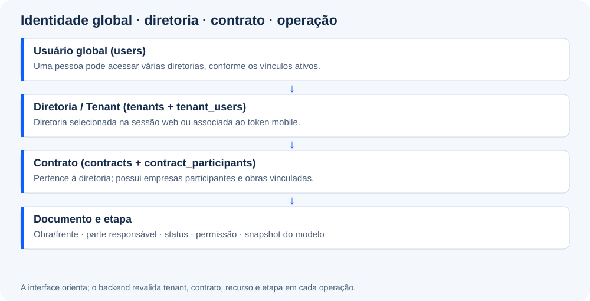

# 03 · Diretorias (tenants), contratos e segurança

## Identidade e escopo

`users` representa a pessoa globalmente. Cada registro de `tenants` representa uma **diretoria**, não uma empresa. `tenant_users` associa usuário, papel e situação à diretoria. `contracts` pertence à diretoria; `contract_participants` vincula pessoas ao contrato e carrega permissões de módulos quando aplicável.

Um usuário pode participar de mais de uma diretoria sem duplicação da pessoa ou do e-mail. A associação e as permissões determinam seu acesso em cada diretoria. Uma `Empresa` é uma organização participante dos contratos, como contratante, gerenciadora ou construtora; não representa a diretoria nem o usuário autenticado.

O termo técnico `tenant` permanece no código. Rótulos antigos de interface ou documentação que chamem tenant de “empresa” não alteram esse significado de domínio. A hierarquia é **diretoria → contratos → obras/documentos**, com empresas participantes vinculadas aos contratos.

Referências: [User.php](../../app/Models/User.php), [Tenant.php](../../app/Models/Tenant.php), [TenantUser.php](../../app/Models/TenantUser.php), [ContractParticipant.php](../../app/Models/ContractParticipant.php).

## Seleção web

[TenantSelectionController](../../app/Http/Controllers/TenantSelectionController.php) e [AccessibleTenants](../../app/Support/AccessibleTenants.php) cuidam da escolha do ambiente web. As URLs do tenant usam `/t/{tenant:slug}`. O middleware [ResolveTenant](../../app/Http/Middleware/ResolveTenant.php) resolve o tenant, registra o contexto na requisição e sessão e, no PostgreSQL, configura `app.current_tenant`. [EnsureTenantAccess](../../app/Http/Middleware/EnsureTenantAccess.php) verifica `hasTenantAccess`.

O binding de uma URL com `{rdo}`, `{order}` ou outro recurso não garante sozinho que o objeto pertence ao tenant da URL. Controllers devem comparar a titularidade ou consultar a partir da relação do tenant. O mesmo princípio vale para referências de contrato, obra, disciplina, empresa, IC, projeto e anexos.

## Três verificações distintas

1. **Entrar no ambiente:** associação ativa ou condição administrativa aplicável.
2. **Executar a operação:** permissão do módulo no contrato.
3. **Atuar na etapa:** responsabilidade, parte, obra, estado atual e demais requisitos do fluxo.

Um usuário poder visualizar o menu não significa que pode aprovar uma OS, preencher uma obra no RDO ou assinar um documento. A interface recebe capacidades para orientar o usuário; o backend deve verificá-las novamente em cada operação.

## Permissões

| Área | Referências |
| --- | --- |
| Papéis e navegação | [TenantRoles](../../app/Support/TenantRoles.php), [NavigationPermissions](../../app/Support/NavigationPermissions.php), [TenantLandingPage](../../app/Support/TenantLandingPage.php) |
| Contratos e usuários | [ContractPermissions](../../app/Support/ContractPermissions.php), [UserPermissions](../../app/Support/UserPermissions.php) |
| RDO | [DiarioObraPermissions](../../app/Support/DiarioObraPermissions.php), `RdoResponsavel` e `RdoController::flowCapabilities` |
| RNC / IC | [RncPermissions](../../app/Support/RncPermissions.php), [IcPermissions](../../app/Support/IcPermissions.php) e responsáveis dos respectivos módulos |
| Ordem de Serviço | [OsDnitPermissions](../../app/Support/OsDnitPermissions.php), [OsDnitWorkflowAccess](../../app/Support/OsDnitWorkflowAccess.php) |
| Liberação de Serviço | [OrdemServicoPermissions](../../app/Support/OrdemServicoPermissions.php) |
| Outros módulos | Helpers `ActivityPermissions`, `BudgetPermissions`, `ProjectPermissions`, `DocumentationPermissions`, `MedicaoPermissions` e `ParametrizacaoPermissions` |

Os formatos e defaults variam entre os módulos. Não generalize uma regra de proprietário de tenant para todas as operações. Na OS, há uma exceção explícita: `OsDnitPermissions::hasContractExemption` exige que o usuário seja administrador da plataforma **e** tenha `os_dnit_contract_exemption`. Isso não concede a mesma exceção a todos os administradores por inferência.

## Mobile

[MobileAuthController](../../app/Http/Controllers/Api/Mobile/MobileAuthController.php) lista tenants ativos autorizados e emite uma sessão vinculada a um deles. A troca por `/api/mobile/tenant` emite outro token para o ambiente escolhido; não muda o tenant do token antigo. O middleware [EnsureMobileApiToken](../../app/Http/Middleware/EnsureMobileApiToken.php) confere token, validade, usuário, estado do tenant e acesso atual.

O banco guarda o SHA-256 do token em `mobile_api_tokens`, não o valor recebido pelo aparelho. No app, o token fica no SecureStore; cache e rascunhos têm contexto de usuário/tenant, e o cache também diferencia o servidor. O cliente rejeita sincronização de rascunho de outro contexto, mas esse bloqueio complementa, não substitui, as verificações da API.

## Exclusões e histórico

Nem todas as tabelas possuem soft delete. Verifique o trait `SoftDeletes`, a migration e o comportamento do controller antes de excluir. Uma FK com exclusão em cascata pode ter efeito diferente de `Model::delete()` com soft delete. Documentos enviados para assinatura e snapshots históricos têm restrições adicionais.

Para testes de isolamento, cubra leitura e escrita, IDs de outro tenant, referências de outro contrato, token antigo, vínculo revogado, anexos e mudanças de etapa concorrentes. Uma consulta apenas com `find($id)` pode estar incorreta mesmo que o menu esconda o recurso.

## Pontos que exigem atenção operacional

O webhook OpenSign valida segredo quando ele está configurado; o código não torna esse valor obrigatório. A proteção efetiva depende de configurar e conferir essa variável no ambiente. O middleware de tenant web possui critérios próprios de status; não presuma que todos os canais tratem todos os estados de tenant de modo idêntico. Revise os caminhos concretos ao acrescentar um estado ou uma forma de autenticação.
